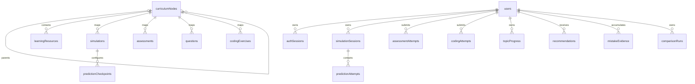
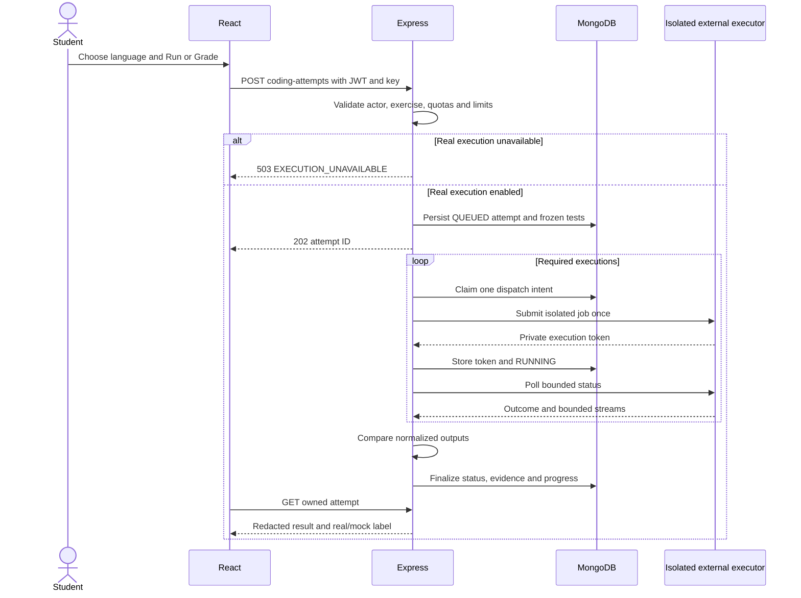

## 1. Overview and Goals

**Product:** Curriculum-Integrated Adaptive Learning and Simulation System for Computer Department.

**Domain:** Educational Technology and Web Application Development. **Status:** requirements specification; no implementation, completed tests or measured performance are claimed. Curriculum mapping uses the user-supplied K. K. Wagh Computer Engineering2023-pattern syllabi.

Computer Engineering students currently move between disconnected theory, visualization, assessment, and coding resources. This product connects those activities to one curriculum topic and makes learning weaknesses visible. Its vision is **Understand → Predict → Practise → Implement → Track Progress** for Second-Year (SY) and Third-Year (TY) students and faculty.

The application is a modular MERN monolith: React/Vite JavaScript client, Express/Node.js JavaScript ES modules, MongoDB 7 through Mongoose, REST JSON, JWT authentication, and bcrypt. React Router, Axios, Tailwind CSS, Recharts, Lucide React, and Monaco Editor are the selected frontend libraries. Git/GitHub hold version control; Vercel hosts the frontend, Render hosts the backend, and Atlas hosts MongoDB. Judge0-compatible hosted execution is the only external application service. Python, C, C++, and Java are student submission languages only; they implement no application service. No additional database, microservice, AI model, or AI backend is permitted.

| Goal | Acceptance target, not a measured result | Evidence required |
|---|---|---|
| Curriculum continuity | All published resources reference valid published topic ancestry | Referential-validation tests |
| Complete learning journey | Demo steps D01–D17 exercise all nine USPs | Demonstration and traceability review |
| Algorithm correctness | All 11 simulator families pass deterministic golden traces | Transition and invariant tests |
| Explainable adaptation | Identical evidence and rule version produce identical recommendation | Rule fixtures |
| Correct grading | All required real test executions pass before a successful submission is counted | Provider integration tests |
| Privacy | All cross-student and unassigned-faculty requests in the test plan fail | Authorization tests |
| Demonstration responsiveness | Non-execution API p95 ≤800 ms, dashboard ≤1200 ms under the environment in section 13 | Reproducible load test |

**Users:** enrolled SY/TY students; faculty responsible for assigned subjects; administrators managing accounts, assignments, and curriculum. The deployment serves one department, not multiple institutions.

| USP | Essential MVP boundary | Advanced capability within the same USP |
|---|---|---|
| 1 Syllabus integration | SY/TY hierarchy, topic mapping, assigned faculty management | Additional institution-reviewed curriculum versions |
| 2 Interactive simulation | All 11 families in section 11; controls, validated input, deterministic replay | Larger validated input caps after profiling |
| 3 Unified workflow | Context-preserving topic links and four activity statuses | Additional resource and assessment revisions in the same topic workflow |
| 4 Adaptive paths | Fixed configurable thresholds, evidence rules and one next action | Additional administrator-managed threshold configurations through the same rules contract |
| 5 Progress dashboard | Student metrics and scoped faculty summaries | Additional filters across retained academic cohorts |
| 6 Coding workspace | Monaco; C, C++, Java, Python; sample runs and graded tests | More exercises in those four languages |
| 7 Mistake-driven learning | Explicit question-option mappings, coding diagnostic categories | Additional curated misconception mappings |
| 8 Predict next step | Binary Search, Bubble Sort, BFS checkpoints; both question types | Checkpoints for the remaining simulator families |
| 9 Performance comparison | Bubble Sort versus Merge Sort; exact counters and charts | Additional pairs with explicitly documented counters |

**Non-goals and complete exclusions:** commercial LMS administration, fees, attendance, video conferencing, chat, social feeds, public leaderboards, plagiarism detection, proctoring, certificates, gradebook integration, university single sign-on, mobile native apps, offline synchronization, collaborative editing, generative tutoring, machine-learning product functionality, automatic syllabus ingestion, natural-language grading, executing arbitrary code in Express, infrastructure for self-hosted code runners, and content outside SY/TY Computer Engineering. Course/unit placement is source-verified; authored learning resources still require faculty review. Current content is restricted to DSA, AI and DBMS, including SY Data Structures as the prerequisite part of DSA. No implementation schedule is part of this document.

## 2. Actors and Permissions

An account has exactly one role: `STUDENT`, `FACULTY`, or `ADMIN`. Authentication derives `actorId` and role from verified credentials and the current user record. Any action absent from the matrix is denied. `OWN` means the authenticated student's records; `ASSIGNED` means topic ancestry resolves to a subject in the faculty account's `subjectIds`; `ALL` means department-wide. Administrator private-progress access is for support and audit and is recorded with a reason. Faculty cannot grant permissions, provision accounts, or inspect source code or raw answers belonging to students.

| Action and API IDs | Anonymous | STUDENT | FACULTY | ADMIN |
|---|---|---|---|---|
| Register student, login: API-01–02 | Yes | Login | Login | Login |
| Refresh/logout/CSRF bootstrap: API-03–04,41 | Valid session cookie only | OWN | OWN | OWN |
| Read profile/change password: API-05–06 | No | OWN | OWN | OWN |
| Browse published curriculum/resources/simulation definitions/assessment metadata/exercises/checkpoints: API-07,09,11,14,18,25 | No | Published | Published | All status filters |
| Create/update/archive curriculum and resources: API-08,10 author operations | No | No | ASSIGNED | ALL |
| Confirm explanation read: API-10 READ | No | OWN enrolled topic | No | No |
| Create/run/control own simulations: API-12–13 | No | OWN | No | No |
| Start/answer/submit assessment: API-15–17 | No | OWN | No | No |
| Submit/poll coding execution: API-19–20 | No | OWN | No | No |
| Read/refresh/act on recommendations: API-21–23 | No | OWN | No | No |
| Read own mistake summary: API-24 | No | OWN | No | No |
| Start/submit prediction: API-26–27 | No | OWN | No | No |
| Create/read comparisons: API-28–29 | No | OWN | No | No |
| Read own dashboard/topic progress: API-30–31 | No | OWN | No | No |
| Read student progress summaries: API-32 | No | No | ASSIGNED aggregate fields | ALL with audit reason |
| Create/update/archive authored definitions: API-33–34 | No | No | ASSIGNED | ALL |
| Provision/update accounts and subject assignments: API-35–36 | No | No | No | ALL |
| Request own deletion: API-37 | No | OWN | OWN | OWN except last active admin |
| Read/update rule configuration: API-38–39 | No | No | Read API-38 only | ALL |
| Read administrative audit log: API-40 | No | No | No | ALL |

Student enrollment in `subjectIds` bounds discovery and all student learning writes. A student's year alone does not grant access. Faculty summaries include enrolled students only for assigned subjects, exclude other subjects, and return the metric fields in section 10. Administrator assignment changes require an active user, matching role, and valid subject references. Administrator self-demotion or disabling the last active administrator is forbidden. Ownership checks precede resource data disclosure; foreign-owned identifiers return the same 404 as nonexistent records. Role failures return 403 before object lookup. Referenced unpublished content is never available through student APIs. Mutation authorization is repeated inside the write operation to avoid relying on frontend controls.

YEAR, SEMESTER and SUBJECT creation/archive are administrator-only. Faculty may create UNIT/TOPIC children within an assigned SUBJECT and update display metadata within that branch; faculty cannot archive a SUBJECT itself or change its key/parent. API-10 READ is the only student resource mutation and affects only the owner’s read acknowledgment. Faculty/admin do not create learner attempts under their staff account.

## 3. Glossary

| Term | Definition |
|---|---|
| USP | Unique selling proposition; one of the nine independently specified capabilities |
| MERN monolith | One Express application contains all business modules and uses MongoDB; React is its separate static client |
| Academic year | SY or TY study level, not a calendar year |
| Semester | Semester 3/4 under SY or 5/6 under TY |
| Subject / unit / topic | Successive curriculum nodes; topic is the leaf to which activities attach |
| Published / archived | Available for authorized learning / unavailable for new activity while history remains readable |
| Revision | Immutable published definition identified by its document ID and integer version |
| Enrollment / assignment | Student subject access / faculty content and summary access |
| Learning resource | Sanitized explanatory text and an optional HTTPS reference link |
| Simulation state | Canonical JSON representation of an algorithm at one discrete transition |
| Trace | Ordered immutable sequence of states produced by the trusted simulation engine |
| Prediction checkpoint | Authored question template bound to a deterministic transition and its expected result |
| Topic completion | Percentage of currently available activity categories completed at least once |
| Topic mastery | Mean percentage of up to the latest three eligible assessments for a topic |
| Adaptive recommendation | Deterministic rule-selected next action with a human-readable reason |
| Misconception | Curated conceptual error code explicitly mapped to an incorrect question option or failed conceptual test |
| Mistake evidence | One deduplicated observed error with source, topic and classification |
| Assessment attempt | Student-owned lifecycle for one immutable assessment snapshot |
| Coding attempt | Student-owned record of a RUN or GRADE request and external execution results |
| Successful submission | Real GRADE attempt whose complete required test set passes |
| Compilation / runtime / correctness | Program translation outcome / execution outcome / passing the exercise's required tests |
| Operation count | Number of specifically instrumented algorithm events, independent of elapsed time |
| Idempotency key | UUID identifying a create/submit request so retransmission cannot create another attempt |
| JWT / refresh credential | Signed short-lived access token / rotating opaque secret used to obtain another token |
| CSRF / CORS / XSS | Cross-site request forgery / allowed browser-origin policy / script injection |
| RBAC / ownership | Permission by role / permission by relationship to a specific record |
| BSON / ObjectId | MongoDB data representation / 24-hex-character reference identifier |
| Snapshot / projection | Immutable copied grading evidence / recalculable derived view |
| p95 / fixture / seed | 95th percentile / fixed test input and expectation / reproducible development data |
| TTL / CAS | Time-to-live index / compare-and-set write using a revision precondition |
| Terminal state | Attempt state that cannot accept additional learner actions |
| Eligible evidence | Real, finalized, non-fixture results admitted to progress and recommendations |
| Mock / fixture | Explicitly synthetic provider response / synthetic seeded history; neither proves real compilation |

Other abbreviations: API = application programming interface; REST = resource-oriented HTTP interface; JSON = JavaScript Object Notation; HTTPS = encrypted HTTP; UI = user interface; MVP = minimum viable product; CPU = processor execution time; UTC = Coordinated Universal Time; UUID = universally unique identifier; UTC timestamps are rendered in the viewer's timezone.

## 4. Domain Model

### Verified curriculum baseline and current content scope

The supplied PDFs are references, not instructions to adopt their programming tools or implement every lab assignment. Page numbers below are one-based PDF page positions. The SY file includes a TY course-structure summary; the separate TY file supplies detailed TY unit content.

| Source | Verified pages | Curriculum authority |
|---|---|---|
| [SY syllabus](C:/Users/patha/Downloads/sy-2023.pdf) | p7 course structure; pp42–43 Data Structures; pp49–51 Data Structures Lab | K. K. Wagh Institute of Engineering Education and Research, Nashik; Computer Engineering2023 pattern; SY Semester IV |
| [TY syllabus](C:/Users/patha/Downloads/1781009701_ty-2023-pattern-computer-engineering-merged.pdf) | p1 course structure; pp3–4 DSA; pp5–6 AI; pp7–8 DBMS; pp14–15 DSA Lab | Same institution/pattern; TY Semester V |

| Focus | Course title / code | Placement | Boundary |
|---|---|---|---|
| DSA foundation | Data Structures / 2301212 | SY / Semester IV | Prerequisite portion of the DSA track; retain its official separate course identity |
| DSA | Data Structures and Algorithms / 2301301 | TY / Semester V | Nonlinear structures, analysis and algorithmic strategies |
| AI | Artificial Intelligence / 2311302 | TY / Semester V | Academic AI learning content; platform adaptation remains rule-based |
| DBMS | Database Management Systems / 2301303 | TY / Semester V | Database theory and query-language learning; MongoDB remains the sole application database |

The TY structure table names Database Management Systems, while its detailed page uses singular System; course2301303 is the identity and the structure title is the display title. SY p42 gives a conflicting lab companion code2301214 and p49 gives theory companion2301211; the p7 structure identifies Data Structures2301212 and Data Structures Lab2301215. Use the structure codes and retain this discrepancy note. Supporting labs inform topic mappings, not separate subject enrollment or extra MVP subjects.

Retain all four semester containers; only SY Semester IV and TY Semester V contain current subjects. SY Semester III and TY Semester VI show `No subjects in the current scope`. Section14 defines the20-unit/40-topic catalogue and14 active learning-topic boundary. Curriculum metadata coverage is not a claim that every listed concept has a simulator or completed teaching resource. Linear/Binary Search remain explicitly labeled prerequisite support; Bubble/Selection/Insertion Sort use SY lab evidence rather than a false claim that they appear by name in SY theory Unit I.

### Dictionary conventions

Collection names are lower camelCase plural; fields are lower camelCase. Each collection includes the following common fields, which form part of every dictionary below. Nested dictionaries explicitly list their complete stored fields. `—` means no default or no additional field index. All references are ObjectIds validated for existence, target type, ancestry and authorization by the backend; Mongoose alone does not supply foreign keys. Strings are trimmed except source code, stdin, output, password input and resource content. Unknown fields are rejected. Required arrays may be empty only where their validation explicitly permits it.

| Field | BSON/Mongoose type | Required | Default | Validation | Index | Meaning |
|---|---|---|---|---|---|---|
| _id | ObjectId | Yes | Generated | Immutable | Unique primary | Document identity |
| createdAt | Date | Yes | Server UTC now | Immutable | As listed below | Creation instant |
| updatedAt | Date | Yes | Server UTC now | Server-controlled | — | Last mutation instant |
| recordVersion | Number / Mongoose Number | Yes | 1 | Integer ≥1; increment on update | CAS with _id | Concurrent-write guard |

Integers use Mongoose Number with integer validation and BSON numeric storage; no integer arithmetic exceeds JavaScript's safe range. Common retained histories include `sourceMode` with `REAL|FIXTURE|MOCK`, default REAL, required, immutable. Only histories explicitly listing that field admit it. `definitionStatus` is `DRAFT|PUBLISHED|ARCHIVED`. Publication freezes instructional fields; a replacement is a new document with the same logical key and version +1. At most one revision per logical key is PUBLISHED. Attempts retain older revisions. Unique logical-key/version and partial unique published-key indexes enforce that rule. Archival does not erase history or retroactively change grading.

### Identity and curriculum collections

| Collection.field | Type | Required | Default | Validation | Index | Meaning |
|---|---|---|---|---|---|---|
| users.email | String | Yes | — | Lowercase; email syntax; ≤254 chars | Unique email | Login identity |
| users.displayName | String | Yes | — | 1–80 chars | — | Screen name |
| users.passwordHash | String | Yes | — | bcrypt hash; never serialized | — | Password verifier |
| users.role | String enum | Yes | STUDENT | Three roles only | role,status | Single permission role |
| users.status | String enum | Yes | ACTIVE | ACTIVE,DISABLED,DELETION_PENDING,ANONYMIZED | role,status | Account lifecycle |
| users.academicYear | String enum | No | null | SY/TY for students; null for staff | — | Study level |
| users.subjectIds | ObjectId[] | Yes | [] | Unique SUBJECT IDs; empty permitted | subjectIds,status | Student enrollment or faculty assignment |
| users.authVersion | Number | Yes | 1 | Integer ≥1 | — | Token revocation generation |
| users.deletionRequestedAt | Date | No | null | Server time; pending only | status,deletionRequestedAt | Deletion deadline base |
| authSessions.userId | ObjectId | Yes | — | Active users reference | userId | Session owner |
| authSessions.tokenHash | String | Yes | — | SHA-256 hex; never serialize | Unique tokenHash | Refresh secret digest |
| authSessions.csrfHash | String | Yes | — | SHA-256 hex | — | CSRF secret digest |
| authSessions.familyId | String | Yes | — | UUID | familyId | Rotation/reuse family |
| authSessions.expiresAt | Date | Yes | now +7 days | Fixed family expiry | TTL expiresAt, 0 seconds | Cleanup; reads also check expiry |
| authSessions.revokedAt | Date | No | null | Server UTC | — | Revocation indicator |
| authSessions.rotatedToId | ObjectId | No | null | authSessions reference | — | Reuse detection link |
| curriculumNodes.kind | String enum | Yes | — | YEAR,SEMESTER,SUBJECT,UNIT,TOPIC | parentId,sortOrder,_id | Node type |
| curriculumNodes.key | String | Yes | — | 1–80 lowercase slug chars | Unique key | Stable curriculum identity |
| curriculumNodes.title | String | Yes | — | 1–120 chars | — | Display name |
| curriculumNodes.parentId | ObjectId | No | null | Null only for YEAR; exact previous level | parentId,sortOrder,_id | Immediate ancestry |
| curriculumNodes.sortOrder | Number | Yes | 0 | Integer 0–999 | parentId,sortOrder,_id | Display and recommendation order |
| curriculumNodes.status | String enum | Yes | DRAFT | definitionStatus | — | Availability |
| curriculumNodes.syllabusLabel | String | Yes | unverified | 1–120 chars | — | Review provenance; inherited display permitted |
| curriculumNodes.courseCode | String | No | null | Required immutable seven-digit code for SUBJECT; null otherwise | Unique for SUBJECT | Official subject identity |
| curriculumNodes.createdBy | ObjectId | Yes | — | users staff reference | — | Author |
| learningResources.topicId | ObjectId | Yes | — | TOPIC reference | topicId,status | Parent topic |
| learningResources.key | String | Yes | — | Slug 1–80 | key,version unique; key published unique | Revision family |
| learningResources.version | Number | Yes | 1 | Integer ≥1 | key,version | Definition version |
| learningResources.title | String | Yes | — | 1–120 chars | — | Resource label |
| learningResources.content | String | Yes | — | Sanitized Markdown ≤50 KiB | — | Explanation; raw HTML forbidden |
| learningResources.referenceUrl | String | No | null | HTTPS ≤2048 chars | — | Optional external reference |
| learningResources.status | String enum | Yes | DRAFT | definitionStatus | topicId,status | Lifecycle |
| learningResources.createdBy | ObjectId | Yes | — | Staff users reference | — | Author |

YEAR keys are exactly sy or ty. SEMESTER keys are sy-semester-3,sy-semester-4,ty-semester-5,ty-semester-6 with the matching YEAR parent. Students require academicYear; staff require null. SY students enroll only in SY subjects. TY students may explicitly enroll in selected TY subjects and SY Data Structures2301212 as a prerequisite; no access follows from year alone. A required reference may point to an anonymized author stub only when preserving historical authorship, never when granting current staff authority.

### Instructional definitions

All five collections below are referenced, not embedded, to allow independent revisions and reuse within their topic. Every one includes `topicId` (required ObjectId TOPIC, no default, index `topicId,status`), `key` (required slug ≤80, no default), `version` (required integer ≥1, default 1), `status` (required definitionStatus, default DRAFT), `createdBy` (required staff user reference, no default), and the common fields. Each has unique `(key,version)` and partial unique `(key)` for PUBLISHED status. These shared fields are part of each complete dictionary.

| Collection.field | Type | Required | Default | Validation | Index | Meaning |
|---|---|---|---|---|---|---|
| simulations.algorithm | String enum | Yes | — | One of section 11 algorithm codes | — | Trusted engine selector |
| simulations.title | String | Yes | — | 1–120 chars | — | Display title |
| simulations.engineVersion | String | Yes | 1.0.0 | Supported pinned version | — | Transition semantics |
| simulations.defaultInput | Embedded Input | Yes | — | Section 11 algorithm schema | — | Starting example |
| simulations.enabledCheckpointIds | ObjectId[] | Yes | [] | ≤20 matching checkpoints; empty permitted | — | Enabled prediction templates |
| assessments.title | String | Yes | — | 1–120 chars | — | Assessment name |
| assessments.questionIds | ObjectId[] | Yes | — | 5–20 distinct published same-topic questions | — | Fixed question order |
| assessments.durationSeconds | Number | Yes | 1200 | Integer 300–3600 | — | Attempt deadline |
| questions.prompt | String | Yes | — | Plain text 1–2000 chars | — | Single-choice prompt |
| questions.options | Embedded Option[] | Yes | — | Exactly four unique option IDs A–D | — | Choices and misconception mappings |
| questions.correctOptionId | String enum | Yes | — | A/B/C/D | — | Secret answer |
| questions.explanation | String | Yes | — | 1–2000 chars | — | Feedback after finalization |
| codingExercises.title | String | Yes | — | 1–120 chars | — | Exercise name |
| codingExercises.prompt | String | Yes | — | 1–8000 chars | — | Problem and I/O contract |
| codingExercises.starters | Embedded Starter[] | Yes | — | Exactly C,CPP,JAVA,PYTHON | — | Editor initial source |
| codingExercises.tests | Embedded Test[] | Yes | — | 2–10 tests; ≥1 sample, ≥1 hidden | — | Required grading cases |
| codingExercises.limits | Embedded Limits | Yes | — | Section 12 limits within provider caps | — | Resource budget |
| predictionCheckpoints.simulationId | ObjectId | Yes | — | Same-topic simulation reference | simulationId,status | Bound revision |
| predictionCheckpoints.trigger | Embedded Trigger | Yes | — | Supported event and occurrence ≥1 | — | State binding rule |
| predictionCheckpoints.questionType | String enum | Yes | — | MCQ or STATE_SELECT | — | Prediction UI |
| predictionCheckpoints.prompt | String | Yes | — | 1–1000 chars | — | Question text |
| predictionCheckpoints.choices | Embedded Choice[] | Yes | — | 2–4 unique IDs; declarative state candidates | — | Curated choices |
| predictionCheckpoints.expectedSelector | String enum | Yes | — | nextEvent,nextArray,nextVisited,nextIndex | — | Trusted state-derived answer selector |
| predictionCheckpoints.explanation | String | Yes | — | 1–1000 chars | — | Expected-transition explanation |

An enabled checkpoint is linked after both drafts exist; publication validates the cycle's topic equality and the checkpoint's deterministic fixture. The checkpoint declares candidates, never an executable expression. A question option embeds `{optionId:String required A–D, text:String required 1–500, misconceptionCode:String optional null}`; correct options require null, wrong options may contain one code from ruleConfigs. A Starter embeds `{language:String required four-language enum, source:String required ≤32 KiB}`. A Test embeds `{testId:String required slug ≤40 unique within exercise, visibility:String required SAMPLE|HIDDEN, stdin:String required ≤8 KiB, expectedStdout:String required ≤16 KiB, misconceptionCode:String optional null}`. Limits embeds `{cpuSeconds:Number required default 2 integer 1–2, wallSeconds:Number required default 5 integer 1–5, memoryKiB:Number required default 131072 integer 32768–131072}`. Trigger embeds `{event:String required supported engine event, occurrence:Number required integer 1–10000}`. Choice embeds `{choiceId:String required A–D, label:String required ≤500, value:JSON required scalar or array conforming to expectedSelector}`. No nested object has an implicit `_id` or timestamps.

Publication of a simulation with enabled draft checkpoints is one atomic content operation: validate the complete linked set against the default input, publish the simulation and those same-topic checkpoints together, and archive any previous published revisions of those keys. A checkpoint published directly requires its simulation already published and itself already present in that immutable enabled set. Adding/changing checkpoints on an existing simulation requires a replacement simulation revision. This resolves the authoring-reference cycle without exposing partially published definitions.

### Activity and projection collections

| Collection.field | Type | Required | Default | Validation | Index | Meaning |
|---|---|---|---|---|---|---|
| assessmentAttempts.userId | ObjectId | Yes | — | Student owner | userId,topicId,submittedAt,_id | Learner |
| assessmentAttempts.topicId | ObjectId | Yes | — | Derived from assessment | Same composite | Topic |
| assessmentAttempts.assessmentId | ObjectId | Yes | — | Immutable published revision | — | Assessment |
| assessmentAttempts.status | String enum | Yes | IN_PROGRESS | IN_PROGRESS,SUBMITTED,EXPIRED,ABANDONED | status,deadlineAt | Lifecycle |
| assessmentAttempts.questionSnapshot | Embedded QuestionSnapshot[] | Yes | — | 5–20 copied questions in fixed order | — | Private grading snapshot |
| assessmentAttempts.answers | Embedded Answer[] | Yes | [] | One valid option per question; empty permitted | — | Saved answers |
| assessmentAttempts.deadlineAt | Date | Yes | Derived | Start + durationSeconds | status,deadlineAt | Deadline |
| assessmentAttempts.submittedAt | Date | No | null | Set on submitted/expired | userId,topicId,submittedAt,_id | Evidence ordering |
| assessmentAttempts.scorePercent | Number | No | null | 0–100, two decimals | — | Final score |
| assessmentAttempts.idempotencyKey | String | Yes | — | UUID | userId,idempotencyKey unique | Start deduplication |
| assessmentAttempts.sourceMode | String enum | Yes | REAL | REAL,FIXTURE | — | Evidence provenance |
| assessmentAttempts.finalization | Embedded Finalization | No | null | Set once on explicit terminal action; immutable | — | Finalize request replay identity |
| codingAttempts.userId | ObjectId | Yes | — | Student | userId,topicId,createdAt,_id | Owner |
| codingAttempts.topicId | ObjectId | Yes | — | Derived from exercise | Same composite | Topic |
| codingAttempts.exerciseId | ObjectId | Yes | — | Published revision | — | Exercise |
| codingAttempts.mode | String enum | Yes | — | RUN,GRADE | — | Sample or full-test execution |
| codingAttempts.language | String enum | Yes | — | C,CPP,JAVA,PYTHON | — | Provider language mapping key |
| codingAttempts.sourceCode | String | Yes | — | UTF-8 ≤32 KiB, nonempty | — | Private source |
| codingAttempts.stdin | String | Yes | Empty string | UTF-8 ≤8 KiB; RUN only | — | Custom standard input |
| codingAttempts.status | String enum | Yes | QUEUED | Section 5 execution states | status,nextPollAt | Outcome |
| codingAttempts.testSnapshot | Embedded Test[] | Yes | — | GRADE all tests; RUN [] permitted | — | Private immutable tests |
| codingAttempts.results | Embedded ExecutionResult[] | Yes | [] | ≤10; one per testId; RUN uses custom | — | Execution outcomes |
| codingAttempts.nextPollAt | Date | No | null | Server scheduling | status,nextPollAt | Durable polling |
| codingAttempts.deadlineAt | Date | Yes | now +60 seconds | Immutable | — | Total execution deadline |
| codingAttempts.correct | Boolean | Yes | false | True only REAL GRADE PASSED | — | Exercise correctness |
| codingAttempts.finishedAt | Date | No | null | Terminal state only | — | Completion instant |
| codingAttempts.idempotencyKey | String | Yes | — | UUID | userId,idempotencyKey unique | Deduplication |
| codingAttempts.sourceMode | String enum | Yes | REAL | REAL,FIXTURE,MOCK | — | Provenance |
| simulationSessions.userId | ObjectId | Yes | — | Student | userId,topicId,createdAt,_id | Owner |
| simulationSessions.topicId | ObjectId | Yes | — | Derived | Same composite | Topic |
| simulationSessions.simulationId | ObjectId | Yes | — | Published revision | — | Definition |
| simulationSessions.input | Embedded Input | Yes | — | Valid algorithm input | — | Replay input |
| simulationSessions.engineVersion | String | Yes | — | Copied definition version | — | Pinned engine |
| simulationSessions.inputHash | String | Yes | — | Canonical JSON SHA-256 | — | Reproducibility |
| simulationSessions.status | String enum | Yes | READY | Section 5 states | — | Session lifecycle |
| simulationSessions.cursor | Number | Yes | 0 | Integer 0 through traceLength−1 | — | Current state index |
| simulationSessions.maxCursor | Number | Yes | 0 | Integer ≥cursor historic maximum | — | Furthest validated step |
| simulationSessions.traceLength | Number | Yes | Derived | 1–10001 | — | Number of states |
| simulationSessions.speed | Number | Yes | 1 | 0.5,1,2,4 | — | Playback multiplier |
| simulationSessions.currentStateHash | String | Yes | Derived | SHA-256 of canonical cursor state | — | Checkpoint binding |
| simulationSessions.completedAt | Date | No | null | First final-state arrival | — | Persistent completion |
| simulationSessions.idempotencyKey | String | Yes | — | UUID | userId,idempotencyKey unique | Creation deduplication |
| simulationSessions.sourceMode | String enum | Yes | REAL | REAL,FIXTURE | — | Provenance |
| predictionAttempts.userId | ObjectId | Yes | — | Session owner | userId,topicId,createdAt,_id | Learner |
| predictionAttempts.topicId | ObjectId | Yes | — | Derived | Same composite | Topic |
| predictionAttempts.sessionId | ObjectId | Yes | — | Owned simulationSessions | sessionId,checkpointId,cursor unique | Session |
| predictionAttempts.checkpointId | ObjectId | Yes | — | Enabled revision | Same unique index | Template |
| predictionAttempts.cursor | Number | Yes | — | Matching checkpoint cursor | Same unique index | Bound state |
| predictionAttempts.stateHash | String | Yes | — | Current canonical state hash | — | Stale-answer guard |
| predictionAttempts.status | String enum | Yes | PENDING | PENDING,ANSWERED,SKIPPED | — | Lifecycle |
| predictionAttempts.responses | Embedded PredictionResponse[] | Yes | [] | ≤2; empty permitted | — | First answer and optional retry |
| predictionAttempts.firstCorrect | Boolean | No | null | Set once on first answer | — | Scored result |
| predictionAttempts.sourceMode | String enum | Yes | REAL | REAL,FIXTURE | — | Provenance |
| topicProgress.userId | ObjectId | Yes | — | Student owner | userId,topicId unique | Projection owner |
| topicProgress.topicId | ObjectId | Yes | — | TOPIC | Same unique index | Topic |
| topicProgress.readConfirmations | Embedded ReadConfirmation[] | Yes | [] | ≤1000 unique same-topic resource references; empty permitted | — | Most recent explicit read time per resource |
| topicProgress.completedCategories | String[] | Yes | [] | Unique UNDERSTAND,SIMULATE,ASSESS,CODE | — | Derived completion numerator |
| topicProgress.availableCategories | String[] | Yes | [] | Same enum, published availability | — | Derived denominator |
| topicProgress.completionPercent | Number | Yes | 0 | 0–100, two decimals | — | Derived display value |
| topicProgress.masteryPercent | Number | No | null | 0–100, two decimals | — | Evidence-based mastery |
| topicProgress.masteryBand | String enum | Yes | INSUFFICIENT | INSUFFICIENT,WEAK,DEVELOPING,MASTERED | — | Recommendation classification |
| topicProgress.evidenceAt | Date | No | null | Latest admitted evidence time | — | Projection freshness |
| topicProgress.ruleVersion | Number | Yes | 1 | Existing ruleConfigs.version | — | Calculation rules |
| recommendations.userId | ObjectId | Yes | — | Student owner | userId,status,createdAt,_id | Recipient |
| recommendations.topicId | ObjectId | Yes | — | Enrolled topic | — | Target context |
| recommendations.activityKind | String enum | Yes | — | READ,SIMULATE,ASSESS,CODE | — | Recommended action |
| recommendations.targetId | ObjectId | Yes | — | Matching published activity | — | Target definition |
| recommendations.reasonCode | String enum | Yes | — | FIRST_USE,INSUFFICIENT,RECURRING,WEAK,PRACTISE,PROGRESS | — | Rule branch |
| recommendations.reasonText | String | Yes | — | 1–500 chars; factual | — | User explanation |
| recommendations.ruleVersion | Number | Yes | — | Positive configured version | — | Reproducible rule version |
| recommendations.evidenceIds | ObjectId[] | Yes | [] | ≤30 relevant attempt/evidence IDs; empty permitted | — | Explanation provenance |
| recommendations.evidenceHash | String | Yes | — | Canonical SHA-256 | userId,evidenceHash,targetId unique | Refresh deduplication |
| recommendations.status | String enum | Yes | ACTIVE | ACTIVE,DISMISSED,COMPLETED,SUPERSEDED | userId active partial unique | At most one active next action |
| recommendations.sourceMode | String enum | Yes | REAL | REAL,FIXTURE | — | Recommendation provenance |
| mistakeEvidence.userId | ObjectId | Yes | — | Student | userId,topicId,createdAt,_id | Owner |
| mistakeEvidence.topicId | ObjectId | Yes | — | Source topic | Same composite | Context |
| mistakeEvidence.sourceKind | String enum | Yes | — | ASSESSMENT,CODING | sourceKind,sourceId,itemId unique | Evidence type |
| mistakeEvidence.sourceId | ObjectId | Yes | — | Final attempt | Same unique index | Attempt |
| mistakeEvidence.itemId | String | Yes | — | Question ID hex or testId or diagnostic | Same unique index | Deduplication item |
| mistakeEvidence.classification | String enum | Yes | — | CONCEPTUAL,COMPILATION,RUNTIME,TEST_FAILURE,UNCLASSIFIED | — | Failure category |
| mistakeEvidence.misconceptionCode | String | No | null | Required only for CONCEPTUAL | — | Curated concept |
| comparisonRuns.userId | ObjectId | Yes | — | Student | userId,createdAt,_id | Owner |
| comparisonRuns.topicId | ObjectId | Yes | — | Enrolled sorting topic | — | Curriculum link |
| comparisonRuns.input | Number[] | Yes | — | n=2–128; integers −999..999 | — | Identical copied data |
| comparisonRuns.arrangement | String enum | Yes | — | CUSTOM,SORTED,REVERSE,RANDOM,DUPLICATES | — | Generator selection |
| comparisonRuns.seed | Number | No | null | RANDOM requires uint32 | — | Reproducible generator seed |
| comparisonRuns.engineVersion | String | Yes | 1.0.0 | Supported | — | Counting rules |
| comparisonRuns.results | Embedded ComparisonResult[] | Yes | — | Exactly BUBBLE_SORT,MERGE_SORT | — | Counts and final output |
| comparisonRuns.idempotencyKey | String | Yes | — | UUID | userId,idempotencyKey unique | Deduplication |

Nested-schema convention: all required fields without an explicit default have no default; optional fields default null. Nested fields have no independent indexes, uniqueness is within the enclosing document, and no nested schema has implicit _id/timestamps. Primitive arrays store the listed BSON element type; embedded structures use Mongoose subdocuments with _id disabled.

QuestionSnapshot embeds `{questionId:ObjectId required, prompt:String required, options:Option[] required, correctOptionId:String required, explanation:String required}` with the same validation as questions. Answer embeds `{questionId:ObjectId required snapshot member, optionId:String required A–D}`. PredictionResponse embeds `{choiceId:String required declared candidate, correct:Boolean required server-calculated, answeredAt:Date required server UTC}`.

ReadConfirmation embeds `{resourceId:ObjectId required same-topic learningResources reference, readAt:Date required server UTC}`. A new acknowledgment inserts or updates that resource’s latest readAt; archived entries are pruned first at the 1000-entry cap. Publishing more than 1000 resources in one topic fails VALIDATION_ERROR. Finalization embeds `{idempotencyKey:String required UUID, payloadHash:String required SHA-256 hex}`. assessmentAttempts, codingAttempts, simulationSessions and comparisonRuns each additionally store `requestHash` (required String, no default, immutable SHA-256 hex, no extra index), the canonical create-request hash excluding idempotencyKey. This field is part of each dictionary and permits payload-sensitive replay without reconstructing historical definitions. Hashes remain server-only.

ExecutionResult embeds `{testId:String required, providerToken:String optional null private ≤200, dispatchStatus:String required default UNSENT enum UNSENT|SENDING|ACCEPTED|UNKNOWN, outcome:String required default PENDING enum PENDING|OK|COMPILE_ERROR|RUNTIME_ERROR|TIME_LIMIT|WRONG_OUTPUT|PROVIDER_ERROR, stdout:String required default empty ≤16 KiB, stderr:String required default empty ≤16 KiB, compileOutput:String required default empty ≤16 KiB, passed:Boolean required default false, pollCount:Number required default 0 integer 0–20}`. Provider tokens are never sent to the client. A RUN stores one custom result without expected output and never sets passed true. ComparisonResult embeds `{algorithm:String required BUBBLE_SORT|MERGE_SORT, comparisons:Number required integer ≥0, swaps:Number required integer ≥0, mainWrites:Number required integer ≥0, auxiliaryWrites:Number required integer ≥0, output:Number[] required sorted input permutation}`.

Input embeds only the selected algorithm's allowed properties from section 11. Simulation State is a computed API value, not an unbounded stored trace. It has `stepIndex`, `event`, `array`, `pointers`, `stack`, `queue`, `tree`, `graph`, `visited`, `recursionFrames`, `counters`, `done`; irrelevant containers are empty and pointers have null values. The engine validates its own output schema. Counter fields are `comparisons`, `swaps`, `mainWrites`, `auxiliaryWrites`, `visits`, each a nonnegative integer. Pointer keys are `low`, `high`, `mid`, `i`, `j`, `currentNodeId`, `targetIndex` with integer/string/null values. Frames are `{low,high,mid,phase}` with integer bounds and phase `SPLIT|MERGE`. Tree, graph and operation input nested fields are fully specified in section 11.

### Embedded field dictionary

This table makes nested defaults, types, validation and descriptions explicit. Every field below has **no independent database index**; within-parent uniqueness constraints are validation rules. Required fields default to `—` unless another default is shown. Types are BSON/Mongoose equivalents: String, Number, Boolean, Date, ObjectId, Array, embedded Object. No unrestricted Mixed value is stored: Choice.value is validated against its selector's scalar/number-array/string-array schema. QuestionSnapshot and ExecutionResult use the frozen source definition's validators. The complete Input union follows the table.

| Nested field | Type | Required | Default | Validation | Index | Meaning |
|---|---|---|---|---|---|---|
| Option.optionId | String | Yes | — | A,B,C,D; unique within question | — | Choice identity |
| Option.text | String | Yes | — | 1–500 chars | — | Visible answer |
| Option.misconceptionCode | String | No | null | Curated same-topic code; correct option null | — | Wrong-choice classification |
| Starter.language | String | Yes | — | C,CPP,JAVA,PYTHON; unique | — | Buffer language |
| Starter.source | String | Yes | — | ≤32 KiB UTF-8 | — | Initial editor source |
| Test.testId | String | Yes | — | Slug1–40; unique within exercise | — | Case identity |
| Test.visibility | String | Yes | — | SAMPLE,HIDDEN | — | Disclosure boundary |
| Test.stdin | String | Yes | — | ≤8 KiB; empty allowed | — | Program input |
| Test.expectedStdout | String | Yes | — | ≤16 KiB; empty allowed | — | Exact expected text |
| Test.misconceptionCode | String | No | null | Curated same-topic code | — | Failed-case concept |
| Limits.cpuSeconds | Number | Yes | 2 | Integer1–2 | — | Provider CPU ceiling |
| Limits.wallSeconds | Number | Yes | 5 | Integer1–5 | — | Provider wall ceiling |
| Limits.memoryKiB | Number | Yes | 131072 | Integer32768–131072 | — | Provider memory ceiling |
| Trigger.event | String | Yes | — | Selected engine's declared event | — | Checkpoint event selector |
| Trigger.occurrence | Number | Yes | — | Integer1–10000 | — | Event occurrence in trace |
| Choice.choiceId | String | Yes | — | A–D unique within checkpoint | — | Response identifier |
| Choice.label | String | Yes | — | 1–500 chars | — | Student-facing choice |
| Choice.value | String/Number/Array | Yes | — | Exact expectedSelector-compatible type | — | State candidate |
| QuestionSnapshot.questionId | ObjectId | Yes | — | Referenced frozen question | — | Original identity |
| QuestionSnapshot.prompt | String | Yes | — | 1–2000 chars | — | Frozen prompt |
| QuestionSnapshot.options | Object[] | Yes | — | Four Option objects | — | Frozen answers/mappings |
| QuestionSnapshot.correctOptionId | String | Yes | — | A–D | — | Frozen answer key |
| QuestionSnapshot.explanation | String | Yes | — | 1–2000 chars | — | Frozen feedback |
| Answer.questionId | ObjectId | Yes | — | Snapshot member; unique per attempt | — | Answered question |
| Answer.optionId | String | Yes | — | Snapshot option A–D | — | Selected answer |
| ReadConfirmation.resourceId | ObjectId | Yes | — | Same-topic resource; unique per projection | — | Read resource revision |
| ReadConfirmation.readAt | Date | Yes | Server now | Server UTC | — | Latest explicit confirmation |
| Finalization.idempotencyKey | String | Yes | — | UUID | — | Submit replay identity |
| Finalization.payloadHash | String | Yes | — | SHA-256 lowercase hex | — | Submit payload guard |
| PredictionResponse.choiceId | String | Yes | — | Declared checkpoint choice | — | Selected state |
| PredictionResponse.correct | Boolean | Yes | Derived | Server comparison only | — | Per-response feedback |
| PredictionResponse.answeredAt | Date | Yes | Server now | Server UTC | — | Answer timestamp |
| ExecutionResult.testId | String | Yes | — | Frozen testId or custom for RUN | — | Result binding |
| ExecutionResult.providerToken | String | No | null | ≤200 chars; private | — | External job lookup |
| ExecutionResult.dispatchStatus | String | Yes | UNSENT | UNSENT,SENDING,ACCEPTED,UNKNOWN | — | Dispatch recovery state |
| ExecutionResult.outcome | String | Yes | PENDING | PENDING,OK,COMPILE_ERROR,RUNTIME_ERROR,TIME_LIMIT,WRONG_OUTPUT,PROVIDER_ERROR | — | Normalized outcome |
| ExecutionResult.stdout | String | Yes | Empty | ≤16 KiB UTF-8 | — | Captured stdout |
| ExecutionResult.stderr | String | Yes | Empty | ≤16 KiB UTF-8 | — | Captured stderr |
| ExecutionResult.compileOutput | String | Yes | Empty | ≤16 KiB UTF-8 | — | Compiler diagnostics |
| ExecutionResult.passed | Boolean | Yes | false | GRADE expected-text match; synthetic matches stay FIXTURE | — | Case correctness |
| ExecutionResult.pollCount | Number | Yes | 0 | Integer0–20 | — | Provider GET budget |
| ComparisonResult.algorithm | String | Yes | — | BUBBLE_SORT,MERGE_SORT | — | Instrumented engine |
| ComparisonResult.comparisons | Number | Yes | 0 | Nonnegative safe integer | — | Counted key comparisons |
| ComparisonResult.swaps | Number | Yes | 0 | Nonnegative safe integer | — | Counted exchanges |
| ComparisonResult.mainWrites | Number | Yes | 0 | Nonnegative safe integer | — | Main-array writes |
| ComparisonResult.auxiliaryWrites | Number | Yes | 0 | Nonnegative safe integer | — | Auxiliary writes |
| ComparisonResult.output | Number[] | Yes | — | Sorted input permutation | — | Correct algorithm output |
| Thresholds.weakBelow | Number | Yes | 50 | Integer0–99; <masteredAt | — | Weak threshold |
| Thresholds.masteredAt | Number | Yes | 80 | Integer1–100; >weakBelow | — | Mastery threshold |
| Thresholds.minimumAssessments | Number | Yes | 2 | Integer2–3 | — | Classification evidence floor |
| Thresholds.assessmentWindow | Number | Yes | 3 | Exactly3 | — | Latest assessment window |
| Thresholds.recurrenceAttempts | Number | Yes | 2 | Integer2–3 | — | Distinct-error threshold |
| Thresholds.misconceptionWindowDays | Number | Yes | 30 | Integer1–90 | — | Recent-error horizon |
| Misconception.code | String | Yes | — | Uppercase underscore1–60; unique | — | Curated concept key |
| Misconception.label | String | Yes | — | 1–120 chars | — | Explanation label |
| Misconception.topicId | ObjectId | Yes | — | Existing TOPIC | — | Concept topic |
| Misconception.revisionResourceId | ObjectId | Yes | — | Published same-topic resource | — | Targeted revision |
| Misconception.simulationId | ObjectId | No | null | Published same-topic simulation | — | Targeted visualization |

Input is a closed discriminated union selected by simulations.algorithm, not an arbitrary object. Each field below has no default and no index. Requiredness depends solely on the selected family; fields belonging to another family are forbidden. Section 11 supplies all numeric bounds and uniqueness rules.

| Input field | BSON/Mongoose type | Required for | Validation | Meaning |
|---|---|---|---|---|
| array | Number[] | Searches and four sorts | 1–32 bounded integers; Binary sorted | Search/sort dataset |
| target | Number | LINEAR_SEARCH,BINARY_SEARCH | Bounded integer | Search key |
| initial | Number[] | STACK,QUEUE | 0–16 values; length≤capacity | Initial container |
| capacity | Number | STACK,QUEUE | Integer1–16 | Container bound |
| operations | Object[] | STACK,QUEUE,BST | Family's bounded operation union | Requested sequence |
| operations[].type | String | Every operation | Family-specific enum in section11 | Operation name |
| operations[].value | Number | PUSH,ENQUEUE,INSERT,SEARCH,DELETE | Bounded integer; otherwise forbidden | Operation operand |
| operations[].order | String | TRAVERSE | INORDER,PREORDER,POSTORDER; otherwise forbidden | Traversal order |
| values | Number[] | BST | 0–15 distinct bounded integers | Initial insertion order |
| vertices | String[] | BFS,DFS | 1–12 unique A–L labels | Graph vertices |
| edges | Object[] | BFS,DFS | 0–24 valid unique edges | Graph topology |
| edges[].from | String | Every edge | Existing vertex label | Edge source |
| edges[].to | String | Every edge | Existing different vertex | Edge destination |
| start | String | BFS,DFS | Existing vertex | Traversal origin |
| directed | Boolean | BFS,DFS | Explicit Boolean | Edge direction policy |

### Configuration and audit

| Collection.field | Type | Required | Default | Validation | Index | Meaning |
|---|---|---|---|---|---|---|
| ruleConfigs.version | Number | Yes | 1 | Integer ≥1; immutable | Unique version | Rules revision |
| ruleConfigs.isActive | Boolean | Yes | false | Exactly one active configuration | Partial unique isActive=true | Current defaults |
| ruleConfigs.thresholds | Embedded Thresholds | Yes | — | Ordered weak < mastered | — | Numeric policy |
| ruleConfigs.misconceptions | Embedded Misconception[] | Yes | — | Unique code; ≤100 | — | Curated mappings |
| ruleConfigs.createdBy | ObjectId | Yes | — | Admin | — | Author |
| auditEvents.actorId | ObjectId | No | null | System or retained/anonymized user | actorId,createdAt,_id | Initiator |
| auditEvents.action | String | Yes | — | API ID or SYSTEM_DELETE/SYSTEM_RECOMPUTE | — | Operation |
| auditEvents.targetCollection | String | Yes | — | Listed collection name | — | Changed collection |
| auditEvents.targetId | ObjectId | No | null | Reference when object remains | — | Target |
| auditEvents.reason | String | No | null | Required for admin private analytics; ≤500 | — | Access justification |
| auditEvents.summary | String | Yes | — | ≤500; no secrets, code, answers or PII | — | Redacted audit description |
| auditEvents.expiresAt | Date | Yes | now +365 days | UTC | TTL expiresAt 0 seconds | Audit retention |

Thresholds embeds `{weakBelow:Number required default 50, masteredAt:Number required default 80, minimumAssessments:Number required default 2 integer 2–3, assessmentWindow:Number required default 3 integer 3, recurrenceAttempts:Number required default 2 integer 2–3, misconceptionWindowDays:Number required default 30 integer 1–90}`. Threshold percentages are integers 0–100. Misconception embeds `{code:String required uppercase underscore 1–60, label:String required ≤120, topicId:ObjectId required TOPIC, revisionResourceId:ObjectId required published same-topic resource, simulationId:ObjectId optional null same-topic simulation}`. Configurations are immutable; API-39 creates a new version and activates it atomically. No arbitrary rule expressions are stored.

### Relationships, embedding and integrity

The diagram shows possible document cardinality, not mandatory content availability. Only TOPIC nodes can own instructional definitions. References omitted from the diagram are explicit here.

| Collection | References/cardinality and ownership | Embedding choice and deletion policy |
|---|---|---|
| users | Many subjectIds → SUBJECT nodes; owns all learner records | Assignments embedded, no profile subcollection; anonymize after deletion purge |
| authSessions | Many → one user; optional next session | Separate for revocation/TTL; delete with owner |
| curriculumNodes | Child → zero/one parent; unique complete hierarchy | References avoid duplicating hierarchy; archive descendants atomically; never hard-delete referenced nodes |
| learningResources | Many → one topic, one staff author | Text embedded in resource; revision archive only |
| simulations | Many → one topic; many enabled checkpoints | Small default input embedded; checkpoint references; revision archive only |
| questions | Many → one topic | Four options embedded; revision archive only |
| assessments | Many → one topic; many ordered questions | Question references at definition level; archive only |
| codingExercises | Many → one topic | Bounded tests/starters/limits embedded; archive only |
| predictionCheckpoints | Many → one simulation and topic | Choices/trigger embedded; archive only |
| assessmentAttempts | Many → one user/topic/assessment | Questions copied to preserve scoring; answers embedded; retained 365 days then purge |
| codingAttempts | Many → one user/topic/exercise | Tests and ≤10 results embedded for bounded atomic grading; retained 365 days then purge |
| simulationSessions | Many → one user/topic/simulation | Input embedded, trace regenerated; retained 365 days then purge |
| predictionAttempts | Many → one session/checkpoint/user/topic | ≤2 responses embedded; delete with expired session or user |
| topicProgress | Exactly zero/one per user/topic | Read acknowledgments and derived categories embedded; recomputed after evidence purge |
| recommendations | Many → one user/topic; target type set by activityKind | Evidence IDs embedded; retained 365 days then purge |
| mistakeEvidence | Many → one owner/source/topic; polymorphic sourceKind selects collection | Separate bounded evidence avoids growing user docs; delete with source |
| comparisonRuns | Many → one user/topic | Two bounded results embedded; retained 365 days then purge |
| ruleConfigs | Staff author; each mapping references topic/resource/simulation | Thresholds/mappings embedded; historical versions retained |
| auditEvents | Optional actor and polymorphic target | Redacted immutable event, TTL 365 days |

Every write requiring multiple documents uses MongoDB transactions on Atlas, including curriculum archive, assessment finalization plus evidence, recommendation replacement, and configuration activation. Student content routes require all ancestors published. Archived branches cannot receive new attempts. Publication of assessment questions, exercise tests, resources and checkpoints validates matching topic ancestry. Moving a curriculum node after creation is forbidden; replacement nodes and remapping through new drafts avoid ancestry changes under historical records. Administrative enrollment removal blocks future activity and faculty visibility but preserves the student's historical own read access.

New activity creation serializes on its users document by CAS-incrementing recordVersion within the transaction before checking concurrency/day limits. Role/status changes that could affect the last-admin count also serialize on the active ruleConfigs document’s common recordVersion as a department-wide guard; its instructional payload stays immutable. Write-conflict retries re-evaluate all constraints. Count-then-insert without these guards is prohibited.

All model changes use common timestamps and recordVersion. Audit events record provisioning, role/assignment/status changes, definition publication/archive, rule activation, deletion, and administrative private-analytics access. Audit is not a copy of content history: immutable definition revisions provide that history. Daily cleanup inside the Express process deletes activity records older than 365 days by createdAt and cascades evidence; recalculates affected progress. Read confirmations expire individually after 365 days by readAt. User-requested deletion disables access immediately, then at age seven days becomes eligible for the daily purge, which completes by age eight days and removes learner records/auth sessions and anonymizes email to `<ObjectId>@deleted.invalid`, displayName to `Deleted user`, passwordHash to an unusable generated bcrypt hash, subjectIds to [], academicYear to null. AuthVersion increments. Retained author references and audit actor IDs point to the anonymized stub. No exports, backups or logs may be used to restore deleted identities; managed-backup retention must not exceed 30 days and restoration must reapply deletion records from retained anonymized stubs.

## 5. State Machines

Each row is a complete transition contract. Failed preconditions leave the state unchanged. Student-owned writes use recordVersion compare-and-set and return 409 `STALE_VERSION` on mismatch. System means trusted Express module, never a separate service. Terminal duplicates return existing results only for identical idempotent replay; conflicting payloads return 409.

| Machine/current → next | Trigger; actor | Preconditions | Side effects | Failure |
|---|---|---|---|---|
| Account: new → ACTIVE | Registration; anonymous / provisioning; admin | Valid email/password; student registration role fixed | Hash password; create user; audit provisioning | Duplicate email 409; invalid role/input 422 |
| ACTIVE → DISABLED | Status update; admin | Target not last active admin | Increment authVersion; revoke refresh families | 409 LAST_ADMIN |
| DISABLED → ACTIVE | Status update; admin | Not deletion pending/anonymized | Restore login eligibility; audit | 409 INVALID_TRANSITION |
| ACTIVE or DISABLED → DELETION_PENDING | API-37; owner | Current password valid; not last active admin | Set deadline base, revoke sessions | 401 INVALID_CREDENTIALS; 409 LAST_ADMIN |
| DELETION_PENDING → ANONYMIZED | Cleanup; system | Request age ≥7 days | Purge personal histories; anonymize stub; audit | Retry transaction on transient failure; never reactivate |
| Simulation: new → READY | API-12; student | Valid input and published authorized definition | Generate trace/hash, cursor 0 | 422 INVALID_SIMULATION_INPUT |
| READY or PAUSED → PLAYING | Play; owner | Not done; no pending checkpoint | Schedule next validated advance | 409 PREDICTION_PENDING |
| PLAYING → PAUSED | Pause or checkpoint arrival; owner/system | Existing active session | Persist cursor; create checkpoint PENDING on arrival | 409 STALE_VERSION |
| READY or PAUSED → PAUSED | Next/previous; owner | Valid cursor and no pending prediction for next | Update cursor/hash; previous allowed from cursor >0 | 409 INVALID_TRANSITION |
| PLAYING → PLAYING | Timed NEXT; owner | No pending prediction; next state not checkpoint/final | Persist next cursor/hash | 409 PREDICTION_PENDING or STALE_VERSION |
| COMPLETED → PAUSED | Previous; owner | cursor >0 | Restore previous snapshot; retain completedAt | 409 STALE_VERSION |
| READY,PAUSED,PLAYING,COMPLETED → same state | Speed; owner | Allowed multiplier | Persist speed only | 422 VALIDATION_ERROR |
| PLAYING or PAUSED or READY → COMPLETED | Advance to final state; owner/system | Deterministic final cursor | Set completedAt once; recalculate progress | 422 invalid transition input |
| COMPLETED or PAUSED or PLAYING or READY → READY | Reset; owner | Existing session | Skip pending prediction; cursor 0; retain completedAt and first scores | 409 STALE_VERSION |
| Assessment: new → IN_PROGRESS | API-15; student | No other open attempt for same assessment; <5 starts/topic/day | Freeze questions; set deadline | 409 ATTEMPT_OPEN; 429 rate limit |
| IN_PROGRESS → IN_PROGRESS | Save answers; owner | Before deadline; valid snapshot options | Upsert per-question answers | 422 INVALID_ANSWER |
| IN_PROGRESS → SUBMITTED | Submit; owner | Before deadline; every question answered | Score once; generate evidence/progress/recommendation | 409 ALREADY_SUBMITTED; 422 INCOMPLETE_ASSESSMENT |
| IN_PROGRESS → EXPIRED | Deadline; system on timer/read/write | now ≥deadline | Score saved answers with blanks wrong; finalize, exclude from mastery | 409 ATTEMPT_EXPIRED for subsequent learner action |
| IN_PROGRESS → ABANDONED | Explicit abandon; owner via API-17 | Not terminal | Record no score; no mastery/evidence | 409 ALREADY_FINALIZED |
| Coding: new → RUN_SUCCEEDED | Mock RUN; student | MOCK mode and valid RUN input | Store MOCK result, correct=false; no evidence/progress | GRADE returns503 REAL_GRADING_REQUIRED |
| Coding: new → QUEUED | API-19; student | REAL provider mode configured; limits valid | Snapshot tests; persist before dispatch | 503 EXECUTION_UNAVAILABLE; no attempt |
| QUEUED → RUNNING | Dispatch accepted; system | Each result UNSENT | Mark each result SENDING before network; store its token | Uncertain dispatch → SERVICE_ERROR; no resubmission |
| QUEUED or RUNNING → SERVICE_ERROR | Transport, uncertain acceptance, provider invalid response; system | No conclusive learner outcome | Store redacted failure; correct false | Poll failure retried only under policy in section 12 |
| RUNNING → PASSED or FAILED_TESTS | All tests complete; system | REAL GRADE; all outcomes known | PASSED iff every required test passed; finalize analytics | Missing test never permits PASSED |
| RUNNING → RUN_SUCCEEDED | Custom run complete; system | RUN exit success | Return output; correct false | Never satisfies CODE completion |
| RUNNING → COMPILE_ERROR or RUNTIME_ERROR or TIME_LIMIT | Provider result; system | First conclusive execution failure | Record category; stop pending test dispatch; analyze diagnostic evidence | Never count as conceptual unless explicit test mapping exists |
| QUEUED or RUNNING → SERVICE_TIMEOUT | Total 60-second deadline; system | Incomplete external result | Terminal infrastructure failure; correct false | Ignore late results after finalization |
| Prediction: new → PENDING | API-26 or checkpoint arrival; owner/system | Matching session state, enabled checkpoint | Store cursor/hash; pause simulation | 409 WRONG_SIMULATION_STATE |
| PENDING → ANSWERED | API-27; owner | Matching cursor/hash; declared choice | Store first result, firstCorrect, feedback | 422 INVALID_PREDICTION; 409 WRONG_SIMULATION_STATE |
| ANSWERED → ANSWERED | Retry; owner | Exactly one response, same bound state | Append feedback-only second response | 409 RETRY_LIMIT |
| PENDING → SKIPPED | Skip/reset; owner | Still pending | Record unscored skip; unblock play | 409 INVALID_TRANSITION |
| Recommendation: new → ACTIVE | Recompute; system | Eligible available action; no identical record | Supersede previous active transactionally | No candidate → return null |
| ACTIVE → DISMISSED | API-23 dismiss; owner | Current active record | Suppress same evidenceHash/target until evidence changes | 409 INVALID_TRANSITION |
| ACTIVE → COMPLETED | Target completion; system | New qualifying activity after recommendation creation | Recompute next action | No qualifying activity leaves ACTIVE |
| ACTIVE → SUPERSEDED | Evidence/rules/availability change; system | Candidate changes or target unavailable | Activate replacement or return null | Transaction failure retains previous record |

`PASSED`, `FAILED_TESTS`, `RUN_SUCCEEDED`, `COMPILE_ERROR`, `RUNTIME_ERROR`, `TIME_LIMIT`, `SERVICE_ERROR`, and `SERVICE_TIMEOUT` are terminal coding states. In mock mode API-19 produces an immediate MOCK `RUN_SUCCEEDED` with explicit synthetic feedback, no provider dispatch and no grading; GRADE is rejected with 503 `REAL_GRADING_REQUIRED`. Mock results never update learning evidence. Simulation client timers issue validated next-step requests; the server does not run animation timers. A pending checkpoint blocks advance, not pause, reset, previous or skip. An answered checkpoint is not re-scored when revisited.

PREVIOUS from a checkpoint marks a pending prediction SKIPPED before moving the cursor. Reset skips pending bindings. Revisiting a SKIPPED or ANSWERED binding never recreates it; retry requires the unchanged bound cursor and stateHash. A deadline is evaluated before accepting learner commands.

## 6. Business Rules

Each rule below is independently testable. Formulas use full precision internally and round displayed percentages to two decimal places using decimal half-up rounding; ranking uses unrounded values. Unless explicitly returning null, a zero denominator returns numeric 0 and an empty-data label.

| ID | Rule |
|---|---|
| BR-01 | The application MUST use the fixed modular MERN architecture and JavaScript application logic specified in section 1. |
| BR-02 | Student registration MUST create only a STUDENT account with validated SY/TY and explicit published enrollment matching the year or the TY-to-SY Data Structures prerequisite exception. |
| BR-03 | Staff provisioning and account-permission updates MUST require an active ADMIN. |
| BR-04 | Each account MUST have exactly one role from STUDENT, FACULTY and ADMIN. |
| BR-05 | Passwords MUST contain 12–64 characters, at least one letter and one digit, and at most 72 UTF-8 bytes. |
| BR-06 | Password storage MUST use bcrypt with cost 12 and no plaintext persistence. |
| BR-07 | Access JWTs MUST expire after 15 minutes and include sub, role, authVersion, iss, aud, iat and exp. |
| BR-08 | Refresh credentials MUST rotate within a fixed seven-day family lifetime and revoke the family on reuse. |
| BR-09 | Protected operations MUST validate current account status, authVersion, role, ownership and curriculum scope on the server. |
| BR-10 | Curriculum ancestry MUST follow YEAR → SEMESTER → SUBJECT → UNIT → TOPIC without skipped levels or cycles. |
| BR-11 | Published instructional definitions MUST reference an existing same-topic published ancestry. |
| BR-12 | Faculty content mutations MUST remain inside assigned subjects. |
| BR-13 | Archived instructional definitions MUST reject new learning attempts while preserving historical reads. |
| BR-14 | Published instructional fields MUST be immutable and changed through a new revision. |
| BR-15 | A topic without resources MUST display each missing activity as unavailable with no fabricated completion. |
| BR-16 | Simulations MUST generate identical traces for identical validated input and engineVersion. |
| BR-17 | Simulation transitions MUST obey the algorithm-specific invariants in section 11. |
| BR-18 | Simulation controls MUST operate only on validated server-derived cursor states. |
| BR-19 | A simulation category MUST complete only after one REAL session reaches its final deterministic state. |
| BR-20 | Topic navigation MUST retain topicId across explanation, simulation, assessment and coding routes. |
| BR-21 | Simulation, assessment, coding and prediction activity MUST be stored in their distinct history collections. |
| BR-22 | Available completion categories MUST be the published nonempty set among UNDERSTAND, SIMULATE, ASSESS and CODE. |
| BR-23 | UNDERSTAND completion MUST require an explicit read confirmation of at least one currently published topic resource. |
| BR-24 | ASSESS completion MUST require one eligible SUBMITTED assessment regardless of score. |
| BR-25 | CODE completion MUST require one REAL GRADE attempt with every required test passed. |
| BR-26 | Topic completion MUST equal 100 × count(completedCategories ∩ availableCategories) / count(availableCategories), returning 0 with NO_ACTIVITIES when no categories exist. |
| BR-27 | Assessment percentage MUST equal 100 × correct answers / snapshot question count with one point per question and no negative marks. |
| BR-28 | Assessment submission MUST require every snapshot question to have one valid answer before its deadline. |
| BR-29 | Assessment finalization MUST be atomic and generate each mistake-evidence item at most once. |
| BR-30 | Expired, abandoned, mock and fixture assessments MUST be excluded from mastery and recommendation evidence. |
| BR-31 | Topic mastery MUST equal the mean score of up to the latest assessmentWindow eligible assessments ordered by submittedAt descending then _id descending (default window3). |
| BR-32 | Mastery classification MUST use the active minimumAssessments, weakBelow and masteredAt thresholds, yielding INSUFFICIENT below the evidence minimum, WEAK below weakBelow, DEVELOPING below masteredAt, and MASTERED otherwise (defaults2,50,80). |
| BR-33 | Recommendation eligibility MUST require an active enrolled student, a published target, and the ordered rule selection in section 9. |
| BR-34 | Recommendation ties MUST resolve by reason priority, then lower mastery with null first, curriculum sortOrder path, activity order READ/SIMULATE/ASSESS/CODE, and target _id ascending. |
| BR-35 | Each recommendation MUST expose a reason code, explanation, ruleVersion, topicId and targetId. |
| BR-36 | A recurring misconception MUST satisfy distinct eligible source-attempt count ≥recurrenceAttempts within the latest assessmentWindow attempts of that source kind/topic inside misconceptionWindowDays (defaults2,3,30 respectively). |
| BR-37 | Incorrect assessment choices MUST create conceptual evidence only when that option has a curated misconceptionCode. |
| BR-38 | Coding compilation, runtime and unmapped wrong-output errors MUST remain diagnostic evidence rather than inferred conceptual misconceptions. |
| BR-39 | A failed coding test MUST create conceptual evidence only when its frozen test explicitly supplies a misconceptionCode. |
| BR-40 | Prediction validation MUST derive its expected value from the next trusted simulation state bound by session, checkpoint, cursor and stateHash. |
| BR-41 | Prediction accuracy MUST equal 100 × correct first answers / answered first attempts, excluding skips, pending records, retries and fixtures. |
| BR-42 | Prediction retries MUST be limited to one feedback-only retry without changing the first-answer score. |
| BR-43 | Prediction checkpoints MUST pause playback until answered or explicitly skipped. |
| BR-44 | Coding execution MUST accept only C, CPP, JAVA and PYTHON through server-configured external language IDs. |
| BR-45 | Student source code MUST execute only in the external isolated provider with networking disabled and resource limits applied. |
| BR-46 | Execution requests MUST enforce 32 KiB source, 8 KiB stdin, 2-second CPU, 5-second wall, 128 MiB memory and 16 KiB per output stream ceilings. |
| BR-47 | Output comparison MUST normalize CRLF to LF and remove exactly one final LF from each output before exact text comparison. |
| BR-48 | Hidden test inputs and expected outputs MUST remain private to the backend and external execution provider. |
| BR-49 | Compilation success or successful RUN execution MUST NOT establish exercise correctness. |
| BR-50 | Execution transport uncertainty MUST NOT trigger automatic resubmission of student code. |
| BR-51 | Mock and unavailable execution modes MUST disclose their mode and never establish real compilation or grading success. |
| BR-52 | Comparison algorithms MUST receive independent copies of exactly the same validated input array. |
| BR-53 | Operation counters MUST follow the event definitions in section 12 without counting rendering, validation or wall-clock duration. |
| BR-54 | Comparison charts MUST label operation counts separately from theoretical complexity and omit execution-speed claims. |
| BR-55 | Overall and subject completion MUST equal the mean current topic completion over published enrolled topics, including unstarted topics at zero. |
| BR-56 | Faculty summaries MUST disclose only assigned-subject aggregate metrics for enrolled students. |
| BR-57 | Foreign-owned private identifiers MUST return 404 RESOURCE_NOT_FOUND without disclosing existence. |
| BR-58 | All API bodies MUST reject unknown fields, invalid types, operator keys and request-size violations. |
| BR-59 | Paginated lists MUST use page 1–10000 and pageSize 1–100 with defaults 1 and 20 and allowlisted sort/filter fields. |
| BR-60 | Errors MUST use the section 8 envelope with stable application codes and no stack trace, provider secret or database diagnostic. |
| BR-61 | Rate limits MUST enforce the exact actor/IP budgets in section 8 and return 429 with Retry-After. |
| BR-62 | History retention and account deletion MUST follow the purge and anonymization contracts in section 4. |
| BR-63 | An idempotency key replay MUST return the original create result for the same payload and 409 IDEMPOTENCY_CONFLICT for a changed payload. |
| BR-64 | Fixture histories MUST be labeled synthetic and excluded from real student metrics and recommendations. |
| BR-65 | A zero-denominator percentage MUST return 0 with NO_DATA except mastery, which returns null with INSUFFICIENT. |
| BR-66 | Displayed percentages MUST use two-decimal decimal half-up rounding while decisions use unrounded values. |
| BR-67 | Rule activation MUST validate all targets and atomically select one active immutable rule version. |
| BR-68 | Password changes and account disablement MUST revoke all refresh families and increment authVersion. |
| BR-69 | The last active administrator MUST NOT be disabled, deleted or demoted. |
| BR-70 | Learner progress values MUST be server-derived and never accepted directly from client requests. |
| BR-71 | Definition publication MUST reject unresolved references, mismatched topics, invalid checkpoints or incomplete exercise tests. |
| BR-72 | Browser rendering MUST treat resource text, student code and provider output as untrusted text. |
| BR-73 | Invalid or missing enrollment MUST block new learning activity outside the student's subjectIds. |
| BR-74 | Simulation input limits MUST follow the closed algorithm schemas in section 11. |
| BR-75 | Every stored index MUST serve the documented query or integrity constraint in section 13. |
| BR-76 | Seed records MUST use deterministic identities and explicit sourceMode provenance without embedded credentials. |
| BR-77 | The current subject catalogue MUST contain only SY IV Data Structures2301212 and TY V DSA2301301,AI2311302,DBMS2301303 with the source-derived units and prerequisite/lab labels in sections4 and14. |
| BR-78 | The platform MUST reject live SQL/PLSQL or student-supplied MongoDB-command execution while supporting DBMS explanations and assessments. |
| BR-79 | Studying the AI subject MUST NOT introduce a machine-learning recommender or separate AI backend. |

## 7. Functional Requirements

Every row uses **P** preconditions, **M** main flow, **A** alternative flow, **E** error flow, **O** postcondition, **D** affected data, **Perm** permissions, **AC** acceptance criteria. Acceptance criteria supplement, rather than replace, the complete contracts in the referenced rules and APIs. USP `Support` means required supporting functionality rather than a tenth USP.

| ID / description / USP / actor | Flow and contract | Given / When / Then | Rules | Tests |
|---|---|---|---|---|
| FR-01 Authenticate and manage own credentials; Support; all roles | P account eligible or registering; M register/login, issue token, rotate refresh, logout/change password; A expired access refresh; E reject duplicate/invalid/reused credentials; O authenticated or revoked; D users/authSessions; Perm API-01–06,41 | Given valid credentials, When login occurs, Then return a 15-minute token without passwordHash and set secure refresh cookie | BR-02–09, BR-58–61, BR-68 | TC-01–05, TC-24, TC-25, TC-43, TC-84 |
| FR-02 Manage account permissions; Support; admin/owner | P active admin or deletion owner; M provision staff, assign subjects, disable/reactivate, request deletion; A empty assignment denies faculty management; E reject privilege injection/last-admin change; O audited permissions; D users/authSessions/auditEvents; Perm API-35–37 | Given an assigned faculty account, When admin removes its subject, Then its next content mutation is denied | BR-03–04, BR-09, BR-62, BR-68–69, BR-73 | TC-06, TC-44–46 |
| FR-03 Navigate syllabus; USP 1; student/staff | P authenticated enrolled/assigned user; M select year→semester→subject→unit→topic; A empty topic shows unavailable cards; E invalid reference rejected; O topic context selected; D curriculumNodes read; Perm API-07 | Given SY enrollment, When navigating its subject, Then only published authorized ancestry and resource availability appear | BR-10–11, BR-15, BR-73, BR-77 | TC-07–09, TC-81, TC-85 |
| FR-04 Manage curriculum and content mappings; USP 1; faculty/admin | P assigned subject or admin; M draft, validate, publish/archive nodes/resources; A new content revision; E reject orphan or wrong subject; O published valid mapping and audit; D curriculumNodes/learningResources/auditEvents; Perm API-08,10 | Given a resource with a nonexistent topic, When publishing, Then receive 422 INVALID_TOPIC_REFERENCE without a write | BR-10–14, BR-58, BR-71, BR-77 | TC-08, TC-10, TC-47, TC-81, TC-85 |
| FR-05 Run interactive simulators; USP 2; student | P published enrolled simulator; M validate input, create trace, use all controls; A reset/replay preserves completion; E invalid input/stale cursor rejected; O server cursor and distinct progress; D simulations/simulationSessions/topicProgress; Perm API-11–13 | Given binary input [2,4,6,8,10] target 8, When stepping twice, Then mids are 2 then 3 and index 3 is found | BR-16–19, BR-21, BR-63, BR-74 | TC-11–14, TC-48, TC-69–77 |
| FR-06 Preserve topic workflow and completion; USP 3; student | P selected topic; M read confirmation→simulation→assessment→code with topicId; A unavailable activities disabled; E direct progress edits rejected; O categories recalculated; D topicProgress plus histories; Perm API-09,13,17,20,31 | Given four available categories and read plus simulation completion, When loading progress, Then completion is 50.00% | BR-15, BR-20–26, BR-70, BR-78 | TC-15, TC-26, TC-27, TC-82, TC-83 |
| FR-07 Assess understanding; USP 3; student | P published assessment; M start, save valid answers, submit once, show feedback; A expiry scores saved answers but supplies no mastery evidence; E invalid/incomplete/duplicate submit rejected; O immutable score and evidence; D assessmentAttempts/mistakeEvidence/topicProgress; Perm API-14–17 | Given five questions and four correct answers, When submitted, Then score is 80.00% | BR-21, BR-24, BR-27–30, BR-63 | TC-16–20 |
| FR-08 Select adaptive next activity; USP 4; student | P active enrolled student; M calculate evidence, select deterministic candidate, show reason; A first use or missing data chooses available first activity; E no targets returns null; O ≤1 active recommendation; D ruleConfigs/recommendations/topicProgress; Perm API-21–23 | Given two topic scores 40 and 60, When recalculated, Then mastery is 50.00 and PRACTISE targets the next available practice action | BR-30–35, BR-63, BR-67, BR-79 | TC-28–30, TC-49, TC-82, TC-83 |
| FR-09 Display own progress; USP 5; student | P authenticated owner; M aggregate scoped topic/subject/history metrics; A no activity displays 0 and null mastery; E foreign ID concealed; O metrics and freshness shown; D topicProgress and activity histories read; Perm API-30–31 | Given no eligible histories, When dashboard loads, Then percentages are 0.00 and mastery is null without division errors | BR-26–32, BR-41, BR-55, BR-57, BR-65–66 | TC-21, TC-27, TC-31 |
| FR-10 Review faculty analytics; USP 5; faculty/admin | P assigned subject or audited admin; M select student/subject summary; A no students yields []; E unassigned request 403; O no raw code/answers disclosed; D users/topicProgress/histories/auditEvents; Perm API-32 | Given faculty assigned only subject A, When requesting subject B summaries, Then receive 403 SUBJECT_FORBIDDEN | BR-09, BR-56–57 | TC-22, TC-32 |
| FR-11 Edit and run code; USP 6; student | P published exercise and provider mode known; M select language, edit Monaco source/stdin, RUN, poll result; A unavailable/mock modes labeled; E malformed/unsupported/timeout failures visible; O private attempt with distinct execution status; D codingAttempts; Perm API-18–20 | Given C syntax error, When provider returns compile failure, Then show COMPILE_ERROR and no CODE completion | BR-44–51, BR-58, BR-61, BR-63 | TC-33–40, TC-50 |
| FR-12 Grade coding exercise; USP 6; student | P valid GRADE request; M snapshot all tests, execute isolated jobs, compare outputs; A failed test shows sample comparison and hidden-case status; E provider failure cannot pass; O successful submission only if all tests pass; D codingAttempts/topicProgress/mistakeEvidence; Perm API-19–20 | Given one of two tests fails, When grading finishes, Then status is FAILED_TESTS and correct is false | BR-25, BR-38–39, BR-45–51 | TC-36–40, TC-51–53 |
| FR-13 Explain recurring mistakes; USP 7; student | P eligible scored evidence; M classify mapped errors, deduplicate, detect recurrence, recommend revision; A unmapped errors remain diagnostic; E malformed content tags block publication; O factual code and explanation shown; D mistakeEvidence/ruleConfigs/recommendations; Perm API-24,21–22 | Given binary boundary misconception in two distinct final attempts, When recomputed within 30 days, Then recurring reason targets its mapped revision resource | BR-35–39, BR-67 | TC-29, TC-41, TC-54 |
| FR-14 Predict deterministic next step; USP 8; student | P enabled checkpoint state; M pause, create bound attempt, choose MCQ/state answer, show feedback; A one retry or skip; E wrong state/retry limit rejected; O first accuracy retained; D predictionAttempts/simulationSessions; Perm API-25–27 | Given Binary Search mid 2 comparison with target 8, When choosing low=3, Then firstCorrect is true and next bound is shown | BR-40–43, BR-63 | TC-42, TC-55–58 |
| FR-15 Compare algorithm operations; USP 9; student | P sorting topic; M generate/copy input, run two trusted engines, chart counts/complexities; A custom/reverse/duplicates inputs; E invalid size rejected; O reproducible comparison record; D comparisonRuns; Perm API-28–29 | Given [3,2,1], When comparing, Then Bubble has 3 comparisons/3 swaps and Merge has 2 comparisons/5 main writes/5 auxiliary writes | BR-52–54, BR-63, BR-74 | TC-59–61 |
| FR-16 Author simulation, assessment, exercise and prediction definitions; USPs 2,3,6,8; faculty/admin | P assigned topic; M validate draft through type schema, publish immutable definition; A create replacement revision; E reject mismatched question/test/checkpoint; O trusted definitions audited; D five definition collections/auditEvents; Perm API-33–34 | Given an assessment referencing another topic's question, When publishing, Then receive 422 TOPIC_MISMATCH | BR-11–14, BR-40, BR-44, BR-48, BR-71 | TC-10, TC-47, TC-62 |
| FR-17 Configure transparent rules; USPs 4,7; admin | P valid new rule version; M validate numeric thresholds and mappings, atomically activate; A faculty reads redacted configuration; E invalid targets/threshold order rejected; O next recompute uses new version; D ruleConfigs/auditEvents; Perm API-38–39 | Given weakBelow=90 and masteredAt=80, When activating, Then receive 422 INVALID_RULE_CONFIG | BR-32–39, BR-67 | TC-49, TC-63 |
| FR-18 Enforce API integrity and privacy; Support; all actors | P any request; M validate envelope, role, scope, limits and version; A idempotent retry returns original; E reject forbidden fields, oversized or invalid pagination; O no unauthorized state change; D all accessed collections; Perm section 2 | Given another student's session ID, When patching its cursor, Then receive 404 RESOURCE_NOT_FOUND without mutation | BR-09, BR-57–61, BR-63, BR-70, BR-72–73 | TC-21, TC-23–26, TC-64–66 |
| FR-19 Retain and delete learning history; Support; owner/system | P eligible retention deadline or deletion request; M purge bounded histories, recompute, anonymize user; A interrupted cleanup resumes idempotently; E last admin deletion rejected; O no personal learner records remain after deadline; D users/authSessions/history/projections/auditEvents; Perm API-37/system | Given a deletion request seven days old, When cleanup completes, Then learner records and refresh sessions are absent and author stub is anonymized | BR-62, BR-68–69 | TC-45–46, TC-67 |
| FR-20 Inspect administrative audit; Support; admin | P active admin; M filter redacted audit by action/date/actor; A empty list; E nonadmin denied; O audit records remain immutable; D auditEvents; Perm API-40 | Given a faculty account, When reading audit API, Then receive 403 ROLE_FORBIDDEN | BR-03, BR-09, BR-58–60 | TC-68 |

## 8. API Catalog

### Shared HTTP contract

All exact routes below have prefix `/api/v1`. JSON requests use UTF-8 `application/json`; all paths containing `:id` or another named identifier require 24-hex ObjectId unless `:kind` is the closed definition enum below. No other application endpoints are part of the scope. OPTIONS is transport preflight only. Authentication uses `Authorization: Bearer <accessJwt>` except API-01–04,41–42 as specified. Cookie APIs require the exact allowed Origin and `X-CSRF-Token` equal to the session secret, except API-41 bootstrap which requires the cookie and exact Origin with JSON preflight but no prior CSRF token. Login/register do not require CSRF but enforce Origin for browsers. Refresh secrets are opaque random 256-bit values, hashed in MongoDB, carried in `__Host-refresh` Secure/HttpOnly/SameSite=Lax/Path=/ cookies through a same-origin hosting rewrite. Login returns a separate CSRF token to client memory. Refresh rotates both secrets. Logout clears cookies and revokes the family. Access JWTs are memory-only, never browser persistent storage or URL parameters. Authorization checks the user record on every request. On page reload, API-41 issues a new CSRF token into memory from the valid refresh cookie, then API-03 restores the access token; no browser persistent token storage is required. API-41 rotates only csrfHash, so another open tab may bootstrap again after CSRF_INVALID. Refresh never extends the original family expiry. With no valid cookie, refresh and logout return 401; logout on a previously revoked but recognized family clears the cookie and succeeds idempotently.

Success envelope: `{data:<declared DTO>, meta:{requestId:String, sourceMode:REAL|FIXTURE|MOCK, page?:Integer, pageSize?:Integer, total?:Integer, calculatedAt?:ISODate}}`. Error envelope: `{error:{code:String,message:String,details:[{field:String,issue:String}]},meta:{requestId:String}}`. `details` is empty when disclosure would leak data. HTTP 204 is not used; successful deletes/actions return 200 with `{ok:true}`. Dates serialize as ISO-8601 UTC strings, IDs as lowercase hex, missing optional values as null, counts as numbers. Internal fields do not leak through generic Mongoose serialization.

All endpoint rows inherit **G**: 400 MALFORMED_JSON / `Request body is not valid JSON`; 401 AUTH_REQUIRED / `Authentication required`, TOKEN_EXPIRED / `Access token expired`, TOKEN_INVALID / `Invalid access token`; 403 ACCOUNT_DISABLED / `Account is not active`, ROLE_FORBIDDEN / `Role cannot perform this action`, SUBJECT_FORBIDDEN / `Subject access denied`; 404 RESOURCE_NOT_FOUND / `Resource not found`; 409 STALE_VERSION / `Record version has changed`; 413 PAYLOAD_TOO_LARGE / `Request exceeds size limit`; 415 UNSUPPORTED_MEDIA_TYPE / `Use application/json`; 422 VALIDATION_ERROR / `Request validation failed`; 429 RATE_LIMITED / `Request limit exceeded`; 500 INTERNAL_ERROR / `Request could not be completed`; 503 DATABASE_UNAVAILABLE / `Database is unavailable`. Anonymous endpoints inherit the non-authentication errors only. Each validation error lists field issues without echoing secrets. Endpoint-specific errors below add to G, not replace it.

| Additional code | HTTP | Exact message |
|---|---|---|
| INVALID_CREDENTIALS | 401 | Email or password is invalid |
| EMAIL_EXISTS | 409 | Account already exists |
| COURSE_CODE_EXISTS | 409 | Official course already exists |
| REFRESH_REUSED | 401 | Refresh session was revoked |
| LAST_ADMIN | 409 | Last active administrator must remain active |
| INVALID_TOPIC_REFERENCE | 422 | Topic reference is invalid |
| TOPIC_MISMATCH | 422 | Definition topics do not match |
| CONTENT_UNAVAILABLE | 409 | Content is unavailable for new activity |
| PUBLISHED_IMMUTABLE | 409 | Create a new revision to change published content |
| INVALID_SIMULATION_INPUT | 422 | Simulation input violates algorithm constraints |
| INVALID_TRANSITION | 409 | State transition is not allowed |
| PREDICTION_PENDING | 409 | Answer or skip the pending prediction |
| ATTEMPT_OPEN | 409 | An assessment attempt is already open |
| INVALID_ANSWER | 422 | Answer is not a snapshot question option |
| INCOMPLETE_ASSESSMENT | 422 | Answer every assessment question |
| ALREADY_SUBMITTED | 409 | Assessment was already submitted |
| ALREADY_FINALIZED | 409 | Attempt was already finalized |
| ATTEMPT_EXPIRED | 409 | Assessment deadline has passed |
| UNSUPPORTED_LANGUAGE | 422 | Language is not supported |
| EXECUTION_UNAVAILABLE | 503 | Real code execution is unavailable |
| REAL_GRADING_REQUIRED | 503 | Grading requires real external execution |
| IDEMPOTENCY_CONFLICT | 409 | Idempotency key was used with another payload |
| WRONG_SIMULATION_STATE | 409 | Prediction does not match the current simulation state |
| INVALID_PREDICTION | 422 | Prediction choice is invalid |
| RETRY_LIMIT | 409 | Prediction retry limit reached |
| INVALID_COMPARISON_INPUT | 422 | Comparison input violates constraints |
| INVALID_RULE_CONFIG | 422 | Rule configuration is invalid |
| INVALID_PAGINATION | 422 | Pagination parameters are invalid |
| ORIGIN_FORBIDDEN | 403 | Browser origin is not allowed |
| CSRF_INVALID | 403 | CSRF token is invalid |

Lists use `page`, `pageSize`, `sort`, `order` with BR-59. `order=asc|desc`; default asc for content and desc for histories; `_id` in the same direction is always the final tie-breaker. Unknown filter/sort values fail 422; no client database expressions are accepted. Each list row states allowed filters and sort fields. Single-object routes accept no query parameters unless stated. Missing required fields fail 422; empty JSON body is `{}` only where declared. General bodies ≤128 KiB, resource content ≤50 KiB within that total ceiling, code source ≤32 KiB and standard input ≤8 KiB, route parameters ≤200 bytes. Headers ≤16 KiB. No multipart uploads. Decoded field byte-limit violations return413 PAYLOAD_TOO_LARGE; type/domain violations return422 with the named endpoint code. Both encoded JSON total size and decoded field sizes are enforced.

| Policy | Budget and key | Use |
|---|---|---|
| R0 | 120 requests/minute/user; anonymous 60/minute/IP | Default |
| R1 | Login 5/15 minutes/IP and 5/15 minutes/normalized-email digest; registration 3/hour/IP | API-01–02; generic login message |
| R2 | 20 refresh or CSRF bootstrap/minute/session family combined; 10 password changes/hour/user | API-03,06,41 |
| R3 | 5 execution creates/minute/user, 20/hour/user, ≤2 nonterminal attempts/user | API-19; separate R0 polling |
| R4 | 30 content mutations/minute/user | API-08,10 mutation,33–34,35–36,39 |
| R5 | 5 assessment starts/topic/user/UTC day | API-15 in addition to R0 |
| R6 | 10 comparison creates/minute/user | API-28 in addition to R0 |

The PBL deployment runs one Express instance with bounded in-process rate counters. MongoDB atomic conditional writes enforce execution concurrency and assessment-day limits, so a restart cannot bypass those two durable limits. In-memory IP budgets reset on restart; this limitation is documented in section 19. No Redis is introduced. Every rejection includes integer `Retry-After` seconds and policy name in details, without account-existence information.

### DTO and request schema registry

The following named schemas are exact contracts used by endpoint rows. Dictionary validators apply to fields of the same name. Request schemas do not accept common timestamps, createdBy, userId, correct, scores or derived state. Required fields appear without `?`; `?` denotes optional. Enum values and limits are those in sections 4/11/12. An endpoint body naming a schema means that entire schema, with no omitted implicit fields.

| Schema | Fields and visibility |
|---|---|
| Profile | id, email, displayName, role, status, academicYear, subjectIds, recordVersion; excludes hashes/authVersion |
| Auth | accessToken:String, expiresIn:900, csrfToken:String, user:Profile |
| Node | id, kind, key, title, parentId, sortOrder, status, syllabusLabel, courseCode, recordVersion; topic detail includes availability:{understand:Boolean,simulate:Boolean,assess:Boolean,code:Boolean} |
| NodeWrite | kind, key, title, parentId:null or ID, sortOrder, syllabusLabel, courseCode:null or seven-digit String, status; update additionally recordVersion and immutable kind/key/parentId/courseCode must match |
| Resource | id, topicId, key, version, title, content, referenceUrl, status, recordVersion |
| ResourceWrite | topicId, key, version, title, content, referenceUrl?, status, recordVersion? for update |
| SimulationDefinition | id, topicId, key, version, title, algorithm, engineVersion, defaultInput, enabledCheckpointIds, status, recordVersion |
| SimulationSession | id, sourceMode, topicId, simulationId, input, engineVersion, status, cursor, maxCursor, traceLength, speed, currentStateHash, state:State, completedAt, recordVersion, pendingPredictionId:null or ID, predictionId:null or ID, checkpointId:null or ID; pendingPredictionId is the unanswered attempt, predictionId the bound attempt, checkpointId its template |
| AssessmentPublic | id, topicId, title, version, questionCount, durationSeconds, status; no question keys |
| AssessmentAttemptPublic | id, sourceMode, topicId, assessmentId, status, deadlineAt, questions:[{questionId,prompt,options:[{optionId,text}]}], answers:[{questionId,optionId}], submittedAt, scorePercent, recordVersion; finalized own responses add correctOptionId/explanation per question, never misconception private mappings |
| ExercisePublic | id, topicId, key, version, title, prompt, starters, limits, sampleTests:[{testId,stdin,expectedStdout}], status; hidden tests absent |
| CodingPublic | id, topicId, exerciseId, mode, language, status, sourceMode, correct, finishedAt, results:[{testId,visibility,outcome,passed,stdout?,stderr?,compileOutput?,expectedStdout?,actualStdout?}], recordVersion; hidden cases expose only testId,visibility,outcome,passed; RUN exposes streams but no comparison |
| CheckpointPublic | id, topicId, simulationId, trigger, questionType, prompt, choices, status; no expectedSelector/explanation until feedback |
| PredictionPublic | id, sourceMode, sessionId, checkpointId, cursor, stateHash, status, responses, firstCorrect, recordVersion, feedback?:{expectedValue,explanation}; feedback only after answer/skip |
| RecommendationPublic | id, sourceMode, topicId, activityKind, targetId, reasonCode, reasonText, ruleVersion, status, recordVersion; evidenceIds and hash remain internal |
| Progress | topicId, availableCategories, completedCategories, completionPercent, masteryPercent, masteryBand, evidenceAt, ruleVersion, recordVersion, dataState:NO_DATA\|NO_ACTIVITIES\|HAS_DATA |
| Dashboard | overallCompletionPercent, subjects:[{subjectId,completionPercent,topicCount}], topics:Progress[], recentActivity:ActivitySummary[], metrics:section-10 metric outputs, recommendations:[RecommendationPublic], calculatedAt; no other student's identifiers |
| ActivitySummary | activityKind:ASSESSMENT\|CODING\|PREDICTION\|SIMULATION, id, topicId, status, updatedAt, scorePercent:Number or null, cursor:Integer or null, correct:Boolean or null, sourceMode:REAL, sessionId:ID or null for prediction navigation; unused result fields null |
| MistakeSummary | topicId, classification, misconceptionCode, label:null or String, distinctAttemptCount, recurring:Boolean, lastSeenAt |
| Comparison | id, topicId, input, arrangement, seed, engineVersion, results, complexity:[{algorithm,best,average,worst,space}], measurementLabel:OPERATION_COUNTS |
| FacultySummary | studentId, displayName, subjectId, completionPercent, assessedTopicCount, masteredTopicCount, weakTopicIds, assessmentMeanPercent, codingCorrectCount, predictionAccuracyPercent; no email, source, answers or hidden tests |
| UserProvision | email, displayName, password, role:STUDENT\|FACULTY\|ADMIN, academicYear?, subjectIds; admin-provided student enrollment follows BR-02 |
| UserUpdate | recordVersion, displayName?, role?, academicYear?, subjectIds?, status?:ACTIVE\|DISABLED; role changes require consistent academicYear/assignments |
| DefinitionWrite | One exact dictionary-specific body selected by kind, excluding createdBy/common timestamps; topicId,key,version,status plus every required instructional field; recordVersion required on update |
| RulePublic | version,isActive,thresholds,misconceptions; faculty gets assigned-topic mappings only; no secrets |
| RuleWrite | version,thresholds,misconceptions; no executable expressions; version must equal highest+1 |
| AuditPublic | id,actorId,action,targetCollection,targetId,reason,summary,createdAt |

`DefinitionWrite` kind enum is `simulations|assessments|questions|codingExercises|predictionCheckpoints`. Definition-author responses expose complete dictionary instructional fields to authorized staff, including private answers/tests, and exclude only common creator security data; students cannot use these endpoints. Topic filters and IDs are scoped before pagination so total counts cannot reveal unauthorized documents.

### Authentication and users

In tables, `A` means active JWT required; `C` valid cookie plus CSRF required; `N` no credentials required. `S/F/D` denote STUDENT/FACULTY/ADMIN. `G` and named errors refer to the exact shared contracts above. `P` means validated pagination. Every success uses the envelope.

| API | Method / exact route | Purpose; auth/role | Path/query and body | Success status/data | Additional errors; validation | BR | Collections | Rate |
|---|---|---|---|---|---|---|---|---|
| API-01 | POST /auth/register | Student registration; N | No query; {email,displayName,password,academicYear,subjectIds} | 201 Profile; login separately | EMAIL_EXISTS; year/prerequisite enrollment | BR-02,04–06,58 | users,curriculumNodes | R1 |
| API-02 | POST /auth/login | Issue session; N | {email,password} | 200 Auth + cookie | INVALID_CREDENTIALS; same response for disabled/unknown email | BR-06–09,60–61 | users,authSessions | R1 |
| API-03 | POST /auth/refresh | Rotate session; C | {}; no query | 200 Auth + cookie | REFRESH_REUSED; expired cookie AUTH_REQUIRED | BR-07–09,68 | users,authSessions | R2 |
| API-04 | POST /auth/logout | Revoke family; C | {} | 200 {ok:true} + cleared cookie | G | BR-08–09,68 | authSessions | R0 |
| API-05 | GET /users/me | Own profile; A S/F/D | No body/query | 200 Profile | G | BR-09,57 | users | R0 |
| API-06 | PATCH /users/me/password | Change password; A S/F/D | {currentPassword,newPassword} | 200 {ok:true}; all sessions revoked | INVALID_CREDENTIALS; password policy | BR-05–06,68 | users,authSessions,auditEvents | R2 |
| API-41 | POST /auth/csrf | Restore in-memory CSRF after reload; valid refresh cookie + exact Origin; no JWT or prior CSRF header | {}; JSON content type required; no query | 200 {csrfToken:String}; update stored csrfHash | AUTH_REQUIRED for missing/expired/revoked cookie; ORIGIN_FORBIDDEN for an unapproved origin | BR-08–09,58,60–61 | users,authSessions | R2 |

### Curriculum and topics

| API | Method / route | Purpose; auth/role | Path/query and body | Success status/data | Errors/validation | BR | Collections | Rate |
|---|---|---|---|---|---|---|---|---|
| API-07 | GET /curriculum | Browse hierarchy; A S/F/D | P; filters parentId?,kind?,status?; sort sortOrder or title; no body | 200 Node[] | G; students forced PUBLISHED; parent scope validated | BR-10–11,15,59,73 | curriculumNodes,definition collections for availability | R0 |
| API-08 | POST /curriculum | Create or update node; A F/D | {operation:CREATE\|UPDATE\|ARCHIVE,id?:ID,node?:NodeWrite,recordVersion?:Integer}; id/version required on UPDATE/ARCHIVE, node required CREATE/UPDATE; no query | 201 Node CREATE; 200 Node otherwise | INVALID_TOPIC_REFERENCE,CONTENT_UNAVAILABLE,COURSE_CODE_EXISTS; illegal hierarchy VALIDATION_ERROR; no parent moves | BR-10–14,58,71 | curriculumNodes,auditEvents | R4 |

### Learning resources

| API | Method / route | Purpose; auth/role | Path/query and body | Success status/data | Errors/validation | BR | Collections | Rate |
|---|---|---|---|---|---|---|---|---|
| API-09 | GET /topics/:topicId/resources | Topic explanation; A S/F/D | topicId; P; status? staff only; sort title; no body | 200 Resource[] | INVALID_TOPIC_REFERENCE | BR-11,15,20,58–59,72 | curriculumNodes,learningResources | R0 |
| API-10 | POST /topics/:topicId/resources | Manage resource or mark read; A S/F/D | topicId; discriminated body: {operation:READ,resourceId} S only; {operation:CREATE,resource:ResourceWrite} F/D; {operation:UPDATE,id,resource:ResourceWrite} F/D; {operation:ARCHIVE,id,recordVersion} F/D | 201 Resource CREATE; 200 Resource UPDATE/ARCHIVE; 200 Progress READ | PUBLISHED_IMMUTABLE,INVALID_TOPIC_REFERENCE,TOPIC_MISMATCH; reject student author operation | BR-11–14,23,26,70–72 | learningResources,topicProgress,curriculumNodes,auditEvents | R0 READ; R4 author |

### Simulations and simulation progress

| API | Method / route | Purpose; auth/role | Path/query and body | Success status/data | Errors/validation | BR | Collections | Rate |
|---|---|---|---|---|---|---|---|---|
| API-11 | GET /topics/:topicId/simulations | Available definitions; A S/F/D | topicId; P; algorithm?; sort title; no body | 200 SimulationDefinition[] | G; algorithm allowlist | BR-11,16,59,74 | simulations,curriculumNodes | R0 |
| API-12 | POST /simulation-sessions | Start simulation; A S | {simulationId,input,idempotencyKey} | 201 SimulationSession; replay 200 | INVALID_SIMULATION_INPUT,CONTENT_UNAVAILABLE,IDEMPOTENCY_CONFLICT | BR-16–19,63,73–74 | simulations,simulationSessions,curriculumNodes | R0 |
| API-13 | PATCH /simulation-sessions/:id | Read/control progress; A S OWN | id; {command:SYNC\|PLAY\|PAUSE\|NEXT\|PREVIOUS\|RESET\|SPEED,recordVersion?,speed?}; version required except SYNC; speed required SPEED only | 200 SimulationSession | INVALID_TRANSITION,PREDICTION_PENDING; no client state payload | BR-16–21,40,43,70 | simulationSessions,predictionAttempts,topicProgress,recommendations | R0 |

SYNC returns a current regenerated state without incrementing recordVersion. Playback requests have minimum 250 ms inter-step spacing at speed 4, with base step interval 1000 ms at speed 1; R0 is raised to 300/minute/user for API-13 alone to permit playback. Explicit NEXT is not forced to wait for animation; the same 300/minute cap applies. Response state, not optimistic client mutation, drives playback.

### Assessments and attempts

| API | Method / route | Purpose; auth/role | Path/query and body | Success status/data | Errors/validation | BR | Collections | Rate |
|---|---|---|---|---|---|---|---|---|
| API-14 | GET /topics/:topicId/assessments | Assessment metadata; A S/F/D | topicId; P; sort title; no body | 200 AssessmentPublic[] | G | BR-11,20,59 | assessments,curriculumNodes | R0 |
| API-15 | POST /assessment-attempts | Start snapshot; A S | {assessmentId,idempotencyKey} | 201 AssessmentAttemptPublic; replay 200 | ATTEMPT_OPEN,CONTENT_UNAVAILABLE,IDEMPOTENCY_CONFLICT | BR-27–30,63,73 | assessments,questions,assessmentAttempts | R5 |
| API-16 | PATCH /assessment-attempts/:id/answers | Save answers; A S OWN | id; {recordVersion,answers:[{questionId,optionId}]} length 1–20 unique | 200 AssessmentAttemptPublic | INVALID_ANSWER,ATTEMPT_EXPIRED,ALREADY_FINALIZED | BR-27–30,58 | assessmentAttempts | R0 |
| API-17 | POST /assessment-attempts/:id/finalize | Submit/abandon; A S OWN | id; {action:SUBMIT\|ABANDON,recordVersion,idempotencyKey}; SYNC via {action:SYNC} only | 200 AssessmentAttemptPublic | INCOMPLETE_ASSESSMENT,ALREADY_SUBMITTED,ATTEMPT_EXPIRED,ALREADY_FINALIZED; same key replay returns final result | BR-24,27–39,63 | assessmentAttempts,mistakeEvidence,topicProgress,recommendations,ruleConfigs | R0 |

Finalize idempotency uses assessmentAttempts.finalization from section 4. Its payloadHash excludes recordVersion, so an identical successful action can be retried after the version increment; changed actions conflict. SYNC has only action, requires no key/version, returns the current attempt, and finalizes expiry on read. Authenticated creates check an existing key before current quotas so replay returns the original attempt even after its quota is consumed.

### Adaptive recommendations

| API | Method / route | Purpose; auth/role | Path/query and body | Success status/data | Errors/validation | BR | Collections | Rate |
|---|---|---|---|---|---|---|---|---|
| API-21 | GET /recommendations | Current/history recommendations; A S OWN | P; status?; sort createdAt; no body | 200 RecommendationPublic[] | G | BR-33–35,59 | recommendations,ruleConfigs | R0 |
| API-22 | POST /recommendations/recompute | Recompute own action; A S | {} | 200 {recommendation:RecommendationPublic\|null} | G; no evidence returns first-use action | BR-30–39,67 | all definition/activity collections,topicProgress,mistakeEvidence,ruleConfigs,recommendations | R0 |
| API-23 | PATCH /recommendations/:id | Dismiss; A S OWN | id; {action:DISMISS,recordVersion} | 200 RecommendationPublic | INVALID_TRANSITION | BR-33–35 | recommendations | R0 |
| API-24 | GET /mistakes | Own classified summary; A S | P; topicId?,classification?,recurring? Boolean; sort lastSeenAt | 200 MistakeSummary[] | G | BR-36–39,59 | mistakeEvidence,assessmentAttempts,codingAttempts,ruleConfigs | R0 |

### Coding exercises and execution

| API | Method / route | Purpose; auth/role | Path/query and body | Success status/data | Errors/validation | BR | Collections | Rate |
|---|---|---|---|---|---|---|---|---|
| API-18 | GET /topics/:topicId/exercises | Exercise workspace data; A S/F/D | topicId; P; sort title; no body | 200 {exercises:ExercisePublic[],executionMode:REAL\|MOCK\|UNAVAILABLE} | G; pagination total counts exercises | BR-44,48,51,59 | codingExercises,curriculumNodes | R0 |
| API-19 | POST /coding-attempts | Enqueue run/grade; A S | {exerciseId,language,mode,sourceCode,stdin?,idempotencyKey}; stdin forbidden GRADE | 202 CodingPublic REAL; 200 same-key replay or MOCK | UNSUPPORTED_LANGUAGE,EXECUTION_UNAVAILABLE,REAL_GRADING_REQUIRED,IDEMPOTENCY_CONFLICT; malformed IDs 422, valid missing ID 404 | BR-25,38–39,44–51,58,61,63 | codingExercises,codingAttempts,users,curriculumNodes | R3 |
| API-20 | GET /coding-attempts/:id | Poll private result; A S OWN | id; includeSource? Boolean defaultfalse; no body | 200 CodingPublic including terminal SERVICE_TIMEOUT | G; polling interval ≥2 seconds/client | BR-25,38–39,45–51,57 | codingAttempts,topicProgress,mistakeEvidence,recommendations | R0 |

### Prediction checkpoints

| API | Method / route | Purpose; auth/role | Path/query and body | Success status/data | Errors/validation | BR | Collections | Rate |
|---|---|---|---|---|---|---|---|---|
| API-25 | GET /simulations/:simulationId/checkpoints | List enabled templates; A S/F/D | simulationId; P; sort trigger.occurrence; no body | 200 CheckpointPublic[] | G; only enabled published templates | BR-40–43,59 | simulations,predictionCheckpoints | R0 |
| API-26 | POST /prediction-attempts | Open bound checkpoint; A S OWN session | {sessionId,checkpointId,cursor,stateHash} | 201 PredictionPublic; existing same binding 200 | WRONG_SIMULATION_STATE,INVALID_TRANSITION | BR-40–43 | predictionAttempts,simulationSessions,predictionCheckpoints | R0 |
| API-27 | POST /prediction-attempts/:id/responses | Answer/retry/skip; A S OWN | id; {action:ANSWER\|SKIP,choiceId?,cursor,stateHash,recordVersion}; choice required ANSWER | 200 PredictionPublic | WRONG_SIMULATION_STATE,INVALID_PREDICTION,RETRY_LIMIT,INVALID_TRANSITION | BR-40–43,57 | predictionAttempts,simulationSessions | R0 |

### Algorithm performance comparison

| API | Method / route | Purpose; auth/role | Path/query and body | Success status/data | Errors/validation | BR | Collections | Rate |
|---|---|---|---|---|---|---|---|---|
| API-28 | POST /comparisons | Run trusted comparison; A S | {topicId,arrangement,size?,seed?,input?,idempotencyKey}; CUSTOM requires input only; others require size; RANDOM additionally seed | 201 Comparison; replay 200 | INVALID_COMPARISON_INPUT,IDEMPOTENCY_CONFLICT | BR-52–54,63,74 | comparisonRuns,curriculumNodes | R6 |
| API-29 | GET /comparisons/:id | Read comparison; A S OWN | id; no query/body | 200 Comparison | G | BR-52–54,57 | comparisonRuns | R0 |

### Student dashboards and analytics

| API | Method / route | Purpose; auth/role | Path/query and body | Success status/data | Errors/validation | BR | Collections | Rate |
|---|---|---|---|---|---|---|---|---|
| API-30 | GET /students/:studentId/dashboard | Own dashboard; A S OWN | studentId must equal sub; subjectId? enrolled; no body | 200 Dashboard | G; foreign student 404 | BR-26–32,41,55,57,65–66 | users,curriculumNodes,topicProgress,all own histories,recommendations | R0 |
| API-31 | GET /topics/:topicId/progress | Own topic projection; A S | topicId; no query/body | 200 Progress | G; no prior record derives empty projection | BR-22–32,65–66,70 | topicProgress,learningResources,simulations,assessments,codingExercises,own histories | R0 |

### Faculty operations

| API | Method / route | Purpose; auth/role | Path/query and body | Success status/data | Errors/validation | BR | Collections | Rate |
|---|---|---|---|---|---|---|---|---|
| API-32 | GET /faculty/progress | Scoped student summaries; A F/D | P; subjectId required; studentId?, masteryBand?; sort displayName or completionPercent; admin reason required query ≤500 | 200 FacultySummary[] | SUBJECT_FORBIDDEN; missing admin reason 422 | BR-09,55–59 | users,curriculumNodes,topicProgress,own-scope histories,auditEvents | R0 |
| API-33 | POST /content/:kind | Create definition revision; A F/D | kind closed enum; DefinitionWrite without recordVersion | 201 complete staff definition DTO | INVALID_TOPIC_REFERENCE,TOPIC_MISMATCH; invalid mapping VALIDATION_ERROR | BR-11–14,40,44,48,58,71 | selected definition collection,referenced definitions,curriculumNodes,auditEvents | R4 |
| API-34 | PATCH /content/:kind/:id | Edit/publish/archive draft or archive published; A F/D | kind,id; {action:UPDATE\|PUBLISH\|ARCHIVE,recordVersion,definition?:DefinitionWrite}; definition required UPDATE only | 200 complete staff definition DTO | PUBLISHED_IMMUTABLE,TOPIC_MISMATCH,CONTENT_UNAVAILABLE; publish full referential validation | BR-11–14,40,44,48,58,71 | selected and referenced definition collections,curriculumNodes,auditEvents | R4 |

### Administrative operations

| API | Method / route | Purpose; auth/role | Path/query and body | Success status/data | Errors/validation | BR | Collections | Rate |
|---|---|---|---|---|---|---|---|---|
| API-35 | POST /admin/users | Provision account; A D | UserProvision | 201 Profile | EMAIL_EXISTS; invalid subjects VALIDATION_ERROR | BR-02–06,09,73 | users,curriculumNodes,auditEvents | R4 |
| API-36 | PATCH /admin/users/:id | Permissions/status update; A D | id; UserUpdate; at least one mutable field | 200 Profile | LAST_ADMIN,INVALID_TRANSITION | BR-03–04,09,68–69,73 | users,authSessions,curriculumNodes,auditEvents | R4 |
| API-37 | POST /users/me/deletion | Own deletion request; A S/F/D | {currentPassword} | 200 {status:DELETION_PENDING,purgeBy:ISODate} | INVALID_CREDENTIALS,LAST_ADMIN | BR-62,68–69 | users,authSessions,auditEvents | R0 |
| API-38 | GET /admin/rules | Inspect active rules; A F/D | No query/body | 200 RulePublic | G | BR-35–39,67 | ruleConfigs | R0 |
| API-39 | POST /admin/rules | Validate/create/activate revision; A D | RuleWrite | 201 RulePublic | INVALID_RULE_CONFIG; version race 409 STALE_VERSION | BR-32–39,67 | ruleConfigs,curriculumNodes,learningResources,simulations,auditEvents | R4 |
| API-40 | GET /admin/audit | Inspect redacted events; A D | P; actorId?,action?,from?,to? ISO dates inclusive; sort createdAt | 200 AuditPublic[] | INVALID_PAGINATION; date range ≤365 days | BR-03,09,58–60,62 | auditEvents | R0 |
| API-42 | GET /auth/enrollment-options | Registration discovery; public | No query/body | 200 {subjects:[{id,title,courseCode,academicYear:SY or TY}]}; published subject metadata only | G; no learner data exposed | BR-01–03,10–14 | curriculumNodes | 60 requests/IP/minute |
| API-43 | GET /content/:kind | Authoring catalogue; A F ASSIGNED, D ALL | P; topicId?,status?; sort createdAt or key; kind includes learningResources and the five other authored definition kinds | 200 paginated authored definition DTOs; draft/archived included within scope | RESOURCE_NOT_FOUND, SUBJECT_FORBIDDEN, INVALID_PAGINATION | BR-03,10–15 | learningResources,simulations,assessments,questions,codingExercises,predictionCheckpoints,curriculumNodes | R0 |
| API-44 | GET /admin/users | Account discovery; A D | P; role?,status?; sort displayName or createdAt | 200 Profile[]; credentials and session secrets excluded | ROLE_FORBIDDEN, VALIDATION_ERROR, INVALID_PAGINATION | BR-01–09 | users | R0 |
| API-45 | GET /coding-attempts | Owned history; A S OWN | P; topicId?; sort createdAt | 200 CodingPublic[]; fixtures explicitly labeled; hidden results redacted | SUBJECT_FORBIDDEN, INVALID_PAGINATION | BR-25,44–51 | codingAttempts,curriculumNodes | R0 |
| API-46 | GET /assessment-attempts | Owned history/resume; A S OWN | P; assessmentId?,status?; sort createdAt | 200 AssessmentAttemptPublic[]; no correct answers before finalization | INVALID_PAGINATION, VALIDATION_ERROR | BR-20–24 | assessmentAttempts | R0 |

All API-01–46 identifiers are unique; numbering groups API-18–20 after recommendation descriptions only for topical readability. Authentication/validation errors happen before service dispatch. All record versions are integer ≥1. PATCH actions reject empty updates. Content writes are never upserts of client IDs. Student attempts carry no trusted client-supplied owner. Provider credentials appear in neither responses nor logs.

## 9. Backend Service Catalog

All services are modules in the same Express process. Inputs below are validated application objects, not raw database queries. Errors use section 8. Ordered steps describe contracts, not complete implementation procedures. Transaction failures return 503 DATABASE_UNAVAILABLE after bounded driver retry; they never expose partially finalized assessments. Read projections can be rebuilt from canonical histories. `recompute` means synchronous calculation before returning finalization; the durable provider poll loop and retention loop live inside the monolith.

| Service | Inputs → outputs; preconditions | Ordered processing; reads/writes | Validation/errors; idempotency | Related FR |
|---|---|---|---|---|
| SVC-01 Authentication | Registration/login/password/cookie+CSRF → Profile/Auth/ok; eligible account | 1 validate input/origin and bootstrap CSRF from valid cookie when requested; 2 verify bcrypt or hash registration; 3 verify status; 4 create/rotate/revoke family; 5 sign 15-minute JWT. R users/authSessions/curriculumNodes; W users/authSessions/auditEvents | Credential, duplicate, policy, reuse failures; logout idempotent; rotation old-secret replay revokes family; login creates separate session | FR-01,02,19 |
| SVC-02 Authorization middleware | Verified token, route role, target identifier → actor/scope; protected route | 1 verify JWT signature/claims; 2 load active user/authVersion; 3 check role; 4 resolve ancestry/ownership; 5 apply scoped database predicate. R users/curriculumNodes/target | 401/403/404; no writes except admin private read audit; repeated checks identical | FR-01–20 |
| SVC-03 Curriculum | Actor + node/resource/definition mutation → validated definition or topic links; authorized staff or learner | 1 resolve ancestry; 2 validate schema/references; 3 check status/version; 4 transact content/audit mutation; 5 invalidate/recompute affected progress on next read. R/W curriculumNodes and definitions; W auditEvents/topicProgress for read acknowledgments | 422 invalid references/topics, 409 immutable/stale; read acknowledgement replaces that resource’s readAt; category completion remains unchanged on repeated acknowledgment; creates protected by unique keys/version | FR-03,04,06,16 |
| SVC-04 Simulation | Definition/input or owned command/version → canonical State/session; enrolled student | 1 validate closed input; 2 select trusted engine version; 3 regenerate deterministic trace; 4 validate cursor/control; 5 persist cursor/hash/checkpoint; 6 recompute first completion. R simulations/checkpoints/sessions; W sessions/predictionAttempts/topicProgress/recommendations | Invalid input/transition/pending/stale; create idempotent key; commands use CAS; SYNC read idempotent | FR-05,06,14 |
| SVC-05 Assessment | Definition ID/answers/finalization → public attempt/feedback; owner before deadline | 1 snapshot questions at start; 2 validate answers; 3 gate deadline/completeness; 4 score atomic terminal transition; 5 derive mistake items; 6 refresh progress/recommendations. R assessments/questions/rules; W assessmentAttempts/mistakeEvidence/topicProgress/recommendations | Missing answer, invalid option, duplicate/expired errors; key replay returns original; conflicting second finalization rejected | FR-07,08,13 |
| SVC-06 Recommendation | User + evidence + active rules → zero/one action; active enrollment | 1 refresh mastery/recurrence; 2 enumerate available candidates by ordered branches below; 3 sort/tie-break; 4 preserve dismissed evidence targets; 5 atomically supersede/activate. R histories/definitions/progress/rules/evidence; W recommendations | Unavailable targets removed; no candidate returns null, not an error; evidenceHash+target unique and active-user partial index ensure idempotency | FR-08,13,17 |
| SVC-07 Misconception analysis | Final eligible attempt snapshots → deduplicated evidence/recurrence summary | 1 classify each wrong choice/test/diagnostic; 2 enforce explicit mapping; 3 insert deduplicated evidence; 4 group distinct sources within windows. R attempts/rules; W mistakeEvidence | Invalid curator code blocks publication, never guessed at runtime; unique source/item makes repeated processing idempotent | FR-12,13 |
| SVC-08 Code execution | Exercise/language/source/mode → queued attempt/public status; owner and REAL capability or explicit mock | 1 enforce budget/concurrency; 2 freeze tests/limits; 3 persist intent; 4 dispatch each external job once; 5 poll token under deadline; 6 normalize/compare; 7 finalize progress/evidence. R exercises/users; W codingAttempts/topicProgress/mistakeEvidence/recommendations | Unsupported language, unavailable, transport/timeout errors; no automatic POST retry; duplicate key returns same attempt; terminal CAS ignores late results | FR-11,12 |
| SVC-09 Prediction validation | Session/checkpoint/bound hash/choice → attempt feedback; owner | 1 reconstruct state; 2 verify trigger/cursor/hash; 3 derive next expected value; 4 validate candidate membership; 5 persist first answer or retry/skip; 6 unlock playback. R sessions/checkpoints/engine; W predictionAttempts/simulationSessions | Wrong state, retry cap, invalid choice errors; open attempt unique binding; repeated same version answer rejected as stale | FR-14,16 |
| SVC-10 Performance measurement | Valid generator/custom array → Comparison; enrolled sorting topic | 1 create input; 2 clone twice; 3 run trusted instrumented algorithms; 4 validate sorted permutations; 5 store counts and engine version. R curriculum; W comparisonRuns | Invalid cap/seed/arrangement errors; creation key idempotent; engine inconsistency 500 INTERNAL_ERROR | FR-15 |
| SVC-11 Progress analytics | Owner/scope + topic set → Progress/Dashboard/FacultySummary | 1 resolve current published topics; 2 read eligible histories; 3 calculate categories/mastery/metrics; 4 upsert derived projection; 5 return scoped aggregates with calculatedAt. R definitions/users/histories/rules; W topicProgress; admin reads W auditEvents | Zero denominators follow BR-65; foreign IDs 404; recompute idempotent, canonical histories win | FR-06,09,10,19 |

### Deterministic selection contract

Completion evidence for SIMULATE, ASSESS and CODE must reference a currently published definition of that category on the topic; replacing that definition can require completing its new revision. Mastery instead retains eligible same-topic assessment history across revisions within retention. Only assessments determine mastery; predictions and code outcomes add separate signals and completion. Latest windows sort timestamp descending then _id descending. A single submitted assessment yields a provisional numeric mastery but band INSUFFICIENT. With zero eligible assessments mastery is null. Recommendations never infer mastery from time spent, page views, successful compilation or fixtures.

Candidate priority is the following strict branch order across all enrolled published topics, not the order in which topics are loaded:

1. **RECURRING:** qualifying misconception → configured revisionResourceId; after that resource has a read confirmation newer than the newest supporting error, choose its mapped simulation; after simulation completion newer than that error, choose an available assessment. If all targets were already completed after the error, this candidate is exhausted until new matching evidence appears.
2. **WEAK:** band WEAK → resource not yet read after the most recent assessment; otherwise simulator not completed after that assessment; otherwise assessment. This keeps the corrective cycle explicit.
3. **INSUFFICIENT:** at least one but fewer than ruleConfigs.thresholds.minimumAssessments eligible assessments → incomplete simulation first, then another assessment; if neither exists, another incomplete available activity.
4. **FIRST_USE:** zero eligible assessments → first incomplete available category in READ, SIMULATE, ASSESS, CODE order. With all available categories complete but no assessments available, no first-use candidate remains.
5. **PRACTISE:** band DEVELOPING → incomplete coding exercise first; otherwise assessment. If no exercise/assessment exists, incomplete simulation then unread resource.
6. **PROGRESS:** band MASTERED → first incomplete activity on that topic; if all complete, no candidate for that topic. Another enrolled topic can then win through the previous branches.

Within a chosen category select the published target with lexicographically smallest logical key then _id. Across candidates use BR-34; the curriculum order is the tuple of ancestor `sortOrder` values and ancestor keys as secondary ties. Never recommend nonexistent activities. An unavailable branch falls to its listed fallback and then the next priority. If every candidate is dismissed under the same evidence hash, return null with UI text `No new recommendation; continue from your topics`. Evidence hash covers sorted source IDs/results, read acknowledgments, completed sessions/coding outcomes, active ruleVersion and published target IDs. Refresh with unchanged evidence preserves the same record. No evidence means a reason such as `Start Binary Search: no assessment evidence yet`. Two scores 40/60 produce mastery 50 and DEVELOPING, not WEAK. Scores 80/100 produce mastery 90 and MASTERED. Three most recent 20/40/60 produce mastery 40 and WEAK; an older 100 is excluded.

## 10. Analytics and Reporting Catalog

All metrics use canonical REAL eligible histories unless explicitly describing diagnostic infrastructure counts. FIXTURE/MOCK never enter student metrics. Content is the currently published enrolled set; historical own attempts remain readable after archival but are omitted from current-topic denominators. All display percentages use BR-66. `sum/count` returns BR-65 empty behavior. No exports or cross-student ranking are part of the scope.

Default filters are current enrolled subject set and retained history; topicId/subjectId filters narrow, never expand, scope. Optional time filtering is not exposed in MVP except audit; date windows for misconceptions are fixed rules. Sorts in the table describe dashboard ordering, not additional query parameters. Faculty access means API-32's scoped summary fields only; remaining metrics are owner-only API-30/31 or their dedicated API.

| Metric/output type | Purpose; exact formula and input fields | Aggregation, filter and sort | Empty data; authorization | FR / tests |
|---|---|---|---|---|
| overallCompletionPercent:Number | Progress across curriculum: ΣtopicProgress.completionPercent / count(published enrolled TOPIC nodes) | Mean including absent projection as 0; current subjects; curriculum order | 0 NO_DATA; owner, faculty assigned mean only | FR-09,10 / TC-15,27,31,32 |
| subjects[].completionPercent:Number | Subject completion: sum topic percentages / published topic count in subject | Group ancestry subject; curriculum sort | 0 NO_DATA; owner/scoped faculty | FR-09,10 / TC-31,32 |
| topics[].completionPercent:Number | BR-26 category completion, based on published definitions, readConfirmations, completedAt, submitted attempts, correct GRADE | Per topic; curriculum order | 0 NO_ACTIVITIES when no category; owner | FR-06,09 / TC-15,27 |
| topics[].masteryPercent:Number or null; masteryBand:String | Mean latest three eligible assessmentAttempts.scorePercent, with ≥2 for classified band | Per topic; weak first then ascending unrounded mastery, null first | null INSUFFICIENT at zero; owner; faculty receives counts/weak IDs | FR-08,09 / TC-28–31 |
| assessmentMeanPercent:Number | Σeligible scorePercent / eligible assessment count | Mean attempts within subject/topic; latest attempts by submittedAt desc | 0 NO_DATA; owner/scoped faculty | FR-07,09 / TC-16,20,31 |
| simulationCompletionPercent:Number | 100 × distinct published simulation IDs with a REAL completedAt / published simulation count | Count distinct definition revisions; topic filter; last activity desc | 0 NO_DATA; owner | FR-05,09 / TC-12,14,31 |
| codingOutcomeCounts:Object | Count REAL terminal codingAttempts by status; nonterminal counts separately under pendingCount | Status buckets RUN_SUCCEEDED,PASSED,FAILED_TESTS,COMPILE_ERROR,RUNTIME_ERROR,TIME_LIMIT,SERVICE_ERROR,SERVICE_TIMEOUT; retained topic scope | All buckets 0; owner | FR-11,12 / TC-33–40,51–53 |
| codingCorrectCount:Number | Count REAL GRADE attempts with status PASSED and correct=true | Attempts, not distinct exercises; newest finishedAt first | 0; owner/scoped faculty | FR-12 / TC-36,51 |
| codingTestPassRatePercent:Number | 100 × passed required tests / completed required tests in REAL GRADE attempts with all required results conclusive | Include OK,WRONG_OUTPUT,COMPILE_ERROR,RUNTIME_ERROR,TIME_LIMIT as conclusive; exclude any attempt with provider-error/missing test; RUN excluded | 0 NO_DATA; owner | FR-12 / TC-38,40,51–53 |
| predictionAccuracyPercent:Number | 100 × firstCorrect=true ANSWERED REAL records / ANSWERED REAL records | Per topic/simulation; first answers only | 0 NO_DATA; owner/scoped faculty | FR-14 / TC-55–58 |
| misconceptions:MistakeSummary[] | Distinct eligible sourceId count by topic/code; recurring by BR-36 | Latest three attempts/source kind/topic inside 30 days; count distinct IDs separately per kind; classification filter; recurring first then latest lastSeenAt | []; owner; faculty only weakTopicIds, not raw mistakes | FR-13 / TC-41,54 |
| simulationActivityCount:Number; recentActivity:ActivitySummary[] | Count REAL simulationSessions in current-topic scope; recentActivity is latest20 REAL activity documents from assessmentAttempts,codingAttempts,simulationSessions,predictionAttempts | Count sessions; recent activity union sorted updatedAt desc,activityKind asc,_id desc; resume by own stored ID | 0 and []; owner only; no faculty raw history | FR-05,07,09,11,14 / TC-14,31,32 |
| weakTopicIds:ID[] | Topics with ≥2 eligible assessments and unrounded mastery <weakBelow | Current topics; mastery asc then curriculum order | []; owner/scoped faculty | FR-08,09,10 / TC-29,32 |
| recommendations:RecommendationPublic[] | Current active recommendation from SVC-06; maximum length 1 | Candidate selection in section 9; no numeric percentage | []; owner | FR-08 / TC-28–30,49 |
| comparisonResults:ComparisonResult[] | Per-run event sums: comparisons=Σcomparison events; swaps=Σswap events; writes=Σwrites | Two algorithms on same input; algorithm order Bubble then Merge; chart x=input size, y=selected counter | No run → []; owner API-29 | FR-15 / TC-59–61 |
| facultySummaries:FacultySummary[] | Per enrolled student/assigned subject mean completion; assessedTopicCount=topics with ≥1 eligible assessment; masteredTopicCount=band MASTERED topics; remaining fields use rows above | One row/student/subject; displayName asc default; optional completionPercent sort | []; assigned faculty or audited admin | FR-10 / TC-22,32 |

For graded attempts that stop after a compilation/runtime failure, missing tests make the whole attempt ineligible for the test-pass-rate denominator; the execution outcome bucket still records the failure. This prevents a partially executed test set from inflating pass rates. The UI explains that codingTestPassRatePercent describes complete conclusive graded test sets, while codingOutcomeCounts includes diagnostic and provider outcomes. Topics with zero published activities stay in overall/subject topic denominators at zero and show NO_ACTIVITIES, exposing content gaps instead of inflating progress.

## 11. Algorithm Simulation and Assessment Design

### Engine inventory and closed inputs

All engines are trusted JavaScript modules using engineVersion `1.0.0`. Numeric values are integers −999..999. Array lengths are 1–32 for simulators; duplicates are allowed unless a row excludes them. Inputs are JSON data, not executable expressions. Canonical serialization sorts object keys and preserves array order. Generated events never depend on time, browser pixels or random choices. Initial state is step 0, each event yields exactly one subsequent state, and final state sets done=true. `traceLength≤10001`; exceeding the cap fails input validation before a session is created. Previous step reads the previous trace snapshot; all MVP engines therefore support it.

| Code/family | Complete input fields and limits | Transition events and internal state | Correctness criteria |
|---|---|---|---|
| LINEAR_SEARCH | {array,target}; target integer | COMPARE index i; FOUND or ADVANCE; NOT_FOUND; pointers i,targetIndex | First matching index or −1; no skipped comparison |
| BINARY_SEARCH | {array,target}; array ascending nondecreasing | PROBE mid=floor((low+high)/2); FOUND or NARROW; NOT_FOUND | Return first probed equal index; duplicates need not return first occurrence; bounds narrow by mid±1 |
| BUBBLE_SORT | {array} | COMPARE j/j+1; SWAP only if >; PASS_END; DONE; i pass/j pair | Stable ascending permutation; early exit after a pass with no swap |
| SELECTION_SORT | {array} | COMPARE current min/j; MIN_UPDATE; SWAP min/i only if different; PASS_END | Ascending permutation; selection is not claimed stable |
| INSERTION_SORT | {array} | PICK_KEY; COMPARE preceding/key; SHIFT; INSERT; PASS_END | Stable ascending permutation; equal key never shifted |
| MERGE_SORT | {array} | SPLIT recursion frame; COMPARE left/right heads; WRITE_AUX; COPY_BACK; RETURN | Mid=floor((low+high)/2); left-first recursion; stable ≤ head selection; ascending permutation |
| STACK | {initial,operations,capacity}; initial array length 0–16, capacity integer 1–16 ≥initial length, 1–32 operations {type:PUSH,value} or {type:POP} or {type:PEEK}; value only PUSH | PUSH,POP,PEEK,OVERFLOW,UNDERFLOW; stack bottom→top | Last-in-first-out; invalid overflow/underflow emits explicit state event without mutation |
| QUEUE | {initial,operations,capacity}; same caps; operations {type:ENQUEUE,value},{type:DEQUEUE},{type:FRONT} | ENQUEUE,DEQUEUE,FRONT,OVERFLOW,UNDERFLOW; queue front→rear | First-in-first-out; overflow/underflow no mutation |
| BST | {values,operations}; values distinct 0–15 numbers; operations length 1–16 from {type:INSERT,value},{type:SEARCH,value},{type:DELETE,value},{type:TRAVERSE,order:INORDER\|PREORDER\|POSTORDER}; final node count≤15 | VISIT,COMPARE,INSERT,DELETE,RELINK,EMIT,RETURN; nodes {nodeId,value,leftId:null or ID,rightId:null or ID}; IDs n0,n1 insertion ordinal | Unique keys; duplicate INSERT emits DUPLICATE no mutation; delete with two children uses inorder successor; traversal exact selected order |
| BFS | {vertices,edges,start,directed}; 1–12 unique vertex labels A–L, ≤24 unique edges {from,to}, start vertex exists, directed Boolean | ENQUEUE(start),DEQUEUE,VISIT,SCAN_EDGE,ENQUEUE; queue/visited/frontier | Mark discovered on enqueue; ascending lexical neighbors; visit reachable vertices only |
| DFS | Same graph input as BFS | ENTER,VISIT,SCAN_EDGE,RECURSE,RETURN; recursionFrames graph extension {nodeId,nextNeighborIndex,phase:ENTER\|SCAN\|RETURN} | Recursive preorder; ascending lexical neighbors; visited on entry; each reachable vertex visited once |

For graph inputs self-loops are rejected, reverse duplicates in undirected edges are rejected, and edges cannot refer to missing vertices. Undirected edges expand into two adjacency entries sorted lexically; disconnected components are not auto-started. Graph State uses `{vertices:String[],edges:{from,to}[],directed:Boolean}`; tree state uses the bounded node array above. Stack/queue transitions store their arrays. BST internal recursion frames use `{nodeId,phase:ENTER|LEFT|EMIT|RIGHT|RETURN}`; these are tagged alternatives to merge/graph frames, never arbitrary JSON. A `recursionFrames` entry's keys are selected by algorithm. Simulation `array` for searches/sorts, `stack`, `queue`, `tree`, and `graph` are complete snapshots, not pixel positions. Comparison labels and pseudocode-line labels may accompany an event but do not alter counters.

### Initial default inputs and counter semantics

| Engine | Exact default input | Additional counter semantics |
|---|---|---|
| LINEAR_SEARCH | array [4,2,7],target7 | comparisons increments once per visited element |
| BINARY_SEARCH | array [2,4,6,8,10],target8 | comparisons increments once per PROBE, independent of equality/less-than code expressions |
| BUBBLE_SORT | array [3,2,1] | Section12 comparison/swap/write events |
| SELECTION_SORT | array [3,1,2] | One comparison per min-candidate comparison, swap only distinct indices, two main writes per swap |
| INSERTION_SORT | array [3,1,2] | One comparison per value-to-key comparison, one main write per SHIFT and INSERT, no swaps |
| MERGE_SORT | array [3,2,1] | Section12 events |
| STACK | initial [],capacity3,operations PUSH2,PUSH5,PEEK,POP | All comparison/swap/write counters0; each successful read/update is an event |
| QUEUE | initial [],capacity3,operations ENQUEUE2,ENQUEUE5,FRONT,DEQUEUE | All comparison/swap/write counters0; each successful read/update is an event |
| BST | values [4,2,6,1,3],operations TRAVERSE INORDER | visits increments on traversal EMIT; comparisons increments once per insertion/search/deletion key comparison |
| BFS | vertices [A,B,C,D],edges A–B,A–C,B–D,directedfalse,startA | visits increments once on VISIT; comparisons/swaps/writes0 |
| DFS | Same graph as BFS | visits increments once on VISIT; comparisons/swaps/writes0 |

All other counters stay0. Array reads and loop checks are never counted. Tree construction from values uses the same insertion transitions and key-comparison counting before requested operations; traversal visits count only EMIT events. Graph discovery is queue membership union visited membership for BFS and visited membership for DFS; no duplicated discovery is allowed.

### Playback and checkpoint behavior

Play advances after each rendered delay (1000/speed ms). Pause cancels pending browser timers; the last acknowledged server cursor remains authoritative. Next/previous perform one event step; reset returns cursor 0; speed selects 0.5×,1×,2×,4× without changing algorithm events. During a network error the client pauses and offers SYNC; it never advances completion locally. Navigating away pauses in the UI and persists the last acknowledged state. Returning with the session ID regenerates the same trace. Backend sessions are not continuously running when a browser closes.

Checkpoint arrival means a state has the configured trigger event and occurrence count within the trace. The question predicts the single next event/state selector. The backend evaluates candidates against that next state and rejects publication unless exactly one candidate matches on its curated default fixture. At runtime a trigger whose choices have no unique valid answer is skipped with an administrative diagnostic; it creates no scored attempt and does not block the learner. The session shows `Prediction unavailable for this input`. Questions with input-specific candidates therefore declare support for the default fixture only in MVP: a checkpoint is enabled only when inputHash equals the defaultInput hash validated at publication. Nondefault inputs still run full simulations without those checkpoints and show the same unavailable message. Advanced generalization requires declarative candidate generators, not arbitrary stored code.

| Initial checkpoint | Type | Trigger/default input | Choices and deterministic answer |
|---|---|---|---|
| binary-boundary | MCQ | Binary Search [2,4,6,8,10], target 8; first PROBE at mid 2 | A low=0, B low=3, C high=1, D found index 2; B correct because 6<8 |
| bubble-swap | STATE_SELECT | Bubble Sort [3,2,1]; first COMPARE | Arrays A [2,3,1], B [3,1,2], C [1,2,3]; A is next state |
| bfs-frontier | STATE_SELECT | Undirected graph A–B,A–C,B–D; first DEQUEUE of A | Next event VISIT with visited [A]; alternatives [B],[A,B],[A,C]; [A] correct |

Selector meanings are closed: nextEvent returns the next state’s event; nextArray returns its array; nextVisited returns its visited array; nextIndex returns pointers.low for BINARY_SEARCH only. Binary uses nextIndex, Bubble nextArray, BFS nextVisited. nextIndex on other engines fails publication. Candidate scalar or order-sensitive array values, never labels, are compared to this exact result.

Prediction answers contain a choiceId for both formats; STATE_SELECT renders candidate arrays/sets rather than free text. On first answer the backend reveals expected value and explanation; a retry supports learning and does not alter firstCorrect. Skips disclose feedback, count neither correct nor answered, and remain SKIPPED. A reset does not recreate an existing bound attempt or award additional points; a new session creates new prediction records. Accuracy is a formative signal, not part of mastery or the four-category topic-completion formula.

### Assessment design and attempts

MVP assessments are single-choice MCQs with exactly four choices, five to twenty questions, one point each. Prediction MCQ/STATE_SELECT are separate from assessments. Question ordering is fixed; no negative marks, partial credit or random draw. An assessment starts with a 20-minute default server deadline; saved answers may be changed before submission. A student cannot submit until every question is answered. Client countdown is informative; server time determines expiry. Expiry scores correct saved answers divided by all snapshot questions and displays missing answers as wrong, but expires are excluded from mastery, misconceptions and recommendation evidence. Abandonment leaves score null. Repeated submitted attempts are permitted within the five-start/day limit; all eligible attempts are retained, and only the latest three affect mastery.

Curators tag wrong options with one explicit conceptual code or null. Initial codes are `BINARY_BOUNDARY_UPDATE`, `BUBBLE_ADJACENT_SWAP`, `BST_TRAVERSAL_ORDER`, `BFS_DISCOVERY_ORDER`, `MERGE_REMAINDER_COPY`, `AI_BFS_FRONTIER`, `DBMS_CONSTRAINT_VIOLATION`, and `DBMS_CONFLICT_SERIALIZABILITY`; their rule mappings are same-topic. Correct answers have no misconception code. A generic wrong answer is UNCLASSIFIED. Coding syntax/runtime categories are not proof that the student misunderstood an algorithm.

### Worked examples

| Example | States or calculation | Expected result |
|---|---|---|
| Binary Search | [2,4,6,8,10], target 8: initial low=0 high=4; PROBE mid=2 value=6; NARROW low=3 high=4; PROBE mid=3 value=8; FOUND index=3 | Two target comparisons; deterministic index 3; first prediction chooses low=3 |
| Bubble Sort | [3,2,1]: COMPARE 3/2 → SWAP [2,3,1]; COMPARE 3/1 → SWAP [2,1,3]; PASS_END; COMPARE 2/1 → SWAP [1,2,3]; PASS_END; DONE | Comparisons=3, swaps=3, mainWrites=6; stable sorted output |
| BST traversal | Insert values [4,2,6,1,3] producing n0=4,n1=2,n2=6,n3=1,n4=3; TRAVERSE INORDER recursively emits left,node,right | Emit [1,2,3,4,6]; PREORDER [4,2,1,3,6]; POSTORDER [1,3,2,6,4] |
| BFS | Undirected edges A–B,A–C,B–D, start A; enqueue A, dequeue A, visit A, discover B then C; dequeue/visit B, discover D; dequeue/visit C; dequeue/visit D | Visited [A,B,C,D]; enqueue each once; queue after processing A is [B,C] |
| Prediction scoring | First bubble choice [3,1,2] is wrong; second [2,3,1] is right; another checkpoint's first answer right | FirstCorrect values false,true → accuracy 50.00%, not 100% |
| Recurring misconception | Two final assessments in 30 days choose mapped BINARY_BOUNDARY_UPDATE wrong options; latest three include both; mapped revision has no later read confirmation | Two distinct source attempts create RECURRING recommendation: `Boundary update was incorrect in 2 recent assessments; revise Binary Search bounds`; target binary explanation |
| Completion versus mastery | Four available categories; resource read and simulation complete; assessment scores 40,60, no passing code | Three categories completed →75.00%; mastery 50.00 DEVELOPING; coding still incomplete |

## 12. Coding Workspace and Performance Comparison

### Workspace and provider boundary

Monaco provides language selection, editable source, stdin, syntax highlighting, status panel, stdout, stderr, compilation diagnostics, Run and Grade controls. Source exists in client memory until submitted; submission source remains private in its codingAttempts record. Switching languages keeps separate in-memory buffers for each language during the page visit. Reload restores the selected own attempt only when its ID is supplied; the private source can be returned by API-20 with its sole optional Boolean query `includeSource=true`, response field `sourceCode`. This supplements CodingPublic, and no faculty endpoint exposes it. Without an attempt ID, reload uses the language starter. Unsaved navigation displays an in-page confirmation. Network retries never silently resubmit code.

| Language key | Source convention | Provider configuration |
|---|---|---|
| C | C source with main | JUDGE0_LANGUAGE_C |
| CPP | C++ source with main | JUDGE0_LANGUAGE_CPP |
| JAVA | Single public class Main with main; no package declaration | JUDGE0_LANGUAGE_JAVA |
| PYTHON | Python source script | JUDGE0_LANGUAGE_PYTHON |

Provider language IDs are environment-specific and must be verified against the configured provider's language inventory before REAL mode is enabled. No compiler-version claim is made without that check. Students see the configured language display names. The hosted provider must contractually support isolated jobs, disabled networking, CPU/wall/memory limits and bounded output retrieval. If any required capability cannot be verified, REAL mode stays unavailable; the compliant alternative is explicit MOCK RUN mode, with real grading disabled. There is no fallback shell execution. Source may contain any program text within the size limit; backend validation does not claim to sandbox code by keyword filtering.

RUN supplies student stdin and executes once; no test correctness is calculated. GRADE ignores custom stdin by rejecting it and executes every frozen required test in testId ascending order. Identical source is compiled by the provider for each test when the provider has no safe compile-once capability; the monolith does not build binaries. At most two external jobs are in flight per attempt and two active attempts per student. Compilation/runtime/time-limit failure ends the attempt and records completed results; missing tests never pass. WRONG_OUTPUT permits the remaining tests to execute to provide a complete pass-rate denominator. Sample results show normalized expected/actual text; hidden results expose only a case ID and pass/fail/outcome. Hidden output text is withheld even when it contains diagnostic data.

Outputs are UTF-8 text with CRLF normalized to LF; exactly one final LF is removed, not all whitespace. `"3\n"` equals `"3"`; `"3 \n"` differs from `"3"`; `"3\n\n"` differs from `"3\n"` after normalization. No floating-point tolerance or unordered-output matcher is supported. Output larger than 16 KiB in any stream is treated as RUNTIME_ERROR with message `Output limit exceeded`, truncated preview marked as such, and correct=false. Binary output is rejected as runtime failure. Required exercise tests are versioned and bounded; tests cannot be altered under an existing attempt.

### Dispatch, polling and failure contract

1. API-19 validates the actor and input, enforces quotas, inserts the attempt and dispatch intent before contacting the provider, then returns 202. Background work is an internal Express timer with MongoDB-backed state, not a separate worker service.
2. A conditional update claims each UNSENT result as SENDING, then one provider POST is made. HTTP timeout is 5 seconds. Any lost/uncertain response sets dispatchStatus UNKNOWN and attempt SERVICE_ERROR; it is never automatically resubmitted. Accepted token is stored privately and status becomes RUNNING.
3. Provider GET polling uses a 3-second network timeout, every 2 seconds while pending, maximum 20 polls/result and 60 seconds since attempt creation. One failed GET may be retried once after 2 seconds inside that budget; the next consecutive failed GET ends SERVICE_ERROR. Provider 401/403/429 disables new dispatch and surfaces EXECUTION_UNAVAILABLE for new attempts; existing attempt becomes SERVICE_ERROR. Provider queue overload with no token is SERVICE_ERROR.
4. Express restart recovers UNSENT/ACCEPTED records. SENDING without a persisted token becomes UNKNOWN/SERVICE_ERROR, preventing duplicate execution. Expired unfinished attempts become SERVICE_TIMEOUT. A late provider result cannot mutate a terminal record.
5. Client polls API-20 at ≥2-second intervals and stops at terminal status; HTTP 200 carries SERVICE_TIMEOUT because the resource lookup succeeded. Provider failures never become FAILED_TESTS or conceptual mistakes. A student may explicitly make a new attempt with a new key after a failure, subject to the same rate limit.

Mock mode only accepts RUN and returns deterministic synthetic text `MOCK: code was not compiled or executed`, sourceMode MOCK, status RUN_SUCCEEDED and correct=false. UI banners remain visible in editor, output, attempt history and demo. UNAVAILABLE creates no attempt and returns HTTP 503. A seeded FIXTURE is a stored illustrative record, not an external run; its original illustrative status is visible with a SYNTHETIC banner.

### Instrumentation and reproducible comparison

MVP compares trusted JavaScript Bubble Sort and Merge Sort implementations inside the simulation/measurement modules. It does not execute student code for comparison. Instrumentation is a count of events, not a benchmark of C/Java/Python code.

| Counter | Bubble Sort exact convention | Merge Sort exact convention |
|---|---|---|
| comparisons | One for each adjacent `a[j] > a[j+1]` evaluation | One for each left-head ≤ right-head evaluation while both halves remain |
| swaps | One for each adjacent exchange | Always 0 |
| mainWrites | Two per swap; temporary variable assignment excluded | One for each element copied from merged auxiliary segment back to main array |
| auxiliaryWrites | 0 | One for each element appended to the merged auxiliary segment, including remainder copies |
| visits | Not charted; 0 | Not charted; 0 |

Loop-bound checks, index changes, source-array reads, temporary scalar assignments, function calls, rendering and allocation are excluded. Array accesses are not presented as a measured counter in MVP. Counts are independent dimensions, never a summed assertion of speed. Bubble uses passes with decreasing upper bound and stops after a no-swap pass; Merge splits at floor midpoint, recurses left first, uses ≤ for stable selection, writes all merged elements to auxiliary, then copies them back. Counter values equal event counts, including when animation is skipped.

Comparison input size is 2–128. CUSTOM supplies exact integers; SORTED generates [1..n]; REVERSE [n..1]; DUPLICATES uses repeating [2,1,2,1] truncated to n. RANDOM takes uint32 seed and repeatedly applies unsigned `x=(1664525×x+1013904223) mod 2^32`, emitting `(x mod 1999)−999`. Use exact 32-bit arithmetic; an omitted RANDOM seed is rejected rather than guessed. Persist the actual array, seed, arrangement and engineVersion. Each comparison always includes the two fixed algorithm codes; arbitrary executable algorithm input is forbidden.

| Input | Bubble comparisons/swaps/mainWrites/auxiliaryWrites | Merge comparisons/swaps/mainWrites/auxiliaryWrites |
|---|---|---|
| [3,2,1] | 3 / 3 / 6 / 0 | 2 / 0 / 5 / 5 |
| [1,2,3,4] | 3 / 0 / 0 / 0 | 4 / 0 / 8 / 8 |
| [4,3,2,1] | 6 / 6 / 12 / 0 | 4 / 0 / 8 / 8 |

Bubble theoretical time is best Θ(n) with early exit, average/worst Θ(n²), auxiliary space Θ(1). Merge time is best/average/worst Θ(n log n), auxiliary space Θ(n) plus recursion stack Θ(log n). Recharts uses bars for a selected run and a line series across explicitly created sizes 8,16,32,64,128 under the same arrangement/seed. Each point is a separate stored comparison; total budgets apply. Optional reference curves n, n² and n log₂n are labeled shape references and normalized to the first positive comparison count for that algorithm; no fitted statistical claim is made. A zero reference anchor omits that curve. The display says `Operation counts; no wall-clock speed measured`. Curve shape supports discussion of growth, not proof of runtime performance on a device.

## 13. Security and Non-Functional Requirements

All performance/reliability figures below are **acceptance targets, not measured results**. Demonstration environment: one Node process with ≥1 GiB RAM and one shared CPU, Atlas replica-set deployment running MongoDB 7 with ≥512 MiB storage allowance, current stable Chromium/Firefox on a laptop with 8 GiB RAM, HTTPS Internet connection, 20 concurrent authenticated viewers, ≤5 concurrent active learning writers, ≤100 users and ≤10,000 retained activity documents. Hosted-provider latency is reported separately and excluded from non-execution API latency targets. If Atlas cannot provide the specified MongoDB 7 version in the selected environment, choose a compliant Atlas deployment before claiming acceptance; do not silently change database version.

| ID | Requirement and verification criterion |
|---|---|
| NFR-01 | JWT verification pins HS256, issuer and audience; rejects `none`, other algorithms, bad signatures and expired tokens; allow at most 30 seconds clock skew. JWT secret is ≥32 random bytes. Verify TC-24/25. |
| NFR-02 | Refresh secrets and CSRF secrets have 256 bits of cryptographic entropy; store only SHA-256 digests; cookies follow section 8; no tokens in localStorage/sessionStorage, URLs or logs. Verify browser storage and refresh reuse TC-43. |
| NFR-03 | Bcrypt cost 12, password byte/character checks and secret redaction pass TC-01/03/64. Password equality comparison uses bcrypt. |
| NFR-04 | Every protected route enforces role and object/subject scope before returning data; cross-user and unassigned faculty fixtures pass TC-06/21/22/26/68. |
| NFR-05 | Validate bodies, paths and query values with closed schemas; reject keys beginning `$`, dotted property keys, unknown fields, prototype keys `__proto__`, `constructor`, `prototype`, and non-scalar IDs; never concatenate client query operators. Verify TC-23/64–66. |
| NFR-06 | Escape all output as text; resource Markdown disables HTML, scripts and non-HTTPS links; prohibit React dangerouslySetInnerHTML except a documented sanitizer wrapper if later introduced through a new decision. MVP needs no such wrapper. Verify TC-65. |
| NFR-07 | CORS allows exactly FRONTEND_ORIGIN, credentials enabled for cookies, allowlisted methods GET/POST/PATCH/OPTIONS and headers Content-Type/Authorization/X-CSRF-Token. Reject unapproved Origin on cookie mutations and login. Verify TC-43. |
| NFR-08 | Apply exact rate budgets before expensive hashing/dispatch, trust only the verified configured Render/hosting proxy chain, return 429 and Retry-After, and bound in-memory counter storage with expiry. Verify TC-39. |
| NFR-09 | Secrets remain server environment variables; frontend uses only VITE_API_BASE_URL. Git ignores local environment files; example files contain placeholders. Bundle and repository secret inspection is required before demo. |
| NFR-10 | External execution has verified network isolation and all section 12 limits; unavailable capability blocks REAL mode. No eval, Function constructor, vm execution, child-process compilation or arbitrary shell invocation accepts student source. Verify TC-36/40/50. |
| NFR-11 | TLS protects client/backend/Atlas/provider traffic; DB user has only application-database permissions; Atlas network access is restricted to backend egress where supported. No public unauthenticated Atlas access is acceptable. |
| NFR-12 | Student raw answers/source and hidden tests never appear in faculty responses/logs; TC-21/32/52 and deletion TC-46 pass. Managed backups have ≤30-day expiry and restoration reapplies deletion. |
| NFR-13 | Errors contain the stable envelope and requestId, with no stack/database/provider secret; body parsing and upstream failures pass TC-23/34/40. |
| NFR-14 | At 360,768,1440 CSS-pixel widths, topic/editor/dashboard pages have no page-level horizontal overflow; code editor and algorithm canvas may scroll internally with labels. Verify keyboard and viewport inspection. |
| NFR-15 | Core journey conforms to WCAG 2.2 AA acceptance checks: keyboard controls, visible focus, accessible names, text alternatives for charts, non-color feedback, 4.5:1 normal-text contrast, reduced-motion mode and polite status announcements. No claim of certified conformance is made. |
| NFR-16 | Under stated load, 95% of non-execution API responses complete ≤800 ms and dashboard ≤1200 ms over 200 post-warmup requests; error rate <1% excluding intentional 4xx. Verify with a repeatable load harness. |
| NFR-17 | Simulator state generation for maximum MVP input completes ≤300 ms p95 in the stated backend; transition UI responds ≤100 ms after receipt, and the main thread has no >100 ms animation task under a 32-element sort. Measure rather than infer. |
| NFR-18 | Code create API acknowledges ≤1000 ms p95 before provider completion; unfinished executions terminate within 60 seconds plus one 2-second poll interval. Fault-injection verifies restart/timeout behavior. |
| NFR-19 | A browser refresh preserves acknowledged simulation/assessment state and duplicate POST keys preserve one attempt. MongoDB unavailable yields 503 rather than local-only success. Verify TC-14/18/48/53. |
| NFR-20 | The demo process survives one provider outage and recovers durable accepted-token polls after a backend restart without duplicate dispatch. Retention runs at startup and daily; requested deletion completes within 7 days plus one daily cleanup interval, with purgeBy reported as request+8 days. |
| NFR-21 | Structured logs contain requestId, API ID, response status, duration, redacted actor ID and terminal execution category. They exclude email, password, token, raw source, stdin, hidden test values and raw answers. Keep logs 14 days. |
| NFR-22 | Expose process/database/provider readiness in the deployment platform's authenticated operational logs; no new public diagnostics endpoint. Alert through platform dashboard indicators on repeated provider auth failures or ≥5 5xx responses in 5 minutes; no outbound email notification integration is required. |
| NFR-23 | Controllers handle HTTP only, services own business decisions, validators define closed schemas, and trusted algorithm modules own transitions/counters. API contract tests and golden traces must pass before demonstration. |
| NFR-24 | System clock uses UTC, stores instants as Date, and formats dates with the viewer timezone; ordering uses _id secondary ties. Numeric targets and formulas have boundary fixtures at 0,49.99,50,79.99,80,100. |

Naming: JavaScript variables/functions and fields use camelCase; React components and Mongoose model names use PascalCase singular; collection names use the exact lower camelCase plurals in section 4; routes use lowercase kebab-case; constants and application errors use UPPER_SNAKE_CASE; identifiers use the exact BR/FR/API/SVC/TC/D prefixes. Errors originate in services as typed application errors and are translated once by the final Express error middleware; unexpected errors log only redacted diagnostics and return INTERNAL_ERROR.

### Complete index inventory and query purpose

Every collection has the automatic unique `_id` index for direct lookup. No additional index is implied by merely mentioning a reference. `recordVersion` is checked with _id CAS and requires no separate index. Definitions means each of learningResources, simulations, assessments, questions, codingExercises and predictionCheckpoints.

| Collection | Additional index | Query or integrity purpose |
|---|---|---|
| users | email unique | Login, duplicate registration and anonymized-email uniqueness |
| users | role,status | Active administrators/last-admin guard |
| users | subjectIds,status | Enrolled student/scoped faculty selection |
| users | status,deletionRequestedAt | Due user-deletion cleanup |
| authSessions | tokenHash unique | Refresh credential lookup |
| authSessions | userId | Revoke/delete all owner sessions |
| authSessions | familyId | Reuse-triggered family revocation |
| authSessions | expiresAt TTL 0 | Expired refresh cleanup |
| curriculumNodes | key unique | Stable identity lookup and seed upsert |
| curriculumNodes | courseCode partial unique where kind=SUBJECT | Prevent duplicate official course identities within the selected institution/pattern |
| curriculumNodes | parentId,sortOrder,_id | Ordered immediate children and ancestry browsing |
| Each definition collection | topicId,status | Published topic activity discovery |
| Each definition collection | key,version unique | Unique immutable revisions |
| Each definition collection | key partial unique where status=PUBLISHED | At most one current published revision |
| predictionCheckpoints | simulationId,status | Enabled checkpoint discovery |
| assessmentAttempts | userId,topicId,submittedAt desc,_id desc | Latest assessment evidence and retained subject aggregates |
| assessmentAttempts | userId,idempotencyKey unique | Start replay deduplication |
| assessmentAttempts | userId,assessmentId partial unique where status=IN_PROGRESS | Single open attempt |
| assessmentAttempts | status,deadlineAt | Expiry finalization |
| codingAttempts | userId,topicId,createdAt desc,_id desc | Own coding history, evidence and concurrency owner scan |
| codingAttempts | userId,idempotencyKey unique | Execution-create deduplication |
| codingAttempts | status,nextPollAt | Recoverable provider polling |
| simulationSessions | userId,topicId,createdAt desc,_id desc | Own completed simulation evidence |
| simulationSessions | userId,idempotencyKey unique | Session-create deduplication |
| predictionAttempts | userId,topicId,createdAt desc,_id desc | Own prediction accuracy |
| predictionAttempts | sessionId,checkpointId,cursor unique | One scored binding per session state |
| topicProgress | userId,topicId unique | Single derived topic projection and dashboard |
| recommendations | userId,status,createdAt desc,_id desc | Current recommendation/history |
| recommendations | userId partial unique where status=ACTIVE | One active action |
| recommendations | userId,evidenceHash,targetId unique | Recompute deduplication |
| mistakeEvidence | userId,topicId,createdAt desc,_id desc | Recent topic mistake summaries |
| mistakeEvidence | sourceKind,sourceId,itemId unique | Idempotent error ingestion |
| comparisonRuns | userId,createdAt desc,_id desc | Owned run retrieval/history |
| comparisonRuns | userId,idempotencyKey unique | Comparison-create deduplication |
| ruleConfigs | version unique | Immutable configuration identity |
| ruleConfigs | isActive partial unique where isActive=true | Single active configuration |
| auditEvents | actorId,createdAt desc,_id desc | Actor-filtered audit list |
| auditEvents | expiresAt TTL 0 | Audit retention |
| Retained histories: assessmentAttempts,codingAttempts,simulationSessions,recommendations,comparisonRuns | createdAt | Daily bounded age purge |

TTL timing is asynchronous; authorization and retention deadlines are checked in application reads as well. Audit date-only filtering can scan ≤365 days under the stated dataset target; an extra audit date index is not required for MVP. Multikey subjectIds index does not replace authorization. Unique constraints are translated into the named 409 error, never returned as raw MongoDB errors. Model dictionaries inherit the additional operational indexes in this inventory.

## 14. Seed Data Specification

Seed data is a reproducible **development-only** fixture, never evidence of implementation or real execution. It is loaded only when NODE_ENV=development/test and ALLOW_DEV_SEED=true into a database named with `_dev` or `_test` suffix. Refuse destructive reset of any other database. IDs are stable ObjectIds derived from deterministic fixture labels; all dates are relative to an explicit SEED_BASE_TIME ISO UTC value, never the machine clock implicitly. Set that value within 30 days of demonstration when testing recurrence. Course/unit placement follows the supplied sources. Nodes carry syllabusLabel such as KKW-2023/SY/p42/U1/THEORY, KKW-2023/SY/p51/U1/LAB or KKW-2023/TY/p3/U1/THEORY. PREREQUISITE_SUPPORT labels distinguish platform foundations not explicitly named in the selected course outline. Learning resources are authored development material, not copied official course notes.

| Collection / entity | Exact count after clean seed | Required relationships and content |
|---|---|---|
| users | 6: 3 students, 2 faculty, 1 admin | studentA/studentB TY enrolled in all four selected courses including SY prerequisite; studentC SY unstarted in Data Structures; facultyA assigned Data Structures/DSA, facultyB AI/DBMS; admin unassigned |
| authSessions | 0 | Login generates real temporary sessions |
| curriculumNodes YEAR | 2 | SY,TY |
| curriculumNodes SEMESTER | 4 | SY→3,4; TY→5,6 |
| curriculumNodes SUBJECT | 4 | SY IV Data Structures2301212; TY V DSA2301301, AI2311302, DBMS2301303; Semester III/VI have no selected subjects |
| curriculumNodes UNIT | 20 | Five official units per selected course; complete catalogue below |
| curriculumNodes TOPIC | 40 | Twelve SY Data Structures, fifteen TY DSA, eight AI and five DBMS topic groups below |
| learningResources | 14 | One explanation per active topic;26 catalogue topic groups initially have no resources |
| simulations | 12 | Eleven original families plus an AI-specific BFS definition reusing the trusted BFS engine |
| assessments | 14 | One per active topic; five same-topic questions each |
| questions | 70 | Five four-option questions/active topic; answer key A,B,C,D,A in each assessment; initial codes mapped on eligible wrong options |
| codingExercises | 12 | Eleven algorithm exercises plus separate AI BFS exercise; four language starters/two tests each; DBMS has no live SQL execution exercise |
| predictionCheckpoints | 3 | Binary, Bubble and BFS examples in section 11 |
| assessmentAttempts | 6 FIXTURE | studentA: TY DSA BST scores80,100; SY Bubble scores20,40. studentB: Binary scores 20,20 with boundary misconception in each. All SUBMITTED, 5 questions; first pair −4/−3 days, second pair −2/−1 days relative to base |
| codingAttempts | 4 FIXTURE | studentA Bubble: illustrative PASSED,COMPILE_ERROR,RUNTIME_ERROR,FAILED_TESTS; language CPP,C,JAVA,PYTHON respectively; all correct=false because synthetic |
| simulationSessions | 3 FIXTURE | studentA Bubble COMPLETED, studentA Binary COMPLETED, studentB Binary PAUSED at first checkpoint |
| predictionAttempts | 2 FIXTURE | One studentA Bubble first-wrong/correct-retry record and one studentA Binary first-correct record, each bound to its own completed session |
| topicProgress | 92 | Forty enrolled topics each for studentA/studentB and twelve for studentC; zero completion/null mastery before replay |
| recommendations | 2 synthetic historical examples | DISMISSED records for studentA BST progression and studentB Binary revision; targets valid, no active record before real recompute |
| mistakeEvidence | 19 FIXTURE-derived items | Five conceptual (four mapped assessment errors plus one mapped failed hidden test), twelve UNCLASSIFIED wrong answers, one COMPILATION and one RUNTIME; excluded via source provenance |
| comparisonRuns | 1 | studentA sorting topic [3,2,1], exact section 12 counts; trusted algorithm computation fixture, no student compilation claim |
| ruleConfigs | 1 | version 1 active, default thresholds, eight same-topic misconception mappings |
| auditEvents | 1 | SYSTEM_RECOMPUTE redacted seed initialization |

StudentA and studentB each explicitly enroll in four selected courses (40 topics); studentC enrolls in SY Data Structures (12 topics). The two completed studentA sessions each own one fixture prediction: Bubble first incorrect then correct retry, Binary first correct. Their illustrative accuracy is 50.00% when inspected manually; fixtures never enter real dashboard metrics. Total curriculumNodes count is **70** (2 years+4 semesters+4 subjects+20 units+40 topics). TopicProgress count is40+40+12=92. Empty semesters add no topics to denominators; resource-empty published topic groups contribute zero completion.

Synthetic history must be inspectable through own known attempt IDs (assessment SYNC, simulation SYNC, coding GET, prediction response DTO after known binding) with sourceMode shown; there is no new fixture analytics endpoint. All pre-seeded projection values remain zero because synthetic history is excluded. The strong/weak examples are historical fixture scenarios, not live mastery claims. The demo preflight replays those answer patterns through real application assessment endpoints to create genuine learning interactions before demonstrating analytics. No seed falsely marks compilation real. The real code-success demo requires external execution; without it the script explicitly demonstrates unavailable/mock behavior and inspects synthetic outcomes labeled as such.

| Scenario | Exact fixture/replay requirement |
|---|---|
| Strong subject and weak subject | For studentA, replay TY DSA BST80/100 (4/5,5/5) and SY Bubble20/40 (1/5,2/5) to show DSA subject assessment mean90 and foundation Data Structures subject assessment mean30; untouched topics remain zero so whole-subject completion is not mislabeled mastery |
| Repeated misconception | studentB repeats Binary wrong mapped choice on question 1 in two submissions; all answers provided, scores 20/20; read acknowledgment older than errors |
| Unstarted learner | studentC has enrollment, zero read confirmations, no real or fixture attempts |
| Completed simulation | studentA Bubble fixture plus live run [3,2,1] to final state |
| Prediction correct/incorrect | Binary default correct B and Bubble default incorrect B then retry A; real new sessions recreate these results |
| Successful code tests | Bubble exercise sorts n integers; sample stdin `3\n3 2 1\n`, expected `1 2 3\n`; hidden stdin `4\n2 2 -1 0\n`, expected `-1 0 2 2\n`; fixture matches both but is synthetic |
| Compilation error | Seed C illustrative compile failure; live demo submits intentionally invalid C source to real provider without storing code in this PRD |
| Runtime error | Seed Java illustrative runtime failure; live provider exercise uses a deliberate uncaught exception supplied during demo preparation |
| Failed test | Seed Python illustrative wrong output; live demo source emits `0` rather than required sorted output |
| Operation comparison | [3,2,1] copied to Bubble/Merge, count results 3/3/6/0 versus 2/0/5/5 |

For the other ten coding exercises use this complete exercise contract set: Linear Search returns first matching index or −1; Binary Search returns an index containing target or −1 with unique test keys; Stack returns each POP/PEEK result; Queue returns each DEQUEUE/FRONT result; Selection/Insertion/Merge return ascending space-separated values; BFS returns reachable labels in prescribed visit order; DFS returns recursive preorder labels; BST returns inorder values. Each prompt specifies the section 11 input constraints encoded as plain-text stdin, outputs as one final newline-terminated text line, and at least the prescribed two curated cases. The exact seed cases below are mandatory; future authored exercises cannot publish with missing cases.

Exact seed answers are A,A,C,D,A for studentA BST80; A,B,C,D,A for BST100; B,A,A,A,A for studentA Bubble20 and studentB Binary20 twice; B,A,A,D,A for studentA Bubble40. Only question1 wrong choice B is concept-tagged in the Binary/Bubble seed assessments; their other wrong options are unclassified. BST question2 wrong options are unclassified. These patterns yield16 wrong assessment items (four conceptual and12 unclassified); the seeded failed hidden Bubble test adds one conceptual item and the compile/runtime fixtures add two diagnostics, totaling19 mistakeEvidence documents.

### Exact coding fixture cases

In the following table quoted text uses \n to denote one LF; these are data examples, not implementation code. Every exercise has exactly the two listed tests (sample first, hidden second). Sort/search stdin uses n, one array line, then a target line for searches. Stack/queue use an operation count followed by one operation per line, empty initial state and capacity16; each POP/PEEK/DEQUEUE/FRONT produces one output line. BST uses n and its distinct values, output inorder. Graph stdin uses `vertexCount edgeCount directedFlag`, edge lines, and start label; vertices are the first vertexCount uppercase letters. directedFlag0 means undirected.

| Topic | Sample stdin → stdout | Hidden stdin → stdout | Hidden misconception mapping |
|---|---|---|---|
| Linear Search | "3\n4 2 7\n7\n" → "2\n" | "3\n4 2 7\n9\n" → "-1\n" | null |
| Binary Search | "5\n2 4 6 8 10\n8\n" → "3\n" | "5\n2 4 6 8 10\n1\n" → "-1\n" | BINARY_BOUNDARY_UPDATE |
| Bubble Sort | "3\n3 2 1\n" → "1 2 3\n" | "4\n2 2 -1 0\n" → "-1 0 2 2\n" | BUBBLE_ADJACENT_SWAP |
| Selection Sort | "3\n3 1 2\n" → "1 2 3\n" | "4\n2 -1 2 0\n" → "-1 0 2 2\n" | null |
| Insertion Sort | "3\n3 1 2\n" → "1 2 3\n" | "4\n2 -1 2 0\n" → "-1 0 2 2\n" | null |
| Merge Sort | "3\n3 2 1\n" → "1 2 3\n" | "4\n2 -1 2 0\n" → "-1 0 2 2\n" | MERGE_REMAINDER_COPY |
| Stack | "4\nPUSH 2\nPUSH 5\nPEEK\nPOP\n" → "5\n5\n" | "4\nPUSH 7\nPUSH 9\nPOP\nPEEK\n" → "9\n7\n" | null |
| Queue | "4\nENQUEUE 2\nENQUEUE 5\nFRONT\nDEQUEUE\n" → "2\n2\n" | "4\nENQUEUE 7\nENQUEUE 9\nDEQUEUE\nFRONT\n" → "7\n9\n" | null |
| BST | "5\n4 2 6 1 3\n" → "1 2 3 4 6\n" | "3\n2 1 3\n" → "1 2 3\n" | BST_TRAVERSAL_ORDER |
| BFS | "4 3 0\nA B\nA C\nB D\nA\n" → "A B C D\n" | "5 3 0\nA B\nA C\nB D\nA\n" → "A B C D\n" | BFS_DISCOVERY_ORDER |
| DFS | "4 3 0\nA B\nA C\nB D\nA\n" → "A B D C\n" | "5 3 0\nA B\nA C\nB D\nA\n" → "A B D C\n" | null |

Sample tests have null misconceptionCode. The graph hidden fixture adds isolated E and checks that traversal does not visit disconnected vertices. All output streams are exact text under BR-47. Synthetic coding results copy these two Bubble tests; the four outcome fixtures are all GRADE records, with compiler/runtime failures stopping before remaining cases.

Users use synthetic addresses `student-a@example.invalid`, `student-b@example.invalid`, `student-c@example.invalid`, `faculty-a@example.invalid`, `faculty-b@example.invalid`, `admin@example.invalid`; display names are Student A/B/C, Faculty A/B, Demo Admin. Passwords are runtime inputs through SEED_STUDENT_PASSWORD, SEED_FACULTY_PASSWORD and SEED_ADMIN_PASSWORD, bcrypt-hashed under normal policy; no literal password or token appears in the seed specification or repository. Seed reruns upsert by stable identities without duplicating data. A reset is an explicit development command, never a startup side effect. Fixture recommendations use reasonText beginning `SYNTHETIC EXAMPLE:`; runtime recompute ignores them. Questions, resources, defaults, snapshots and seeded scores are checked by the same validators used by authoring/grading.

### Exact unit and topic catalogue

This catalogue defines the40 topic nodes. Semicolon-separated groups are separate TOPIC nodes, each in the listed order with sortOrder1..groupCount. Course keys are course-2301212,course-2301301,course-2311302,course-2301303. Unit keys append -u1 through -u5; topic keys append -t1 through the row's group count. Official unit titles are retained, with whitespace/capitalization normalized. Only entries explicitly identified in the active-resource table receive initial learning assets; all other topic cards say `Learning resources not yet available` and contribute zero completion. Detailed concepts inside a group are resource-authoring boundaries, not extra hidden topic nodes.

| Course / unit / source page | Unit title | Ordered topic groups | Count |
|---|---|---|---|
| SY2301212 / I / SY p42 | Introduction to Data Structures and Algorithms | Foundations, ADTs, array operations, analysis and sorting methods (including Quick/Shell/Radix/external sorting); Linear Search (prerequisite support); Binary Search (prerequisite support); Bubble Sort (lab p51); Selection Sort (lab p51); Insertion Sort (lab p51); Merge Sort | 7 |
| SY2301212 / II / SY p42 | Multidimensional Arrays and Memory Representation | Multidimensional arrays, polynomials, sparse matrices and strings | 1 |
| SY2301212 / III / SY p43 | Linked Lists | Linked representations, operations, linear/circular/doubly linked lists and GLL | 1 |
| SY2301212 / IV / SY p43 | Stack & Queue | Stack operations, applications and recursion; Queue operations, variants and applications | 2 |
| SY2301212 / V / SY p43 | Hashing | Hash-table concepts, hash functions and collision resolution | 1 |
| TY2301301 / I / TY p3 | Algorithm Analysis and Graph Algorithms | Analysis, asymptotic notation and P/NP classes; Graph representations and connected components; Breadth-First Search; Depth-First Search; Minimum spanning trees and Prim/Kruskal | 5 |
| TY2301301 / II / TY p3 | Trees | General/binary trees, representations and traversals; Binary Search Tree operations/traversal; Threaded binary trees and expression trees | 3 |
| TY2301301 / III / TY p3 | Symbol table, indexing and multiway tree | Symbol tables and AVL trees; Multiway trees, B/B+ trees and indexing; Heaps and heap sort | 3 |
| TY2301301 / IV / TY p4 | Greedy And Dynamic Programming algorithmic Strategy | Greedy control abstraction, knapsack and scheduling; Dynamic programming, binomial coefficients, OBST,0/1 knapsack and matrix-chain multiplication | 2 |
| TY2301301 / V / TY p4 | Backtracking and Branch and Bound | Backtracking,8-queens,graph coloring and subset sum; Branch-and-bound FIFO/LIFO/LC,TSP and knapsack | 2 |
| TY2311302 / I / TY p5 | Introduction of Artificial Intelligence | AI foundations, risks/benefits, agents/environments and problem-solving approach | 1 |
| TY2311302 / II / TY p5 | Problem Solving using Search Techniques | Uninformed search: BFS,DFS,depth-limited and bidirectional; Heuristics: greedy best-first,A* and memory-bounded search; Local search: hill climbing and simulated annealing | 3 |
| TY2311302 / III / TY p5 | Adversarial search | Games,optimal decisions and alpha-beta pruning; CSP definition,propagation,inference,backtracking and local search | 2 |
| TY2311302 / IV / TY p5 | Logical Reasoning | Knowledge-based agents,propositional/first-order logic,inference,chaining and resolution | 1 |
| TY2311302 / V / TY p5 | Knowledge Representation and Planning | Ontologies,categories,objects,events and classical forward/backward state-space planning | 1 |
| TY2301303 / I / TY p7 | Relational Model and SQL | DBMS foundations,relational model,algebra/calculus,constraints,SQL commands/types/select and Codd's rules self-study | 1 |
| TY2301303 / II / TY p7 | Advanced SQL and PLSQL | Sets,aggregates,nulls,subqueries,views,joins,sequences,indexes,embedded/dynamic SQL,PLSQL routines/cursors/triggers/packages/assertions/privileges and Oracle architecture self-study | 1 |
| TY2301303 / III / TY p7 | Database Design: Entity-Relationship Model and Relational Database Design | ER/EER,table conversion,functional dependencies,1NF/2NF/3NF and BCNF self-study | 1 |
| TY2301303 / IV / TY pp7–8 | NO SQL Database | Centralized/client-server/parallel/distributed architectures,data categories,RDBMS/NoSQL,CAP/BASE,store types and MongoDB CRUD/aggregation/indexing/sharding | 1 |
| TY2301303 / V / TY p8 | Transaction Management | Transaction states/ACID,concurrency,conflict/view serializability,deadlocks,2PL,timestamps,shadow paging and log recovery | 1 |

The totals are12+15+8+5=40 topic groups and5×4=20 units. Topic granularity groups related concepts under a single node without claiming full concept-by-concept activity coverage. The DSA prerequisite relation is an enrollment/navigation policy, not a new cross-parent curriculum hierarchy: each topic still has exactly one UNIT parent.

The group descriptions above are coverage text, not literal stored titles. Use the following exact topic display titles in catalogue order, advancing through each course's units in order; every title satisfies the120-character model cap. This also fixes seed titles independently of line wrapping in the source PDF.

| Course | Exact ordered topic titles |
|---|---|
| 2301212 | Foundations and sorting methods; Linear Search; Binary Search; Bubble Sort; Selection Sort; Insertion Sort; Merge Sort; Arrays, polynomials, sparse matrices and strings; Linked Lists; Stack; Queue; Hashing |
| 2301301 | Algorithm analysis; Graph representations and connectivity; Breadth-First Search; Depth-First Search; Minimum spanning trees; General and binary trees; Binary Search Tree; Threaded and expression trees; Symbol tables and AVL trees; Multiway trees and indexing; Heaps; Greedy strategy; Dynamic programming; Backtracking; Branch and bound |
| 2311302 | AI foundations and agents; Uninformed search; Heuristic search; Local search and optimization; Games and adversarial search; Constraint satisfaction problems; Logical reasoning; Knowledge representation and planning |
| 2301303 | Relational model and SQL; Advanced SQL and PLSQL; ER modeling and normalization; Database architecture and NoSQL; Transaction management |

| Active course/topic keys | Initial assets | Explicit limitations |
|---|---|---|
| course-2301212-u1-t2 through -t7; course-2301212-u4-t1,-t2 | Eight explanations,assessments,simulations and coding exercises;40 questions | Search support is supplementary; basic sort exercises simplify the floating-point marks lab to bounded integers and do not claim to reproduce its full assignment |
| course-2301301-u1-t3,-t4; course-2301301-u2-t2 | BFS,DFS,BST explanations/assessments/simulators/exercises;15 questions | BST simulator includes the original operations; full lab menus,longest-path/mirror-tree tasks are outside this initial asset set |
| course-2311302-u2-t1 | One uninformed-search explanation,one BFS state-space simulation,one BFS coding exercise,one assessment/five questions | Resource covers BFS/DFS concepts; interactive engine/exercise is BFS initially; depth-limited/bidirectional searches have no new engine |
| course-2301303-u1-t1; course-2301303-u5-t1 | Two explanations,two assessments/ten questions | No DBMS-specific simulator,SQL/PLSQL runner or coding exercise; those cards are explicitly unavailable |

AI BFS uses the same deterministic BFS implementation and default graph as DSA BFS but its own topic-bound definition/exercise IDs, prompt and misconception code AI_BFS_FRONTIER. Its two coding cases are the exact BFS sample/hidden cases above with that AI-specific hidden-case tag. The three prediction templates remain attached to SY Binary Search,SY Bubble Sort and TY DSA BFS; AI BFS has none initially. This produces14 explanations,14 assessments,70 questions,12 simulation definitions,12 coding exercises and3 checkpoints while retaining all11 original algorithm families. DBMS topics with only explanation/assessment have two available categories, so read+submission gives100% completion while mastery still requires the minimum eligible assessments. A compiler outcome is never substituted for DBMS conceptual understanding.

The eight rule mappings target the active same-topic explanations: BINARY_BOUNDARY_UPDATE→SY Binary; BUBBLE_ADJACENT_SWAP→SY Bubble; BST_TRAVERSAL_ORDER→TY BST; BFS_DISCOVERY_ORDER→TY DSA BFS; MERGE_REMAINDER_COPY→SY Merge; AI_BFS_FRONTIER→AI uninformed search; DBMS_CONSTRAINT_VIOLATION→DBMS Unit I; DBMS_CONFLICT_SERIALIZABILITY→DBMS Unit V. The two DBMS mappings have null simulationId; the other six reference their topic's published simulator. Only explicitly curated wrong choices or failed tests receive these codes. SQL/PLSQL may be explained and assessed as subject matter; student SQL/MongoDB command strings are never executed against the application database, a new database service, or an unrestricted shell. No SQL language selector is added to Monaco.

## 15. Demo Script

This is an ordered acceptance walkthrough, not an implementation schedule. Preflight: configure REAL provider only after verifying section 12 capabilities, seed development data with explicit base time and passwords, log in the three students once, and rehearse the four-language runtime cases without saving credentials. For reproducible live analytics, D01 includes real assessment replay for studentA (TY DSA BST80/100, SY Bubble20/40) and studentB (Binary 20/20 with question-1 mapped error). All replay submissions provide five answers and use distinct keys; do not edit the database to fabricate REAL history. If a provider is unavailable, record a genuine limitation and use the explicitly labeled alternate D09–D10 flow. The remaining USPs remain demonstrable.

| Step / actor | Initial conditions and action | Expected interface and backend | Database change and result | FR / tests |
|---|---|---|---|---|
| D01 / studentA,studentB | Seed complete; login and replay preflight assessments using answer key A,B,C,D,A and specified correct counts | Authenticated context; live score feedback distinct from synthetic known-ID histories | Real assessmentAttempts and mistakeEvidence; progress/recommendations recomputed; studentA BST mastery90, Bubble mastery30; studentB Binary mastery20 | FR-01,07,08,13 / TC-01,16,28,29,41 |
| D02 / studentA | Navigate SY→Semester IV→Data Structures2301212→Unit I→Bubble Sort (lab-supported) | Hierarchy, topic context and four activity cards; untouched content visibly incomplete | Read only curriculum/definitions; USP1 demonstrated | FR-03 / TC-07,09 |
| D03 / studentA | Open Bubble explanation and press Mark read | Sanitized explanation; UNDERSTAND complete; same topic preserved | topicProgress.readConfirmations latest readAt updated; category completion 50% because ASSESS was completed in D01 | FR-04,06 / TC-15 |
| D04 / studentA | Start [3,2,1], use play/pause, next, previous, speed and reset | Actual array, pointer, event and counts change deterministically; reset cursor0 | New REAL simulationSessions; acknowledged cursor persisted | FR-05 / TC-11–14 |
| D05 / studentA | Reach first Bubble COMPARE; choose wrong candidate B then retry A | Pause, immediate wrong feedback then correct feedback; first score remains wrong | One predictionAttempts with two responses; no duplicate first score | FR-14 / TC-42,55,56 |
| D06 / studentA | Finish Bubble trace after checkpoint | [1,2,3], completion status retained; navigate back to same topic | completedAt set; SIMULATE category; three categories completed=75% | FR-05,06 / TC-12,15 |
| D07 / studentB | Open Binary default; choose low=3 at checkpoint, complete simulation | Correct feedback; binary narrows to index3 | New session/prediction records; studentB prediction accuracy100%; independent of studentA | FR-05,14 / TC-11,55 |
| D08 / studentB | Load mistakes and recommendations after D01 recurrence | Boundary update explanation cites two attempts; revision link keeps Binary context | Recompute selects RECURRING mapped resource; one active recommendation | FR-08,13 / TC-29,41,54 |
| D09 / studentA | Bubble workspace; choose each C/CPP/JAVA/PYTHON starter; enter prepared correct implementation and GRADE in one language | REAL queue/running/passed with sample comparison and hidden pass flags; no hidden expected text | REAL codingAttempt all tests pass; correct=true; CODE complete; topic100% | FR-11,12 / TC-33,36,51,52 |
| D10 / studentA | Submit prepared compile error, runtime error and wrong-output cases, respecting rate budget | Separate compile/runtime/failed-test feedback; none implies correctness; provider unavailable alternative returns503, then optional MOCK RUN visibly says no compilation | Separate real failed attempts or no attempt on unavailable; MOCK never updates progress; fixture outcomes inspected only with synthetic banner | FR-11,12 / TC-34–40,50–53 |
| D11 / studentA | Compare [3,2,1], then reverse arrays n8,16,32,64,128 | Bubble/Merge charts show exact counters, complexity labels and no measured-speed claim | comparisonRuns inserted under quota; deterministic results | FR-15 / TC-59–61 |
| D12 / studentA | Open dashboard and subject summaries | Bubble completion100% if real code passed; TY DSA BST mastery90; SY Bubble mastery30; weak topic and next action; outcomes separate | Rebuild/read topicProgress; dashboard only own data; USP5 demonstrated | FR-06,08,09 / TC-15,28,31 |
| D13 / studentC | Login and open SY Data Structures dashboard | All percentages0, mastery null, available first-use recommendation; no NaN | Empty projections read; one first-use recommendation on recompute | FR-08,09 / TC-27,30 |
| D14 / facultyA | Login, create a new Binary explanation draft revision, publish it, inspect SY Semester IV Data Structures summaries | Only assigned Data Structures/DSA content editable; Data Structures summaries exclude raw code/answers; DBMS request denied | New learningResources revision; old revision archived; audit event; summaries read | FR-04,10,16 / TC-10,22,32,47 |
| D15 / admin | Inspect audit, activate rule version2 with weakBelow45 and other defaults unchanged, provision faculty and assign AI2311302, revoke assignment, attempt student cross-access in separate login | Changes audited; removed faculty loses access; student foreign dashboard returns404 | ruleConfigs version2 activated; users/authVersion updates when role/status changes; assignment takes effect on next request; audit records | FR-02,17,18,20 / TC-06,21,44,63,68 |
| D16 / studentB | Open TY V AI2311302→Unit II→Uninformed search; read,run BFS and submit its assessment | AI problem-state/frontier explanation and deterministic traversal; no prediction template is advertised; no ML service claimed | Distinct AI topic-bound simulation/assessment/progress records; DSA BFS progress remains independent despite engine reuse | FR-03,05,06,07,08 / TC-81,83 |
| D17 / studentB | Open TY V DBMS2301303→Unit V; read explanation and submit two five-question assessments scoring40 with the mapped serializability error on question1 | Simulation/coding cards unavailable; topic completion100% from two available categories, mastery40 WEAK; targeted revision explains recurrence | Two REAL assessmentAttempts and mapped evidence; DBMS progress/recommendation recomputed; no SQL query or MongoDB command executes | FR-03,06,07,08,09,13 / TC-82 |

If a replacement resource revision is published in D14, read confirmations for the previous revision no longer satisfy UNDERSTAND until the new resource is read; dashboard denominators still count one category. Demo screenshots captured before that mutation must not be presented as current after it. D09 success is conditional on real hosted execution, not a promised test result.

## 16. Test Plan

This catalog defines tests to perform; no row claims a pass. Priority P0 blocks demonstration; P1 blocks acceptance of the affected feature. `NEG` marks a negative/security/failure/empty-data test. Fresh independent fixtures prevent one test's mutations from affecting another. API tests assert the complete envelope, HTTP status, error code, no unauthorized writes, and redacted fields. All roles are active unless the row states otherwise. `G` authentication/error conventions still apply. Unit algorithm checks require no production credentials; provider integration tests use a verified isolated service or explicit fault stubs labeled as tests, never learner compilation results.

| TC | FR | BR | Preconditions | Input | Steps | Expected result | Type | Priority |
|---|---|---|---|---|---|---|---|---|
| TC-01 | FR-01 | BR-02,05–08 | No email exists; valid SY subjects | Valid registration/password | Register; login; inspect cookie/profile | 201 then200; bcrypt12 hash; token900s; secret fields absent | API normal | P0 |
| TC-02 | FR-01 | BR-06,60–61 | Known student | Wrong password | POST API-02 | 401 INVALID_CREDENTIALS; no session | NEG security | P0 |
| TC-03 | FR-01 | BR-02,05–06 | Email exists | Duplicate email with valid password | POST API-01 | 409 EMAIL_EXISTS; one user; password unchanged | NEG boundary | P0 |
| TC-04 | FR-01 | BR-04,09 | Anonymous | Registration role ADMIN extra field | POST API-01 | 422 VALIDATION_ERROR; no user | NEG security | P0 |
| TC-05 | FR-01 | BR-05–06 | New email | 11-char password; then >72 UTF-8 bytes | Register each | 422 VALIDATION_ERROR each; no hash persisted | NEG boundary | P0 |
| TC-06 | FR-02,18 | BR-03,09,12 | Student JWT | Valid node mutation | POST API-08 | 403 ROLE_FORBIDDEN; no change | NEG security | P0 |
| TC-07 | FR-03 | BR-10–11,73 | Enrolled SY student | parentId of SY Semester IV | GET API-07 through hierarchy | 200 scoped ordered nodes; exact five levels | API normal | P0 |
| TC-08 | FR-03,04 | BR-10–11 | Assigned faculty | Nonexistent valid-hex topic ID | Create resource API-10 | 422 INVALID_TOPIC_REFERENCE; no resource | NEG integrity | P0 |
| TC-09 | FR-03 | BR-15,26 | Published topic with no definitions | topic ID | Browse availability/load progress | 200 disabled cards, completion0 NO_ACTIVITIES | Boundary | P1 |
| TC-10 | FR-04,16 | BR-12,14,71 | Assigned faculty and published resource | Direct changed content on same published ID | UPDATE API-10 | 409 PUBLISHED_IMMUTABLE; revision unchanged | NEG integrity | P0 |
| TC-11 | FR-05 | BR-16–18 | Binary simulation published | [2,4,6,8,10],target8 | Start, next through trace twice | Same hashes; mid2 then3; found3 | Unit/API normal | P0 |
| TC-12 | FR-05,06 | BR-17,19,26 | Bubble default session | [3,2,1] | Finish then reset | Final sorted output, completedAt retained, category remains complete | State integration | P0 |
| TC-13 | FR-05 | BR-17,74 | Binary simulation | Unsorted [3,1,2] | POST API-12 | 422 INVALID_SIMULATION_INPUT; no session | NEG validation | P0 |
| TC-14 | FR-05 | BR-18,63 | Paused owned session | Previous, speed2, reset, SYNC | Exercise controls, reload | Exact snapshots; speed no semantic change; reload acknowledged cursor | State boundary | P1 |
| TC-15 | FR-06,09 | BR-22–26,55 | Four categories available | Read+complete simulation only | Load API-31 | completion50.00%; after eligible submission75%; after real passed code100% | Formula integration | P0 |
| TC-16 | FR-07 | BR-27–29 | Five-question open attempt | Four correct, one wrong | Save all; submit | 200 SUBMITTED score80.00; one evidence record | API normal | P0 |
| TC-17 | FR-07 | BR-28–29 | Submitted assessment | New finalization key | Submit again | 409 ALREADY_SUBMITTED; no duplicated evidence | NEG duplicate | P0 |
| TC-18 | FR-07 | BR-29,63 | Submitted with known key | Exact same submit/key | Replay API-17 | 200 original result; one finalization | Idempotency | P0 |
| TC-19 | FR-07 | BR-28,58 | Open assessment | Unknown question or option Z | PATCH API-16 | 422 INVALID_ANSWER; answers unchanged | NEG validation | P0 |
| TC-20 | FR-07 | BR-28,30 | Open attempt at deadline | Saved 4/5; late submit | Advance test clock; API-17 | 409 ATTEMPT_EXPIRED; EXPIRED scored80; excluded mastery | NEG time boundary | P0 |
| TC-21 | FR-09,18 | BR-09,57 | StudentA JWT | studentB dashboard ID | GET API-30 | 404 RESOURCE_NOT_FOUND; no private fields | NEG security | P0 |
| TC-22 | FR-10 | BR-09,56 | Faculty assigned Data Structures2301212 | DBMS2301303 subjectId | GET API-32 | 403 SUBJECT_FORBIDDEN | NEG security | P0 |
| TC-23 | FR-18 | BR-58,60 | Valid JWT | Truncated JSON body | POST API-12 | 400 MALFORMED_JSON; no write | NEG parsing | P0 |
| TC-24 | FR-01,18 | BR-07,09 | No header then expired JWT | API-30 requests | Request separately | 401 AUTH_REQUIRED then TOKEN_EXPIRED | NEG security | P0 |
| TC-25 | FR-01,18 | BR-07,09 | Forged token | alg none or wrong signature | GET API-05 | 401 TOKEN_INVALID | NEG security | P0 |
| TC-26 | FR-06,18 | BR-57,70 | StudentA JWT; B owns session | B id + valid command/version | PATCH API-13 | 404 RESOURCE_NOT_FOUND; cursor unchanged | NEG ownership | P0 |
| TC-27 | FR-06,09 | BR-26,31–32,65 | Unstarted student | Empty history | GET dashboard/progress | 200; percentages0, mastery null, no NaN | NEG empty-data | P0 |
| TC-28 | FR-08,09 | BR-31–35 | Eligible scores40,60 | Recompute | POST API-22 twice | mastery50 DEVELOPING; PRACTISE target same, ≤1 active | Formula normal | P0 |
| TC-29 | FR-08,13 | BR-31–39 | Scores20,20, recurring mapped code | Two distinct attempts in30days | Recompute | RECURRING outranks WEAK; mapped resource and two-attempt reason | Integration | P0 |
| TC-30 | FR-08 | BR-15,33–35 | Zero evidence; first topic has no resources | Available simulator elsewhere | Recompute | FIRST_USE valid simulator/available activity; no broken target | Boundary | P1 |
| TC-31 | FR-09 | BR-31–32,55,66 | SY Data Structures has12 published topics,completion100,50 and ten0 | Current enrolled subject | Load dashboard | Subject12.50%; scores80/100 mastery90; unstarted included | Formula | P0 |
| TC-32 | FR-10 | BR-56–57 | Assigned faculty; scoped students | Data Structures2301212 filter | GET API-32; inspect fields | 200 scoped rows only; no email, answers, source or hidden tests | Privacy integration | P0 |
| TC-33 | FR-11 | BR-44,49 | Verified REAL provider | Four valid source variants RUN | Run each language within quota | 202 then200 RUN_SUCCEEDED; correct=false all | External integration | P0 |
| TC-34 | FR-11 | BR-46,58 | Valid student | Missing sourceCode / oversized source | API-19 separately | 422 VALIDATION_ERROR / 413 PAYLOAD_TOO_LARGE; no dispatch | NEG validation | P0 |
| TC-35 | FR-11 | BR-44 | Valid exercise | language JAVASCRIPT | API-19 | 422 UNSUPPORTED_LANGUAGE | NEG validation | P0 |
| TC-36 | FR-11,12 | BR-25,45,49 | REAL provider | Invalid C syntax | GRADE; poll | Terminal COMPILE_ERROR; correct=false; no CODE completion | External negative | P0 |
| TC-37 | FR-11,12 | BR-38,49 | REAL provider | Java uncaught exception | GRADE; poll | RUNTIME_ERROR; diagnostic RUNTIME only | External negative | P0 |
| TC-38 | FR-12 | BR-39,47,49 | Two required tests | One wrong expected result | GRADE; poll | FAILED_TESTS; correct=false; 50% test pass rate for this complete two-test set | External negative | P0 |
| TC-39 | FR-11,18 | BR-61 | Execution budget exhausted | Next valid request | API-19 | 429 RATE_LIMITED + Retry-After; no dispatch | NEG rate limit | P0 |
| TC-40 | FR-11,12 | BR-50–51 | Provider accepts token then stays pending | Valid GRADE | Advance clock past60s; poll | API-20 HTTP200 status SERVICE_TIMEOUT; correct=false; no POST retry | NEG provider failure | P0 |
| TC-41 | FR-13 | BR-36–39 | Same mapped mistake twice in one attempt | Two wrong items | Analyze evidence | One distinct attempt, not recurring; after second final attempt recurring | Rule boundary | P0 |
| TC-42 | FR-14 | BR-40 | Session cursor/hash changed | Old cursor/hash answer | API-27 | 409 WRONG_SIMULATION_STATE; score unchanged | NEG state | P0 |
| TC-43 | FR-01 | BR-08–09 | Valid refresh family | Reload/bootstrap/refresh, then reuse old token; wrong Origin case separately | API-41 bootstrap then API-03 requests | Reuse401 REFRESH_REUSED and family revoked; wrong Origin403 ORIGIN_FORBIDDEN | NEG security | P0 |
| TC-44 | FR-02 | BR-03,09,12 | Admin/faculty assigned Data Structures2301212 | Remove subjectIds | API-36 then faculty write | 200 update; next mutation403 SUBJECT_FORBIDDEN | Authorization | P0 |
| TC-45 | FR-02,19 | BR-62,69 | Sole active admin | Disable, demote, delete | API-36/37 separately | 409 LAST_ADMIN each; admin remains active | NEG security | P0 |
| TC-46 | FR-02,19 | BR-62,68 | Student histories exist | Own deletion/password | API-37; advance7days; run cleanup | Token invalid after request; histories purged; anonymized stub; purgeBy≤request+8days | Privacy integration | P0 |
| TC-47 | FR-04,16 | BR-11,71 | Assigned content author | Assessment includes other-topic question | Publish API-34 | 422 TOPIC_MISMATCH; draft remains | NEG integrity | P0 |
| TC-48 | FR-05,18 | BR-18,63 | Existing session/key | Replay create same/different input | API-12 twice | Same payload200 same ID; changed payload409 IDEMPOTENCY_CONFLICT | Idempotency boundary | P0 |
| TC-49 | FR-08,17 | BR-34–35,67 | Two tied topics and active rules | Same evidence; valid new version | Recompute; activate; recompute | Stable sort order; old recommendation superseded; new ruleVersion recorded | Rule integration | P1 |
| TC-50 | FR-11 | BR-45,51 | EXECUTION_MODE=UNAVAILABLE then MOCK | Valid RUN then GRADE | API-19 | Unavailable503 no attempt; MOCK RUN200 clearly synthetic; MOCK GRADE503 REAL_GRADING_REQUIRED | NEG service mode | P0 |
| TC-51 | FR-12 | BR-25,47–49 | REAL provider; two tests | Correct implementation | GRADE; poll | PASSED correct=true, sample comparisons, CODE category; repeat polling no duplicate evidence | External integration | P0 |
| TC-52 | FR-12 | BR-48,57 | Own graded attempt + faculty JWT | API-20 own then faculty | Inspect JSON | Own hidden tests expose only flags/IDs; faculty403 ROLE_FORBIDDEN | NEG privacy | P0 |
| TC-53 | FR-12,18 | BR-50,63 | Provider POST response lost | Same key retry/restart | Simulate lost response; API-19 replay | One dispatch; SERVICE_ERROR with unknown dispatch; replay same attempt; no auto POST | NEG reliability | P0 |
| TC-54 | FR-13 | BR-36,38–39 | Two compilation errors; old mapped error31days ago | Recompute | Analyze latest windows | No conceptual recurrence from syntax or out-of-window evidence | NEG classification | P0 |
| TC-55 | FR-14 | BR-40–43 | Binary default checkpoint | choice B low3 | Open/answer | ANSWERED firstCorrect=true; next state low3; playback unblocked | Prediction normal | P0 |
| TC-56 | FR-14 | BR-41–42 | Wrong first Bubble answer | Correct retry then third response | API-27 twice | FirstCorrect remains false; retry feedback; third409 RETRY_LIMIT | NEG retry boundary | P0 |
| TC-57 | FR-14 | BR-41,43 | Pending prediction | SKIP then dashboard | API-27; API-30 | SKIPPED, accuracy denominator unchanged; playback allowed | State boundary | P1 |
| TC-58 | FR-14 | BR-40,58 | Valid pending prediction | choiceId Z | API-27 | 422 INVALID_PREDICTION; still PENDING | NEG validation | P0 |
| TC-59 | FR-15 | BR-52–54 | Sorting topic | CUSTOM [3,2,1] | API-28 then29 | Exact section12 counts; both sorted outputs; OPERATION_COUNTS label | Golden trace | P0 |
| TC-60 | FR-15 | BR-52,74 | Sorting topic | size129 or fractional member | API-28 | 422 INVALID_COMPARISON_INPUT; no run | NEG boundary | P0 |
| TC-61 | FR-15 | BR-16,52–54 | Same RANDOM seed123,size8 | Two distinct create keys | Compare twice | Identical inputs/counters; reverse/sorted fixtures match section12 | Reproducibility | P0 |
| TC-62 | FR-16 | BR-40,71 | Faculty checkpoint draft | No unique correct candidate | Publish API-34 | 422 VALIDATION_ERROR; checkpoint unpublishable | NEG authoring | P0 |
| TC-63 | FR-17 | BR-32,67 | Admin | weakBelow90,masteredAt80 | API-39 | 422 INVALID_RULE_CONFIG; active config unchanged | NEG rules | P0 |
| TC-64 | FR-18 | BR-58 | Valid JWT | Object email {$ne:null}, `$set`, prototype key | Submit closed-schema endpoints | 422 VALIDATION_ERROR; no query operator reaches MongoDB | NEG injection | P0 |
| TC-65 | FR-18 | BR-58,72 | Assigned content author | Markdown script/unsafe link and source text script | Author/render | Resource rejected422 VALIDATION_ERROR; code/output rendered inert text | NEG XSS | P0 |
| TC-66 | FR-18 | BR-59 | Valid JWT | page0,pageSize101,unknown sort | GET API-07 separately | 422 INVALID_PAGINATION for page limits; unknown sort422 VALIDATION_ERROR | NEG pagination | P0 |
| TC-67 | FR-19 | BR-30,62,65 | Old and current histories | createdAt older365days | Cleanup twice; recalculate | Only expired records/evidence removed, current remain; no stale mastery; second pass no changes | Retention | P1 |
| TC-68 | FR-20 | BR-03,09,60 | Faculty then admin JWT | Audit query | API-40 | Faculty403 ROLE_FORBIDDEN; admin200 redacted paginated events | NEG authorization | P0 |
| TC-69 | FR-05 | BR-16–17,74 | Linear engine | [4,2,7],target7 then9 | Trace to final | Found2 with3 comparisons; absent−1 with3 comparisons | Golden trace | P0 |
| TC-70 | FR-05 | BR-16–17,74 | Selection engine | [3,1,2] | Trace to final and replay | [1,2,3];3 comparisons;2 swaps;4 mainWrites; same hashes | Golden trace | P0 |
| TC-71 | FR-05 | BR-16–17,74 | Insertion engine | [3,1,2] | Trace to final | [1,2,3];3 value comparisons;4 mainWrites;stable ties | Golden trace | P0 |
| TC-72 | FR-05,15 | BR-16–17,53 | Merge engine | [3,2,1] | Trace and compare counter outputs | [1,2,3];2 comparisons;5 main/5 auxiliary writes;recursion empty at final | Golden trace | P0 |
| TC-73 | FR-05 | BR-17,74 | Stack capacity1,empty | POP,PUSH2,PUSH5,PEEK,POP | Step all operations | UNDERFLOW,no change;push2;OVERFLOW,no change;peek2;pop2;empty final | Boundary trace | P0 |
| TC-74 | FR-05 | BR-17,74 | Queue capacity2,empty | ENQUEUE2,ENQUEUE5,FRONT,DEQUEUE,DEQUEUE | Step all operations | FRONT2,remove2,remove5;FIFO;empty final | Golden trace | P0 |
| TC-75 | FR-05 | BR-17,74 | BST engine | [4,2,6,1,3],traversals then DELETE4 | Trace all orders and deletion | Orders match section11;successor6 replaces4;inorder[1,2,3,6];unique keys retained | Golden trace | P0 |
| TC-76 | FR-05,14 | BR-17,40,74 | BFS default plus isolatedE | Default edges and startA | Trace and checkpoint | Visited[A,B,C,D],neverE;4 visits;queue no duplicate | Golden trace | P0 |
| TC-77 | FR-05 | BR-17,74 | DFS same graph | Default edges and startA | Trace to final | Visited[A,B,D,C];4 visits;empty recursion at final | Golden trace | P0 |
| TC-78 | FR-03,05,06,09,11,14 | BR-20,72 | Rendered core journey | Keyboard,reduced motion,width360/768/1440 | Navigate/control without pointer;inspect contrast/chart text | NFR-14/15 criteria met;no lost focus or page overflow | Accessibility/UI | P0 |
| TC-79 | FR-05,09,11 | BR-16,58 | Stated demo load | 200 requests after warmup,20 viewers | Measure API/dashboard and maximum simulator input | NFR-16–18 targets assessed against recorded measurements;report failures honestly | Performance | P1 |
| TC-80 | FR-11,12,18 | BR-50,63 | Accepted provider token persisted | Restart Express during pending execution | Resume poll;replay same create key | Same attempt;no extra POST;terminal result once or deadline timeout | Reliability integration | P0 |
| TC-81 | FR-03,04 | BR-10–11,77 | Clean revised seed | Course/unit/topic catalogue | Browse SY IV and TY V;inspect empty III/VI | Exactly4 subjects/20 units/40 topic groups;correct official codes/placement;14 active topic bundles;no fabricated S3/S6 subjects | Curriculum integration | P0 |
| TC-82 | FR-06,07,08,09,13,18 | BR-22–32,36–39,78 | Enrolled student;DBMS Unit V has explanation/assessment only | Read plus two40% submissions with mapped q1 error;separate SQL-language execution request | Complete learning actions;recompute;attempt language SQL via API-19 | completion100%;mastery40 WEAK;RECURRING targets DBMS revision;no simulator fallback;SQL request422 UNSUPPORTED_LANGUAGE with valid exercise ID | Formula/security integration | P0 |
| TC-83 | FR-05,06,08 | BR-11,16,21,79 | Student enrolled in DSA and AI | Same BFS default graph on each topic | Complete only AI session;inspect both topic projections | Identical trusted trace semantics but separate session/topic IDs;only AI SIMULATE category completes;no AI infrastructure introduced | Topic isolation | P0 |
| TC-84 | FR-01,02,18 | BR-02,09,73 | Published selected courses | TY registration with explicit SY2301212;SY registration with TY2301301 | Register separately with fresh emails | TY prerequisite enrollment201;SY-to-TY request422 VALIDATION_ERROR;no enrollment implied merely by year | NEG enrollment boundary | P0 |
| TC-85 | FR-03,04,18 | BR-10–11,58,77 | Seed and assigned/admin author | Duplicate subject courseCode2301212;inspect source labels | Attempt duplicate through API-08;inspect Search/Bubble labels | 409 COURSE_CODE_EXISTS;one official identity;Search marked prerequisite support,Bubble lab p51;SY companion typo codes never become subjects | NEG curriculum integrity | P0 |

Additional mandatory identifier check within TC-34: a valid-shaped nonexistent coding exercise ID returns 404 RESOURCE_NOT_FOUND; malformed ID returns 422 VALIDATION_ERROR. Incomplete assessment with one missing answer in TC-19 returns 422 INCOMPLETE_ASSESSMENT on finalize; expiry is tested separately. Invalid hidden-case grading cannot be repaired by client `correct:true`; TC-64 adds that unknown field and expects 422. Test catalog has 85 cases and more than 15 explicit negative cases, including every required negative scenario.

API G includes ORIGIN_FORBIDDEN and CSRF_INVALID from the shared error table. API-02–04,41 and browser cookie mutations use those errors for their respective validation failures. Infrastructure timeout at create time returns503 EXECUTION_UNAVAILABLE when readiness is already false; accepted-attempt deadline uses the200 terminal-result contract in TC-40.

## 17. Traceability Matrix

Ranges in this matrix are inclusive. A cell lists the concrete contracts needed to demonstrate that USP; shared authentication/security/retention rules and FR-18 apply to every row without redefining the USP. Definition collections are individually named where a USP uses them. No USP is merged into another.

| USP | BR IDs | FR IDs | API IDs | Collections | Service IDs | Test-case IDs | Demo steps |
|---|---|---|---|---|---|---|---|
| 1 University syllabus integration | BR-10–15,71,73,77 | FR-03,04 | API-07–10,33–34 | curriculumNodes,learningResources,simulations,assessments,questions,codingExercises,predictionCheckpoints | SVC-02,03 | TC-07–10,47,81,84,85 | D02,03,14,16,17 |
| 2 Interactive algorithm simulation | BR-16–19,74 | FR-05,16 | API-11–13,33–34 | simulations,simulationSessions,topicProgress | SVC-02,03,04 | TC-11–14,48,69–77,83 | D04,06,07,16 |
| 3 Understand–Test–Implement | BR-15,20–30,70,78 | FR-06,07 | API-09–20,31 | learningResources,simulations,assessments,questions,codingExercises,assessmentAttempts,codingAttempts,simulationSessions,topicProgress | SVC-03–05,08,11 | TC-15–20,26–27,82,83 | D03,06,09,12,16,17 |
| 4 Adaptive learning paths | BR-30–35,67,79 | FR-08,17 | API-21–23,38–39 | ruleConfigs,assessmentAttempts,topicProgress,recommendations,learningResources,simulations,assessments,codingExercises | SVC-05,06,11 | TC-28–30,49,63,82,83 | D01,08,13,15,16,17 |
| 5 Unified progress dashboard | BR-26–32,41,55–57,65–66 | FR-09,10 | API-30–32 | users,curriculumNodes,topicProgress,assessmentAttempts,codingAttempts,simulationSessions,predictionAttempts,recommendations,auditEvents | SVC-02,11 | TC-15,21–22,27–32,82 | D12–14,17 |
| 6 Multi-language coding workspace | BR-25,44–51,61,63 | FR-11,12,16 | API-18–20,33–34 | codingExercises,codingAttempts,topicProgress,mistakeEvidence | SVC-03,08,11 | TC-33–40,50–53 | D09,10 |
| 7 Mistake-driven adaptive learning | BR-35–39,67 | FR-13,17 | API-21–24,38–39 | questions,assessmentAttempts,codingExercises,codingAttempts,mistakeEvidence,ruleConfigs,recommendations | SVC-05–08 | TC-29,41,54,63,82 | D01,08,17 |
| 8 Predict the Next Step | BR-40–43 | FR-14,16 | API-25–27,33–34 | simulations,simulationSessions,predictionCheckpoints,predictionAttempts | SVC-03,04,09 | TC-42,55–58,62 | D05,07 |
| 9 Algorithm performance comparison | BR-52–54,74 | FR-15 | API-28–29 | curriculumNodes,comparisonRuns | SVC-10 | TC-59–61 | D11 |

| Supporting requirement | APIs / model / services | Tests / demo evidence |
|---|---|---|
| FR-01 authentication | API-01–06,41 / users,authSessions / SVC-01,02 | TC-01–05,24–25,43 / D01 |
| FR-02 account permissions | API-35–37 / users,authSessions,auditEvents / SVC-01,02 | TC-06,44–46 / D15 |
| FR-16 authoring | API-08,10,33–34 / curriculumNodes and six definition collections,auditEvents / SVC-03,09 | TC-10,47,62 / D14 |
| FR-17 rule configuration | API-38–39 / ruleConfigs,auditEvents / SVC-06,07 | TC-49,63 / D15 |
| FR-18 request integrity | All endpoints / accessed collections / SVC-02 plus owning service | TC-21,23–26,64–66 / D15 |
| FR-19 retention/deletion | API-37 and internal cleanup / users,authSessions,all learner histories/projections,auditEvents / SVC-01,11 | TC-45–46,67 / D15 extension: request deletion on a disposable student, inspect immediate revocation; use controlled test clock for purge |
| FR-20 audit inspection | API-40 / auditEvents / SVC-02,03 | TC-68 / D15 |
| Supporting discovery and resume contracts | API-42–46 support FR-01,02,06,11,16 / curriculumNodes,users,instructional definitions,assessmentAttempts,codingAttempts / SVC-01–03,05,08 | TC-01,06,10,16,33,47,50; browser acceptance for registration discovery, staff lists and owned assessment resume / D01,09,14,15 |

No functional requirement lacks an API, model, test or demonstration reference. Internal-only cleanup has API-37 as its user trigger and TC-67 as its retention trigger; it does not require a publicly exposed purge endpoint. NFR targets are acceptance obligations and require future measurements, not invented results. The demonstration does not replace the negative/security test suite.

## 18. Deliverables and Project Structure

The **current deliverable is only PRD.md**. The following is the required structure of the eventual application, not files generated by this document.

| Directory/file | Responsibility |
|---|---|
| frontend/package.json | JavaScript React/Vite dependencies and scripts |
| frontend/src/main.jsx, App.jsx | React mounting and route shell |
| frontend/src/routes/ | React Router authenticated topic and role routes; topicId retained |
| frontend/src/pages/ | Login/registration, curriculum, topic, simulation, assessment, coding, comparison, dashboard, faculty and administration screens |
| frontend/src/components/ | Accessible reusable controls, chart tables and status panels |
| frontend/src/features/simulations/ | State renderer, playback timers, prediction UI; no independent grading logic |
| frontend/src/features/assessments/ | Answer editing, deadline display and feedback |
| frontend/src/features/coding/ | Monaco language buffers, run/grade and output views |
| frontend/src/features/progress/ | Recharts metrics and recommendation views |
| frontend/src/api/ | Axios wrapper, memory token/CSRF handling, error envelope translation |
| frontend/src/styles/ | Tailwind and CSS3 rules, responsive/reduced-motion styles |
| frontend/public/ | Static assets with no secrets |
| frontend/.env.example | Only VITE_API_BASE_URL placeholder |
| backend/package.json | Node/Express JavaScript ES-module dependencies and scripts |
| backend/src/app.js, server.js | Express middleware/routes/error wiring; process startup, shutdown, database connection |
| backend/src/config/ | Validated environment, CORS, provider language mapping and MongoDB connection |
| backend/src/models/ | One Mongoose model per section 4 collection; nested schemas, indexes and validators |
| backend/src/routes/ | auth,users,curriculum,topics,simulationSessions,assessmentAttempts,codingAttempts,recommendations,mistakes,predictions,comparisons,faculty,admin route modules implementing API-01–46 |
| backend/src/controllers/ | HTTP-to-service adapters; no business calculations |
| backend/src/services/ | SVC-01–11 modules and their typed application errors |
| backend/src/middleware/ | Authentication, authorization, scope, body limits, rate limits, requestId and error translation |
| backend/src/validators/ | Closed request/definition/input schemas; reject MongoDB operators |
| backend/src/algorithms/ | Versioned deterministic 11 engine families, traces and counters shared by simulation, prediction and comparison |
| backend/src/assessment/ | Snapshot grading, deadline and answer-validation domain helpers |
| backend/src/recommendations/ | Versioned candidate selection, recurrence and explanation templates |
| backend/src/jobs/ | In-process durable provider polling, expiry and retention loops; no separate service |
| backend/src/seeds/ | Deterministic development identities/content/history fixtures and guarded reset/validation |
| backend/tests/unit/ | Rules/formulas/algorithm golden traces/output normalization |
| backend/tests/api/ | Endpoint contracts, ownership, validation, idempotency and privacy |
| backend/tests/integration/ | Atlas transactions, real provider capability and fault tests |
| frontend/tests/ | Keyboard/navigation/state rendering and responsive journey tests |
| tests/fixtures/ | Shared deterministic JSON expectations with explicit sourceMode |
| tests/acceptance/ | D01–D17 walkthrough and NFR load/accessibility checks |
| backend/.env.example | Server configuration names and nonsecret placeholders |
| .gitignore | node_modules, build output, .env files except examples, logs and coverage artifacts |
| README.md | Prerequisites, environment setup, seed provenance, commands, account entry, provider limits, demo, test scope and known limitations |
| PRD.md | This canonical requirements document |

| Environment variable | Required context / validation / nonsecret default |
|---|---|
| NODE_ENV | development,test,production; production required for hosted demo |
| PORT | Backend listen port; default3000; bind0.0.0.0 |
| MONGODB_URI | Secret Atlas URI for sole application database; TLS required |
| JWT_SECRET | Server secret ≥32 random bytes |
| JWT_ISSUER | Server configured issuer string; default pbl-api |
| JWT_AUDIENCE | Configured audience; default pbl-web |
| FRONTEND_ORIGIN | Exact HTTPS Vercel origin; development localhost origin explicitly configured |
| TRUST_PROXY_HOPS | Integer0–2; verified trusted proxy-chain value, default0 |
| EXECUTION_MODE | REAL,MOCK,UNAVAILABLE; default UNAVAILABLE |
| JUDGE0_BASE_URL | Allowlisted HTTPS provider root; REAL required; never client-controlled |
| JUDGE0_API_KEY | Server-only provider credential, REAL required when provider authenticates by key |
| JUDGE0_AUTH_HEADER | Provider-required header name from fixed deployment configuration; default X-Auth-Token |
| JUDGE0_LANGUAGE_C | Verified provider integer language ID, REAL required |
| JUDGE0_LANGUAGE_CPP | Verified provider integer language ID, REAL required |
| JUDGE0_LANGUAGE_JAVA | Verified provider integer language ID, REAL required |
| JUDGE0_LANGUAGE_PYTHON | Verified provider integer language ID, REAL required |
| PROVIDER_CAPABILITIES_VERIFIED | Boolean defaultfalse; REAL cannot start ready unless true and capability checks pass |
| LOG_LEVEL | info,warn,error; default info; no raw body logging |
| VITE_API_BASE_URL | Frontend public same-origin HTTPS API root ending /api/v1 |
| ALLOW_DEV_SEED | Boolean defaultfalse; ignored/refused in production |
| SEED_BASE_TIME | Explicit ISO UTC for deterministic development timestamps |
| SEED_STUDENT_PASSWORD | Runtime-only synthetic student password meeting BR-05 |
| SEED_FACULTY_PASSWORD | Runtime-only synthetic faculty password meeting BR-05 |
| SEED_ADMIN_PASSWORD | Runtime-only synthetic administrator password meeting BR-05 |

JWT lifetime, refresh family lifetime, request caps, rate budgets and execution caps are version-controlled constants matching this PRD; they are not free-form environment overrides. Adaptive thresholds live in ruleConfigs, not a second database. Provider header names are configuration, never an arbitrary client URL/header proxy. Production initial admin is provisioned by an operator-only Node command that reads a runtime password and validates BR-05; no public admin-creation shortcut exists.

High-level command order: install dependencies with `npm ci` in backend and frontend from committed lockfiles; configure backend and frontend environments; verify Atlas connectivity and indexes; run the guarded backend `npm run seed` only for development/test; run `npm test` and `npm run test:integration` with explicit provider mode; run frontend `npm test` and `npm run build`; start local backend `npm run dev` and frontend `npm run dev` for review. Production uses backend `npm start` with no seed and Vercel builds frontend with `npm run build`, publishing `dist`. Vercel first proxies /api/v1/:path* to the public Render backend URL, preserving Origin and Set-Cookie; only remaining React Router paths rewrite to index.html. The browser therefore uses its frontend origin for API calls and refresh cookies. This is hosting routing, not a second business backend. Local Vite uses the same /api proxy convention. Render configures PORT, environment secrets and one Node instance; graceful termination stops accepting requests and leaves durable execution states recoverable. GitHub review checks verify the same validation/test commands and no embedded secrets. These commands are expected script interfaces, not claims that those files exist.

## 19. Decision Log, Assumptions, and Open Risks

| Decision | Concrete choice and rationale | Affected sections |
|---|---|---|
| DEC-01 Architecture | Fixed MERN monolith, one Express instance, Atlas only; honors stack and PBL complexity constraints | 1,4,8,9,13,18 |
| DEC-02 Registration | Student self-registration, admin provisions faculty/admin; student enrollments validated against year with explicit TY access to the selected SY Data Structures prerequisite; email verification/password reset outside MVP because no mail service is authorized | 2,4,6–9,18 |
| DEC-03 Roles | One role/account; no implicit faculty/admin overlap; explicit assignments bound every faculty write/read | 2,4,6–10,16 |
| DEC-04 Auth | Memory-only15-minute HS256 access JWT plus rotating opaque7-day refresh cookie/CSRF token and Origin-checked reload bootstrap; short access lifetime and server revocation bound compromise | 4–6,8,9,13 |
| DEC-05 Password | 12–64 chars, letter+digit, ≤72 UTF-8 bytes, bcrypt12; accommodates bcrypt input boundary without silent truncation | 4,6,8,13,16 |
| DEC-06 Curriculum | One typed curriculumNodes collection models all five levels; no parent moves; verified KKW2023 sources; SY IV Data Structures and TY V DSA/AI/DBMS only;40 catalogue topics/14 active resource bundles | 1,4,6–8,14 |
| DEC-07 Content ownership | Assigned faculty manage own subjects; admin all; published content immutable, revisions independently identified and archive retained | 2,4–8,15 |
| DEC-08 Completion | Four available categories weighted equally, one qualifying activity completes its category, missing categories omitted, prediction is separate; keeps content gaps and mastery distinct | 4,6,7,10,11 |
| DEC-09 Mastery | Latest three real submitted assessments, at least two to classify, <50 weak/50–<80 developing/≥80 mastered; incomplete and expired results do not drive paths | 4–7,9–11,16 |
| DEC-10 Recommendations | Fixed priority RECURRING,WEAK,INSUFFICIENT,FIRST_USE,PRACTISE,PROGRESS with deterministic ties and one active action; transparent rules rather than AI | 4–10,16 |
| DEC-11 Misconceptions | Explicit curated wrong-option/test tags; recurrence across two distinct attempts in last three/source-kind/30days; diagnostic errors never guessed conceptual | 4,6–11,14,16 |
| DEC-12 Simulator | Trusted versioned canonical traces regenerated on server, bounded input, persisted cursor/hash; all engines support previous via snapshots | 4–9,11–13 |
| DEC-13 Predictions | First answer scored, one feedback-only retry, skip excluded; initial three checkpoints limited to validated default fixture input to avoid incorrect static choices | 4–8,11,14–16 |
| DEC-14 Counters | Bubble/merge comparisons, swaps, main and auxiliary writes exactly defined; no wall-clock or array-access claims | 4,6–7,10–12,14–16 |
| DEC-15 Grading | Frozen sample/hidden tests, exact output normalization, all required tests needed, no partial execution counted as correctness | 4–10,12,14–16 |
| DEC-16 Provider | Hosted Judge0-compatible isolated API, verified language IDs/capabilities, single dispatch intent, durable polling and no uncertain POST retry; avoids unsafe local execution | 1,4–9,12–13,18 |
| DEC-17 Provider modes | REAL,MOCK,UNAVAILABLE explicit; MOCK RUN never compiles or grades; no provider capability is claimed verified in this document | 4–8,12–16,18 |
| DEC-18 Privacy | Owner histories only; faculty subject aggregate fields; admin access audited with reason; no public leaderboard | 2,4,6–10,13,16 |
| DEC-19 Retention | Learning history365days, logs14days, audit365days; deletion age7days processed by daily loop within8days, backups≤30days with re-deletion on restore | 4–6,8,13,16 |
| DEC-20 HTTP contract | Closed JSON,128KiB total, source32KiB, stdin8KiB, output16KiB, pagination1/20 max100, stable envelopes and errors | 4,6–9,12–13,16 |
| DEC-21 Seed provenance | Explicit FIXTURE histories excluded from real metrics; live replay creates authentic demo interactions; deterministic IDs/time and runtime passwords avoid fake results/secrets | 4,6,10,14–16,18 |
| DEC-22 Environments | Server credentials and verified provider mapping only in backend environment; same-origin Vercel API rewrite avoids third-party-cookie dependence; frontend sees its API root only; provider unavailable is default | 1,8,12–13,18 |
| DEC-23 MVP | All nine USPs essential; all11 engines/four languages; three prediction algorithms/one comparison pair; advanced additions remain the distinct same USPs | 1,7,11–12,17 |
| DEC-24 Percentages | Full precision for decisions, decimal half-up two-decimal display,0 for empty rates and null for absent mastery; denominator definitions cannot be swapped | 6,9–11,16 |
| DEC-25 Account deletion | Disable immediately, no deletion cancellation workflow, anonymized stub retains authorship links; last admin protection prevents lockout | 2,4–6,8,13,16 |
| DEC-26 Deployment targets | Targets describe the stated demonstration load and need future evidence; no availability SLA, compiler-version assertion or fabricated test results | 1,12–13,16,18 |
| DEC-27 Supplied syllabi | Use SY PDF pp42–43 and TY PDF pp3–8 for official units, structure tables for course codes; keep unrelated subjects outside current scope and label lab/prerequisite mappings | 1,4,6–8,14–17 |
| DEC-28 Prerequisite enrollment | TY learners may explicitly enroll in SY Data Structures2301212 as part of the DSA track; SY learners cannot enroll in TY subjects; this preserves real subject placement and usable foundational practice | 2,4,6–8,14–16 |
| DEC-29 Coverage boundary | Forty syllabus topic groups are metadata, fourteen have initial assets; AI adds a topic-specific BFS definition, DBMS initially uses explanations/assessment only; no SQL database or query runner is introduced | 1,4,6–7,11–12,14–17 |

| Open dependency/risk | Impact and compliant response | Blocking status |
|---|---|---|
| Source discrepancies and resource coverage | Source documents establish course/unit placement; SY companion-code inconsistencies are resolved against its course table;26 topic groups have no initial resources | Does not block scoped mapping; blocks claims of full teaching coverage |
| Hosted executor capability, quota and language inventory unverified | Verify isolation/network/resource limits and language IDs before REAL mode; otherwise show unavailable or mock run; all four languages remain required for full acceptance | Does not block PRD; blocks real coding acceptance |
| MongoDB7 availability and Atlas network settings | Provision verified compatible deployment/transactions; never substitute another database | Deployment acceptance dependency |
| Internet/hosting cold starts | Prewarm for demo and measure latency targets; mark provider latency separately; do not claim SLA | Operational risk |
| Single-process rate counters | Restart resets IP windows; durable active-attempt/day constraints remain; scaling requires MongoDB-backed budgets under the same architecture before multiple instances | Accepted bounded MVP limitation |
| Hosting proxy and cookies | Verify API rewrite preserves Set-Cookie/Origin and runs before SPA fallback; serve local auth tests over HTTPS, and verify trusted forwarded-IP handling before enabling IP budgets | Deployment acceptance dependency |
| External code disclosure | Student source and hidden tests leave backend for the executor; UI notice explains purpose and retention, use synthetic demo code and provider retention controls | Review before real student deployment |
| Curated misconception accuracy | Incorrect tags can misdirect revision; faculty validate mappings and examples; no inference beyond explicit tags | Content-quality risk |
| Repeated assessments inflate mastery | Latest-window evidence is formative practice, not an accredited examination; five-start/day limit bounds spam but does not prove unaided learning | Accepted educational limitation |
| Curriculum revisions alter completion | New published resource can remove UNDERSTAND credit; UI names current revision and preserves prior attempt history | Explicit product behavior |
| Large traces and code output | Hard caps, deterministic bounded traces and output truncation constrain memory; test NFR targets before increasing limits | Performance risk |
| Cleanup availability and backup restoration | Startup/daily sweeps enforce deletion; monitor failures and reapply anonymized-stub deletion on restore | Operational obligation |
| Accessibility and performance unmeasured | Run the specified browser/load checks during implementation; no certification or measured claim is made | Acceptance evidence outstanding |

All remaining technical questions concern external deployment capability and institutional content approval, not unresolved application contracts. No alternative framework, additional database, AI infrastructure or separate application service is introduced to address them.

Local development exception: successful sign-ins do not consume the login budget; failed sign-ins allow 20 attempts per IP and per account in 15 minutes. Production R1 remains five requests per IP and per account in 15 minutes. Only the two explicit development origins http://127.0.0.1:5173 and http://localhost:5173 are interchangeable for origin validation when the configured origin is one of them. Production continues to require its single configured HTTPS origin. Rate-limited responses include the remaining wait in Retry-After, and the UI displays that wait.
